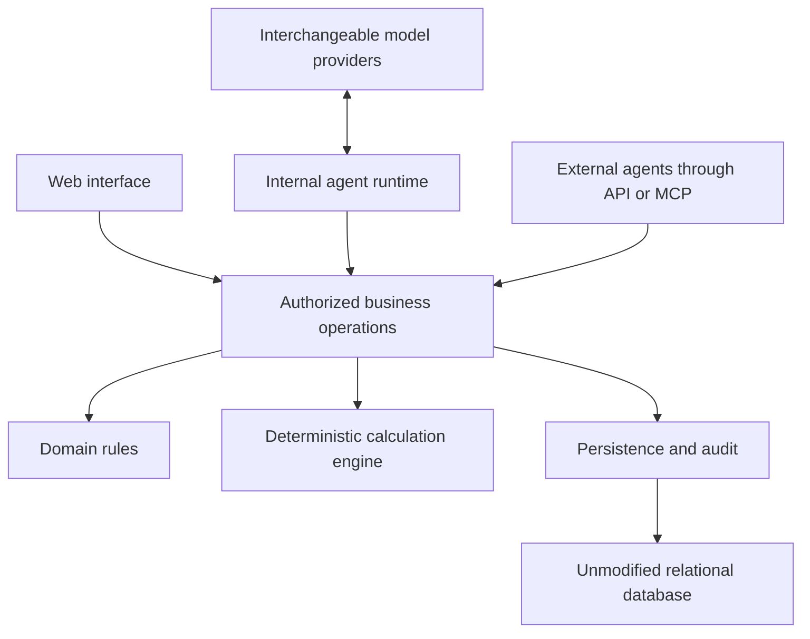

# Architecture and domain contracts

Status: baseline approved for implementation and publication on 2026-10-16.
No implementation is implied by this document.
See [decisions](decisions.md) for the distinction between agreed requirements,
proposals and choices that still need evidence. See [the delivery plan](plan.md)
for implementation scope and exit criteria.

D271 introduces the bounded [fixed-volume physical crude](physical-crude.md)
consumer for local implementation: exact grade/custody references, normalized
physical and cash sides, retained executable booking, common trading views and
shared contractual portfolio PV/scenario risk. Its documented
qualification gates remain distinct from production activation and physical
completion outside the bounded [delivery and cash workflow](physical-crude-operations.md).
That workflow records explicit accepted receipts, owned/reserved quantities,
dispatches, component invoices and payments without changing retained contractual
valuation or introducing inventory costing. Explicit cash-record corrections
retain immutable originals, restore active balances and preserve cumulative
rounding through ordered invoice void/reissue. The local inventory-to-sale
increment retains exact lot allocations and dispatch evidence, reusing the same
managed cash ledger for receipt-backed purchases and dispatch-backed sales.

Gas may use an explicitly configured independent market/reference selection;
this keeps physical location setup separate from the primary power and financial
inputs without rebasing their source identities or feeds.

D269 adds the local [physical gas booking slice](physical-gas-side.md): fixed
contractual delivery, independent consideration and optional usage fee, shared
retained executable schedules, and an authorized preview/book/reopen ticket.
Shared curve groups, point price adjustments, dated direct-meter schedule attribution
and configured per-unit tariffs are wired into that bounded profile. The
Gas delivery setup editor saves immutable drafts, previews resolution/coverage and
publishes versioned economic settings; saved trades retain their setup pins. Usage fees
have independent pay/receive directions. The fixed-quantity composition ticket now adds independently directed physical
and cash/fee sides, exact fuel links and retained per-member quantity ratios. The [daily quantity workflow](physical-gas-daily-quantities.md) adds trade-owned daily revisions, retained-grid reconciliation and explicit quantity-input selection. The [performance checkpoint](gas-quantity-performance.md) adds bounded batch selection and demand-loaded history. The common Blotter now includes gas positions, exact retained terms and contractual PV alongside futures, swaps and PPAs. New trade uses one product panel and each product’s existing authorized booking operations. Daily gas quantities open from the position and remain separate operational revisions. Mixed risk reports list exact gas exclusions while valuing supported positions; gas scenario risk, physical completion, operational PV and settlement remain work.

D229 integrates PPA bindings into the common blotter and interactive/queued
portfolio risk, with an explicit pending-meter policy and distinct value measure.
Heat-rate examples use the existing typed factor contract and independent
floating-side schedules. See [demo instruments](demo-instruments.md) for the
implemented contracts, synthetic preview and bounded verification.

D224 adds typed asset and rate curve evaluators and an explicit saved lookup
operator in the existing custom-curve graph. Exact prices, interpolation and
scenario dependencies share the connected evaluator; payment discounting uses
`RatesCurve`. See [curve evaluation](curve-evaluation.md) for policies, consumers
and bounded scope.

The interval-data foundation (D212) shares exact UTC grids and masks between TOUs,
schedules and compact value columns. Shaping and PPA quantity preparation retain
exact arithmetic, revision lineage and explicit missing-data behavior. Hourly
pricing is a Curves & prices view; the reusable interval-data widget separates
presentation and optional refresh from financial-context selection. See
[interval data](interval-data.md) for implemented consumers and measured limits.

Published custom recipes compose through normalized exact-version/output
relationships (D187, migration 0082). Their output panels retain direct graph
dependencies, resolved under the same effective date, knowledge cutoff and
current authority as their consumers. Scenario evaluation retains the complete
ancestor declarations and native sample pins. Source execution eligibility is
an explicit retained input distinct from the risk repricing convention.

Live corrections advance the same certified header context consumed by market,
instrument, side-schedule and portfolio operations (D188). Existing read paths
recompute displayed results; risk requests and jobs retain one admitted
generation. The bounded push/update and numerical-reuse contracts are documented
in [live calculation](live-calculation.md).

Custom curve activation publishes complete immutable effective-date timelines of
exact version/output references (D189). Certified knowledge selects one timeline
before its effective interval; gaps are inactive. Effective previews resolve to
the ordinary exact graph, while booked references and retained jobs stay pinned.
Daily indexed projections use exact delivery intervals independently of output
positions, preserving actual fixings and schedule weights.


Blotter and swap entry extend this baseline through D206–D207. The blotter keeps
numeric amounts separate from unit labels, supports comparison filters, and
projects backend aggregates into configurable row/column pivots and linked
bar, line and heatmap plots. Additive totals retain exact rational cash; price
extrema retain exact values and unweighted means use an explicit rounding policy.
Unit references, currency references and quote multipliers keep incompatible
cells separate. Local grid filters do not change report/chart scope. Subtotals
and cell drill-through remain work.

Swap entry offers financial fixed/floating and floating/floating composition.
Floating sides retain independent index fixings, explicit projection references,
payment rules and fixed spreads; opposite coefficients express pay/receive.
The ticket explicitly chooses agreed fixed pricing or par calculation. Agreed
pricing requires an entered price, including supported zero and negative values.
Par calculation alone submits a blank draft price under a selected precision
policy, reviewed as a concrete quote, then used unchanged by Risk and booking.
This uses the connected valuation pipeline, including selected actual fixings,
custom projections and discount inputs. Migration 0101 adds the persisted side
relationships and generated/existing-close evidence without rewriting retained events.

The scheduled financial swap version (D214) composes independent monthly side
plans with explicit period quantities, calendar-day rates, declared contract-total
allocation or integrated MW delivery intervals. Each SideSchedule supplies the
quantity/payment records consumed by PV; exact rational membership size and one
external binding preserve normalized pricing. Existing one-period economics stay
versioned. See [financial swap quantities](financial-swap-quantities.md) for
persistence, replay, supported combinations and lifecycle limits. Standalone
physical gas/power is a separate delivery-obligation plan.

Swap entry follows Trade → Instrument → Sides (D210). Visual instrument choices
apply a visible, managed starting template to empty side controls; all submitted
terms remain explicit. Floating-side commodity choices filter index, projection
and unit choices independently, within the current same-commodity swap model.
New Trade also links to the existing PPA booking workflow.

## 1. Product purpose

The authorized [financial swap settlement MVP](swap-settlement.md) (D215) builds
trade-owned determinations, payments and reconciliation before futures margining
or physical settlement. Its explicit policies apply only to enrolled swaps;
pure instrument pricing and existing physical policy contracts remain separate.
D216 extends the same shared backend with qualified scheduled observation
editing, explicit same-trade gross allocations, and closing-context contractual
P&L contributions. Net settlement never changes reusable instrument identity.
One cash header has one or more signed gross allocations; zero-net discharge is
explicitly noncash. Prior and revised terms are valued under closing authority;
only unchanged occurrences carry posted determinations into the counterfactual.
See [implemented settlement contracts and limits](swap-settlement.md).

Build an ETRM that an AI can use as a complete application. People, internal
agents and external agents operate through the same business capabilities.
Conversational interfaces, models and providers can change without changing the
meaning of a booking, market input, calculation or authorization decision.

Most behavior is deterministic application code: identity resolution, contract
validation, schedules, units, arithmetic, pricing, risk, permissions and durable
workflows. A language model interprets intent, proposes structured actions and
explains retained evidence. It does not become the authority for these rules.

The initial product scope includes futures and fixed/floating linear products.
The bounded [exchange futures example](exchange-futures.md) retains exact dated
lot quantities and independent outright/basis observables. Contract profiles and
basis settlement references are immutable economic terms; curve recipes do not
invent them or infer upstream exposure from directly quoted marks.
Futures require explicit settlement/variation-margin state and outstanding risk,
not only an ordinary forward formula. The contracts must accommodate
future option pricers, physical operations, optimization and complex fees without
replacing the scenario mechanism or collapsing the side architecture.

The application must be self-hostable from public dependencies. Its foundation is
an unmodified relational database, not a database fork or a private platform SDK.
A private pilot may be hosted at leanetrm.com under the separately approved
deployment procedure. Automatic image updates use attested GitHub Release bundles
and a pinned local pull operator; schema and infrastructure changes require a
separate qualified baseline (D135). Hosted authentication and collection boundaries are described
in [hosted pilot operations](hosted-pilot.md); the synthetic local preview stays isolated.

The public buildless homepage lives in `site/`, separately from the authenticated
workspace assets. The hosted gateway serves only its exact homepage and two public
assets; `/app` forwards to the application's native root with its query intact.
Only successful sign-in redirects to that native root are rewritten to `/app`.
All other application and API paths retain the authenticated upstream routing.
The site and gateway configuration require a separately reviewed installation;
the application-image updater does not deploy them (D163).

Schema releases retain the immutable reference-intake migration before the
durable-job and Swarm migrations (D141). Import and scheduling executor roles
remain independent; an image update cannot silently adopt a different schema.
Historical visibility uses indexed exact publication lookups without caching
current authority. Blotter reads its catalog and report in one bound operation
and returns their shared context (D143). This database function upgrade requires
the same separately qualified schema baseline as other migrations.
Reference tables with a verified restrictive visibility policy retain fresh
per-row access checks inside that policy and omit a duplicate permissive check.
Catalog-only access and separate quantity-catalog restrictions stay in force.
Migration 0041 rejects unexpected policy shapes or visibility-helper changes;
its deployment requires a separately qualified schema baseline.
Migration 0044 applies the same rule to eleven market-definition and observation
tables. Its guards verify the complete existing policy sets and authority helpers
before changing any policy. The mandatory volatile visibility helper still checks
current authority for every candidate row; neither permissions nor historical
visibility are cached. Write policies, role targets and grants remain unchanged.
Provider credential replacement also revalidates current authority after row
waits and before returning an outcome (0045), including an idempotent replay; the
page assistant's model and price commands do the same (0051).
Blotter navigation requests a booking directory without pricing unused entry
contracts. Choosing a new futures trade explicitly loads the priced catalog and
replaces both catalog and report under one shared context before opening entry.
Historical requests retain their selected context and remain read-only.
Business reads follow the definition bundle's declared reference relationships;
the reference inspector loads its selected table separately in bounded pages
under the same authorization and temporal rules (D144).
Initial browsing uses a distinct market-navigation response: curve names and
explicit classifications, frame summaries and exact bundle/context identities.
A classification is the curve's market type plus, for commodity curves, its
commodity; interest-rate curves have no commodity (D175). The browser presents
these classifications and does not derive its own from workspace rows.
It reads no observations, economic model or unit-conversion catalog. Full
workspace inspection remains available and is loaded explicitly before a screen
consumes its definitions, references or source pins. The browser keeps these two
contracts separate and rejects hydration from a changed identity or selection.
Bootstrap contains only working session selections. Resolved historical aliases
and stored-close headers come from freshly authorized navigation or workspace
reads. Historical alias identities are scoped to the session, exact certified
context and complete resolved pins; returning to the same selection preserves its
identity without caching financial values or authority.
Historical choices contain original input snapshots and visible stored closes.
Manual working variants require explicit close registration for historical reuse.
First pricing can explicitly include the complete catalog projection from its
same authorized model read, avoiding a second model load. Selected source facts
remain separate from the catalog's empty, on-demand observation projection.
An explicit Blotter directory may return an empty report without constructing a
valuation model only after both product revision tables have no visible rows
under the selected trading context. Exact bundle/reference visibility, selected
observation completeness, view/book validation and final current authority still
apply. Any visible revision retains the complete valuation path, even if report
filters would hide it. These projections defer validation of unused economic
material; they do not supply missing financial inputs or change pricing rules
(D160).

Priced trading workspace reads retain the complete catalog and report while
loading only their consumed first/last-trading milestones and exact primary
snapshot observation pins. Missing required facts still fail under current
authorization and the selected historical cutoff. Full metadata reads retain
all milestone kinds. Generic observation reads retain their same-fact history.
Supplemental swap markets price their snapshot's exact pins and resolve visible
corrections only in a certified context's own frames (D172).
Built-in calendar availability reads the union of every offered snapshot's exact
observation pins. Each snapshot still validates all its pins, including those
outside the selected curve. Custom-curve availability retains its broader
historical observation and correction policy.

Exchange first-trading facts and application execution eligibility are distinct
(D158, superseding D157's installation-specific restrictions). A sourced date
never becomes a fabricated exchange event instant. The actual timestamp may
remain unknown; execution requires a separate exact-version policy under the
selected convention, price source and price role. A next-native-day policy pins
its approved instant, clock offset and tzdb release. The managed clock and
database reject a boundary inconsistent with the declared zone/date, including
missing or ambiguous local midnights. Date-bound proofs support minute-aligned
offsets within fourteen hours of UTC; historical second-offset dates are outside
this contract. Existing precise synthetic facts retain their exact first-trading
boundary unless a retained policy conflicts. Eligibility remains outside reusable
instrument identity and is retained in the selected market binding, lifecycle
checks and risk context.

The hosted pilot uses the standard application. Private seed/import scripts and
installation configuration supply real exchange references and separately labeled
generated prices. Generic exact-version execution policies qualify supported
futures use without rewriting unknown source milestones or adding installation
names to business rules (D158). Source provenance is separate from execution
qualification. Schema changes still require a separately qualified release.


## 2. Application structure and deployment

Start with a modular monolith and three tiers: browser, application and database.
The application serves the built browser assets and business API. Local preview
uses this repository's application and an isolated stock PostgreSQL database.
The required deployment and container-execution backend is Docker Swarm. Durable
scheduling and the trusted execution controller add separately supervised
processes while retaining the same managed business modules and operations.
Implement the scheduler as a .NET Worker Service in this repository, with an
independently deployed image and placement on a separate Swarm node when selected.
It uses ordinary PostgreSQL connections; no scheduler extension is required.
A bounded durable worker, container controller and shared infrastructure view are
implemented locally; see [automation](automation.md) for executable operations and
limits. Real Swarm qualification, full agent execution and deployment migration
remain work; the local preview does not establish those capabilities.



Logical modules:

| Module | Responsibility |
| --- | --- |
| Identity and administration | Principals, scopes, grants, policy, provider configuration and audit |
| Reference data | Business definitions: units, currencies, commodities, typed locations, calendars, venues and product/index identities |
| Market setup | Versioned pricing, quantity, delivery, settlement and rounding configuration |
| Instruments | Sides, compositions, templates and instrument memberships |
| Trading | Portfolios, books, trades, instrument quantities, amendments and lifecycle |
| Market data | Primitive factors, observations, curve definitions and snapshots |
| Calculation | Schedules, pricer execution, scenarios, risk and calculation receipts |
| Agent operations | Discoverable tools, task execution, provider adapters and execution limits |
| Automation execution | Durable scheduling, authorized job admission and Swarm workload reconciliation |
| Presentation | Browser screens, reports and export views over the business operations |

Presentation uses familiar business names. Market data provides futures and
forward curves with commodity-first or market-type-first browsing. A compact
market-close calendar floats with the shared Context panel (D162, D217); user
profiles hold time zone and other remembered display preferences. Minutes are
enough for ordinary display; exact retained instants and selected versions remain
unchanged underneath. Repeated local clock times must remain distinguishable, for
example by showing an offset only when needed. Internal GUIDs, database fields and
numerical implementation labels are not user-visible column names or calculation
receipts.

Ordinary table screens share the table renderer and a reusable table workspace
for column, filter, pivot and named-view controls. Blotter displays the table
immediately; optional configuration opens from its toolbar. Pivot arithmetic
remains a managed operation supplied by the consuming screen. Row/column pivots
reshape those exact returned groups without browser aggregation. The shared grid
retains exact decimal strings for sorting and export. A shared chart component
uses approximate numbers for pixel coordinates and exact strings for tooltips;
it keeps display labels separate from category identities and preserves gaps.
Account layouts retain grid, pivot and chart presentation choices independently
of financial contexts. Exports recheck current authority through the pinned
consuming operation.

Navigation and curve-list side panels and their menu groups can collapse as
remembered user layout choices. Ordinary tables support display-only search and
column filters with visible row counts. Connected pricing worksheets keep their
complete contract mappings. Filtering never changes calculation inputs or access;
filter state is discarded when its authorized data/context scope changes.

Trading opens a **Blotter** of individual trade bindings. Named views select
columns, portfolio/book filters, row filters and an explicit pivot layout. Pivots
use the managed backend, preserving exact quantity and currency partitions; they
do not merge obligations. Saving a view does not save or choose market inputs,
knowledge coordinates or authority. Effective/knowledge controls share a floating
Context panel (D217). Native interval, delivery-price and PPA cutoffs use the same
presentation while retaining their distinct backend read contracts. The market
date, with the Blotter's close badge (D219), floats beside that panel, whose summary
names the knowledge in use and whose panel holds live corrections; the header keeps
the page title and profile. The active user and current permissions are visible
in the profile, independently of the layout.

Amount display precision belongs to a deal's shared current presentation, with
separate trade/fixed/floating role policies in the bounded editor. It is not a
personal preference and does not enter economic identity, contractual rounding
or pricing/risk caches. Saved precision uses exact trade foreign keys, explicit
roles, current authority and optimistic versions; it may format a historical
financial view without changing that view's inputs. Final money display defaults
to three places. Money display controls live in collapsed Advanced settings below ordinary trade entry, with separate trade and
side roles. Other amount displays trim padding zeros using their managed display
policies; futures prices retain their tick scale. Price, quantity and factor
precision are not ordinary editor controls.

Profile customization is presentation state, never a source of authorization,
market-input selection policy or contractual clock conventions. Blotter layouts persist in the database for the current human account and
workspace, with current trading-read authority and optimistic version checks.
They retain no market snapshots, historical coordinates, permissions or results.
Other preview preferences remain browser-local; production authentication and
broader account profile synchronization remain part of identity integration.

Modules have explicit contracts. The domain and numerical core do not depend on
web frameworks, persistence libraries, model-provider SDKs or browser state.

The approved implementation stack is a TypeScript browser client, a C#/.NET
application service and standard PostgreSQL. Exact dependency versions are chosen
and pinned during setup. A separate native calculation service is not required
for the first slice. A measured bottleneck can justify moving an implementation
behind the existing calculation contract later.

Custom curve authoring uses a typed graph shared by visual and formula editors
(D161, D186). Exact source, weighted contract member and date-reference bindings
are persisted as normalized foreign keys. Ordinary curves, basis relationships
and saved recipes use one connected evaluator with immutable multi-date inputs,
exact rational combinations and observation/factor lineage. The backend compiles
formulas and resolves all selections; the browser only edits and displays the
contract. D186 removes the SQL panel alternative. The workspace and its explicit
limits are described in [custom curves](custom-curves.md). D262 adds read-only
raw component histories through the same backend sampler, preserving declared
contract binding, actual dated contracts and roll jumps under the selected
knowledge cutoff. The browser performs no historical selection or analytics.

Add a table, configuration value or dependency only with a named current consumer
or a concrete executable baseline use case. A seed row or a viewer alone is not
sufficient. The current units and interest conventions are small project-owned
implementations with explicit versions and independent numerical tests. Additional
algorithms or dependencies require a concrete consumer and qualification; their
availability does not justify unused catalogs or inherited defaults. Numerical
policies remain explicit without changing exact monetary arithmetic. Broader
calendar/FX work stays in the plan until its workflow is implemented.

Long computations use durable jobs without changing permissions, inputs or result
contracts. Scheduler, trusted controller and container workers have the execution
boundaries in section 11; business modules remain shared. Further service splits
require a concrete operational need.

## 3. Domain vocabulary and ownership

The contractual hierarchy is:

```text
Portfolio
  Books[]
    Book
      Trades[]
        Trade
          TraderId, TradeDate, counterparty, memo and legal entity
          Events and lifecycle state
          Instruments: immutable unit instrument references with external quantities/bases

Instrument
  FuturesContract: exact immutable futures-series reference; typed LotSize
  SidedInstrument: explicit side memberships where composition is contractual
    Side reference, signed coefficient, role and order
    Side definition: index/curve, observation/averaging and payment conventions
    Separate resolved pricing bindings and generated dated schedules
```

These are distinct concepts:

- A portfolio contains books; a book contains trades.
- A trade directly owns its instrument-to-quantity bindings and lifecycle state.
  It may contain more than one instrument, each with its own quantity/unit/basis.
  No separate quantity-bearing domain class sits between trade and instrument.
  Stable binding/obligation keys retained inside Trade can distinguish different
  occurrences of the same definition; equivalence alone does not merge them.
- Events, TraderId, TradeDate, counterparty, memo and legal entity belong to Trade.
  These booking facts are excluded from reusable instrument and side identity.
  Trader is the authenticated human who originally books the trade. The backend
  assigns its UTC booking date and persistence timestamp; amendments retain these
  facts and independently audit their own actor. Economic effective time remains
  separate from persistence, market inputs and knowledge coordinates.
- An instrument defines unit economics. Each booked quantity uses the existing
  unit-aware Quantity value type: an ExactDecimal amount with an exact
  commodity/basis/unit specification, held externally to the instrument in the
  trade's binding. Contractual unit normalization, such as the physical
  size of one futures lot, is the typed `FuturesContract.LotSize`; the number
  of booked lots is not definition data. Unit amounts are fixed at one and do
  not participate in identity. The exact quantity basis and LotSize do.
- A side is an independent reusable definition, not a booked trade.
- A simple futures contract is the instrument itself. `FuturesContract` is a leaf
  `Instrument`, resolved from the exact futures-series primary key. Curves and
  trade bindings reference that same definition. A curve recipe revision does not
  change the contract's identity. Resolved quote-admission policy and curve/member
  selection live in a separate `FuturesMarketBinding`, outside contract identity.
- D218 implements generic `Trade`/`TradeInstrument` bindings and the typed
  `Instrument.PV(UnitValuationContext)` calculation entry point. Product adapters
  retain execution/lifecycle facts while risk uses the common contract. A bounded
  managed `ForwardContract` composes fixed/indexed sides with external signed
  size. See [unit instruments and trade bindings](instrument-contracts.md) for
  identity, reuse, storage compatibility and the persisted-forward boundary.
- `SidedInstrument` retains one or more independent sides through explicit
  memberships where the product actually requires composition, including the
  current fixed/floating financial swap. A simple contract needs no artificial side.
- Coefficients and ordering belong to instrument memberships. They do not make a
  new side definition merely because another instrument uses different weights.
- Signed booked quantities belong to the trade's instrument bindings, with an
  explicit unit and basis for each instrument.
- Generated schedule legs are dated delivery, observation or payment events. A
  generated leg is not another side.
- A Side's observation plan retains target-to-price applications before combining
  their weights. Several delivery dates may consume one observation. The valued
  application points to the same generated price term and resolved price as its
  observation subtotal; inspection never builds a parallel calculation.
- A side owns whole-term parameters, never child sides (D253). Coefficients,
  roles and ordering belong to instrument memberships. Dependencies between
  quantities and their sources are explicit schedule references.

Each side may have its own commodity, location, unit, currency, index, delivery
shape, observation convention, payment convention and calendar. An instrument
does not impose a shared location or schedule on all its sides.

Physical activity and its financial payments remain distinguishable. Reusing a
physical quantity as a payment basis must not count that quantity or cashflow
twice. Operating constraints must not be disguised as linear financial sides.

For example, one trade can directly bind an option instrument to its contract
quantity and a cash instrument to a premium payment quantity. The trade coordinates
booking and lifecycle across those bindings. An instrument's membership role or a
trade's descriptive payment role does not apply an extra pay/receive sign.

`Trade.PV(context)` aggregates the values of its instruments at their respective
quantities and lifecycle states. Each instrument retains its common behavior
contract and delegates to its sides. Currency conversion remains explicit.

The local preview now implements shared certified contexts for existing market,
rate, reference and schedule screens, plus current workspace administration.
[Implementation scope](implementation.md#shared-historical-market-view-and-administration)
records the qualified boundaries. The bounded synthetic futures slice implements
immutable shared futures contracts, independent trade/pricing bindings and typed execution
P&L. Latest-head futures booking amendments append immutable versioned trade states;
earlier revisions are read-only and shared definitions remain unchanged.
Futures PV, other lifecycle transitions and the wider trading abstractions
here remain design; fixed/floating swap PV has a bounded managed implementation.

The preview retains immutable `trading.booking_facts`: exact original human
workspace membership, captured booker name/login/version, server persistence
instant and its UTC date under `server_booking_utc_v1`. Database and API operations
reject caller-supplied trader, trade date and execution time. Bookings stamp these
facts after replay resolution, immediately before inserting the trade. Exact
retries return the original outcome; amendments preserve the original booker and
stamp while separately retaining the amendment actor. Timestamps are stored in
UTC and rendered in the user's chosen zone; the date-only TradeDate remains the
explicit UTC booking date.

The selected market frame supplies the separate economic effective coordinate.
It is not presented as the persistence timestamp. Existing economic execution and
publication facts are not rewritten. Migration 0029 resolves retained original
actors against actual workspace memberships and certifies old persistence times
from commit receipts. `retained_commit_utc_v1` explicitly identifies this origin;
its label capture instant records that names were captured during migration,
not historically certified. Missing original human membership or certified time
rejects migration rather than inventing facts.

Exact-version LegalEntity/Counterparty bindings and memo remain amendable booking
terms outside instrument identity. New booking/amendment operations require both
parties, effective by the economic execution coordinate and visible at the
selected knowledge cutoff; current authority governs every read and write. Legacy
NULL party fields remain unchanged until an explicit amendment supplies them.
Party editors append scoped immutable name/code versions with expected heads,
nondecreasing effective instants and idempotent commands. Read/maintenance
permissions are separate from trade access; broader party attributes remain work.
Party names retain up to 80 Unicode scalar values consistently through authoring,
storage and retained trade reads; supplementary characters count once.

Trade editors render common Trade Terms, then a product-specific instrument
editor and its independent side editors where needed. The common header exposes
book, parties and memo, with read-only booking facts. Futures booking/amendment
share their product widget; swaps mount separate fixed/floating side widgets.
Each instrument binding owns its quantity. There is no editable trade-wide total
quantity. The bounded operations currently book one instrument binding per trade;
modular presentation does not imply multi-instrument booking is implemented.
Widgets render authorized backend catalogs/results and submit the same business
operations as other clients; pricing, schedules, quantity scaling and validation
remain managed/backend responsibilities.

Reuse the existing project-owned value contracts: Quantity for unit-aware
amounts, Money for currency amounts and UnitPrice for currency per quantity with
an explicit quote multiplier, all backed by ExactDecimal. External quantity means
outside the instrument definition, using these established types.

Readable trade and instrument references accompany exact UUID relationships.
The selected trading catalog is their namespace. A reference is assigned once
and survives trade revisions, book moves and reuse; it is not an effective or
knowledge coordinate. Existing historical states acquire the same display alias
without changing their original financial facts or publication identity.

### 3.1 Definition identity and versions

Use **economic equivalence** to describe reuse: instrument definitions with the
same canonical economic terms and supported conventions can be shared across
trades within an authorized namespace. Instrument identity includes its economic
type, side definitions, membership coefficients,
relevant ordering, quantity transformations and the selected discounting policy. A trade's quantity, booking identity and lifecycle state do not
create different reusable instrument terms. Equivalence for definition/calculation
reuse does not imply that separate booked trades or their obligations are merged.

Canonical side identity includes applicable economic terms, normalized numeric
values, exact typed reference bindings and schedule conventions. For future
options this includes strike, right, expiry, exercise and settlement terms.
Different strikes are different definitions. Identical complete definitions may
be reusable within an authorized identity namespace.

Labels, instrument membership weights, booked quantities, current market prices
and valuation outputs are excluded from side identity. Canonicalization itself
has a version and must preserve economically meaningful ordering and distinctions
between missing, explicit zero and explicit references.

Do not infer equivalence from a display name. A content hash is an identity aid,
not a permission grant or a reason to disclose another workspace's definitions.
Uniqueness and conflict handling must be enforced atomically, not only by the UI.

Executable instrument and side definitions mark economic properties with
`IdentityField` and declare an `EconomicDefinition` canonicalization version.
For futures, the sole marked `SeriesKey` expands to the exact primary-key columns
`ref_data.futures_series(catalog_id, revision_id, code)`. Those immutable terms own
lot size, product and settlement relationships. Primary-key lookup is used in the
managed model and database admission. A versioned SHA-256-prefix UUID is a compact
alias; every database reuse verifies the complete exact key, so a hash collision
cannot select different terms. The contract is available to authorized market
readers before booking and does not require trade-read permission.

For composed instruments, identity includes ordered memberships, coefficients,
marked side terms and the explicit discounting choice. Fixed-side keys include
its exact quote reference. Floating-side keys include the exact projection curve,
contractual observation dates/weights, index/quote, averaging and payment terms;
resolved constituent aliases belong to a separate pricing binding. Key lookup and
atomic uniqueness use the corresponding typed primary/candidate keys, including
exact payment-rule references. SQL admission resolves immutable derived references
before lookup. UUID primary keys on retained trading rows remain stable reference
aliases; they do not substitute for economic uniqueness.

The implemented lookup contracts are:

| Definition | Typed economic lookup key | Storage enforcement |
| --- | --- | --- |
| Futures contract | Exact reference catalog, reference revision and series code | Existing futures-series primary key; canonical alias checks the full key |
| Fixed side | Exact quote reference, fixed price, delivery interval, payment instant and payment-rule reference | Fixed-side candidate key |
| Floating side | Exact curve/reference/index/quote, delivery/fixing/averaging and payment-rule terms | Named floating-side economic candidate key; resolved contract ID is excluded |
| Financial swap | Fixed/floating side references, signed coefficient and discounting choice | Swap-instrument candidate key |

Marked resolved units, calendars and observation schedules are determined by those
exact immutable references and the selected supported rule. The bounded persisted
floating resolver requires one unique monthly constituent or one complete ordered
daily set. It compares retained definition/curve/contract/ordinal/weight bindings
before reuse. Ambiguity or conflicting retained bindings raises a structured error.
Migration 0020 changes only uniqueness/lookup behavior and preserves earlier rows;
conflicting legacy economic keys fail migration rather than being merged.

A SHA-256 digest and canonical payload aid managed lookup. Calculation reuse also
includes complete resolved pricing bindings and the selected context. Different
bindings cannot be silently interned into whichever object was seen first. No
cross-run result cache is implied. Trade quantities, parties, trader, memo and
lifecycle remain outside reusable definition identity. Payment dates may distinguish
contracts while their commodity factors remain shared.

Migration 0019 leaves existing events, UUIDs and publication coordinates unchanged.
Typed alias and per-revision pricing-reference tables recover only the exact old
bindings. New bookings create no futures side or one-side wrapper. Missing pricing
bindings raise a structured error instead of dropping a holding. Historical
pricing never silently switches to a current recipe.

### 3.2 Schedules and quantity bases

Schedule definitions retain delivery intervals, observation rules, payment rules,
calendars, time zones and source versions. Generated events retain their source
definition and trade/instrument/membership context.

Each side owns its generated schedule and its PV operation. `GenerateSchedule()`
uses its parameters alone, including captured rules for its exact-version clock
and calendar. A `ScheduleRow` retains delivery/observation windows, typed quantity
terms or source references, price references and a contractual payment key/date.
It holds no market value. The common `ScheduleRowValue` records resolved quantity,
prices, amount, discount factor and PV under one immutable scenario. The side
computes each payment PV from those rows and sums its own
payment PVs. Instrument.PV delegates to Side.PV and sums membership-signed side
results. The trade scales that instrument PV by its quantity once. Membership
direction and booked quantity do not enter independent side valuation.

The inspected side rows are the rows actually valued. An instrument's aligned
schedule view does not replace side-owned valuation with a net-payment formula.
Contractual generation, market resolution, side valuation, signed aggregation and
trade scaling remain distinguishable stages with the same complete context.

Distinguish total-period quantity, flow rate and quantity per occurrence. A total
quantity must not be multiplied by schedule hours a second time. A flow rate must
be integrated over the actual supported intervals. Date-only values remain dates;
instants retain offsets/UTC identity and the relevant time-zone rules.

Actual instants persist in UTC and render in the user's selected display zone.
TOU definitions retain local recurring rules and explicit versioned market clocks,
including fixed-offset and DST-following conventions. Compile them to UTC delivery
intervals; never let a display preference change contractual operating dates,
TOU membership or delivered energy. Source feeds can use a different clock from
the contract. See [time-and-schedules.md](time-and-schedules.md) for clock types,
mixed-clock predicates, DST policies, provenance and qualification gates.

Normalized shapes used for quantity reuse are part of the reusable contract. Two
equal total quantities with different hourly profiles are not equivalent inputs.

Separate named schedule definitions can share identical immutable typed date
payloads. Definitions retain semantic roles, source versions, coverage and
occurrence mappings; equal dates do not merge booked obligations or establish PV
reuse. A small compiled temporal kernel can compose holiday/date sets, ordered
events and interval/TOU selections while preserving their distinct semantics.
Joint-calendar policy, adjustment order, grid resolution and clock/DST rules are
explicit. Canonical publication is atomic; pricing reuses validated in-memory
artifacts. Proposed representations and performance qualification are in
[the schedule design](schedules-and-contract-sequences.md#shared-immutable-data-composition-and-the-fast-path).
No implementation speed claim follows from this design alone.

The financial-swap editor can use published schedule expressions as a one-time
date-entry helper. Both suggestions and resolution use the editor's complete
retained effective/knowledge certificate. The user reviews the resolved date,
schedule version and occurrence before applying a literal side date. Booking
retains that exact date; this helper does not establish a moving schedule binding.
Shared managed date-set, monthly-anchor and rolling utilities remain authoritative;
the browser neither generates sequences nor evaluates date expressions.

The contract-date editor has a durable shared library (D167). Draft saves require
market-definition authoring permission; publication requires separate sealing
permission. Date fields retain literal values or exact published schedule-version
foreign keys, occurrence indexes and business-day offsets. Each version retains
its certified validation context and explicit UTC cutoff. Resolution selects an
exact published definition version and context; a later schedule publication does
not substitute a new source version. Publication visibility follows certified
knowledge time and current schedule/calendar authority. This library resolves
date rules only; instrument activation and booked side integration remain separate.

Reference choices come from the selected database revisions, including currencies,
units, commodities, indices, calendars and curve bindings. Supported payment
algorithms use typed backend enums and a backend-supplied capability catalog.
Convention enums do not replace user-maintained reference tables. The standard
local example uses a USD / US Dollar row in the currencies table with linked
quotes, rates and trades; its prices and trading examples remain synthetic.

### 3.3 Behavioral contracts on instruments and sides

Every instrument exposes a common behavior contract. Every side owns the behavior
for generating its schedule and computing its contribution to PV from that
schedule. These are executable domain abstractions, not only data records.

Keep the concrete side families small. `FixedSide` and `FloatingSide` have current
managed consumers; physical and complex contingent sides remain later scope.
Commodity and receipt/payment direction do not create additional subclasses.
`SidedInstrument` validates nonempty memberships and sums normalized signed side
contributions. `FuturesContract` directly implements its supported behavior without
composition; futures PV rejects unsupported settlement state explicitly. The
current futures consumer remains execution P&L and open mark sensitivity.

Financial swaps combine one fixed and one floating membership with opposite
explicit pay/receive coefficients. Each side independently controls its delivery,
observation and payment terms. The first bounded model normalizes side PVs to
one currency and quantity basis and uses positive total trade quantity. Sampling and averaging are selected
financial terms: monthly index, equal calendar-day or business-day observations,
preceding/following-observation calendar weighting, or supplied quantity weights.
Calendar-dependent rules retain exact calendar references and resolved date sets.
Daily rules require matching dated projections for unresolved observations.
Observations and their weights remain separate from payment discounting. New swap
entry resolves an exact, versioned index observation schedule (D165), not a
user-entered first-fixing time. Each dated publication rule pins its index, quote,
source and actual series. At or after that observation's publication instant, the
selected snapshot must contain its exact final `index_fixing` observation as a
frozen fact. Unresolved observations retain their declared projection and original
averaging weights. A partly fixed period combines actuals and projections; missing
due actuals fail explicitly. Frozen actuals contribute cash but no live quote risk.
Every bundle, including the separate daily swap bundle, prices its snapshot's exact
pins (D172). A corrected actual reaches valuation only through a new snapshot that
selects it, or through a certified context's latest-correction policy at its cutoff.
The bounded implementation consumes qualified, explicit dated schedules; it does
not invent publisher conventions, peak calendars or holiday/DST publication rules.
Old projection-only definitions retain their original boundary and replay meaning.

Contractual payment dates are generated from each side's payment convention,
not authored as payment timestamps. New entry chooses monthly payment frequency,
either days after the last delivery day or a day in the following month, the
applicable lag basis/short-month policy, business-day adjustment and exact calendar.
Generate anchor/lag first and adjust afterward. Retain the immutable originating
rule, calendar and unadjusted/final dates on the actual valued payment plan.
Calendar-day dates do not shift with the user's display time zone. Existing
manual-instant revisions remain exact historical definitions; no rule is inferred
from their dates. New writes require explicit rules.

Commodity is selected from the pinned reference catalogue and filters available
floating indices/curves and compatible units. Exact quote/quantity references
remain authoritative; selection does not silently convert units. Reset frequency,
averaging method and payment frequency are separate financial terms. Current
booking offers monthly/no-averaging and daily/arithmetic sampling and monthly
payments only; broader calculation/payment grids require separate qualification.

The local booking consumer persists one complete delivery month with one payment
per side. It exposes monthly-index and equal daily-calendar projection rules;
daily rows retain exact contracts and cash allocations before monthly aggregation.
Other pure-core averaging strategies are not yet booking choices. Storage uses
immutable typed side definitions, exact reset references and explicit membership
slots. The shared blotter separates projected swap PV from futures execution P&L.
Draft swap quote risk and actual-versus-projected observation valuation are
supported. Managed monthly strips compose those existing side definitions and
retain each payment's exact quantity allocation, curve lookup, discount factor
and PV (D170). Their per-month, equal-total or calendar-day-weighted-total quantity
basis is explicit; trade quantity scales the completed unit instrument once.
The persisted booking/editor contract still supports one month. Actual fixing
lifecycle events and settlement/payment processing are not implemented.

The bounded [collected interval delivery-value operation](power-preview.md#collected-interval-delivery-value)
connects an exact curve/source association to native power price history and the
shared typed settlement arithmetic (D171). Its price cutoff is explicit, its
current model/TOU definitions are pinned, and missing intervals/units fail closed.
It retains UTC/DST and observation lineage; MW shape/duration applies once and
already-shaped MWh is consumed directly. This unsaved HTTP consumer does not
establish publisher finality or trade cash/payment lifecycle. The broader
[settlement design](settlement-plan.md) remains a versioned delivery proposal (P39).

The currency's configured default supplies the discount curve unless the
instrument explicitly selects discounting=false. Calculation inputs retain the
exact resolved mapping/curve, context, payment date, selected observations and
numerical policies. Missing defaults or coverage are structured errors.
A publication holds at most one default per exact definition revision, currency
reference and effective instant; a later publication may replace it. A tied
latest default is rejected, never chosen (D166).
Log-linear interpolation applies to discount factors between explicit pillars;
there is no extrapolation. The first rates implementation uses its declared UTC
date basis, with user-local display kept separate from contractual dates.
Side cash amounts and PVs retain exact rational values through their own
payment calculations. Instrument aggregation applies each membership coefficient
once to those completed side PVs, and trade scaling happens afterward. A side PV
may require more decimal places or a larger range than the final Money format;
never round or reject it prematurely when exact aggregation/scaling yields a
representable trade value. The final conversion enforces the selected monetary
policy. Unit-level valuation and external trade quantities are mandatory for
every instrument (D146).

FixedSide and FloatingSide implement independent GenerateSchedule and PV
operations for swaps and PPAs. Whole-term dated period parameters replace the
monthly/scheduled side wrappers; interval parameters support PPA clocks, masks,
source quantities, and fixed or indexed prices. Period delivery/payment dates
and quote multipliers can differ. A dated fixed-price term must be constant
through each declared row; finer price changes require explicit finer rows.
Side valuation receives no instrument,
membership direction or trade quantity. The context supplies exact declared
market inputs and side-specific discount factors. FixedSide can value without a
built commodity market; FloatingSide requires its own exact projection lookups.
Instrument.PV validates compatible side outputs bound to the same valuation
operation, including its scenario and discount inputs, then sums their signed
values without interpreting or netting side cashflows. A snapshot ID alone cannot
validate a cached side result; scenario overlays can share the same snapshot.

PPA graph compilation binds the generated rows to typed quantity, price, cash and
discount nodes. Immutable columns share monthly grids; an interval is a column
cell, rather than a separate heap graph node. The retained connected price graph
supplies quote and computed-output shocks, including nested scenarios. Volume
sources, capacity, degradation/loss adjustments, normalization and linked delivery
quantities have declared edges. Only affected columns are evaluated in a child
scenario; aggregate roots sum the same cells that bounded detail reads expose.
Frozen actuals and historical source admission retain their own knowledge cutoff.
Plans and scenarios are receipt identities, and calculation caches remain owned
by the authorized request. See [side schedules](side-schedules.md) for bounds,
storage changes and measured qualification.
D258 retains every logical pricing row in immutable PostgreSQL content tables.
For the compact local trial, a native row is a typed vector operation over an
exact grid and selection, rather than one physical record per interval's
arithmetic. Shared column operations retain exact units and dependencies; the
database remains stock PostgreSQL. The backend evaluates those columns directly
and derives bounded interval detail without expanding a scalar-operation DAG.
Publication metadata lives on a separate append-only header, and child reads
inherit its temporal and current-authority checks. Booking stages complete
content before the short final publication transaction. Valuation loads the
retained rows, edges, typed bindings and named roots; missing content is refused
rather than regenerated. [Side schedule evaluation](side-plans.md) describes the
local trial contract; [whole-term side schedules](side-schedules.md) records
qualified implementation and limits.

The 2026-10-29 D258 amendment requires every booked Side family to retain its
complete executable schedule at booking. This is the next execution contract,
not a claim that the current loading path already satisfies it. Booked valuation
must read stored operation order, operands, grids, roots and sibling mappings
directly, without regenerating a schedule or compiling another execution graph.
Independent dynamic inputs resolve concurrently under one committed financial
context and immutable scenario, with explicit source cutoffs and current
authorization. Evaluated price, delivery, expiry and payment states remain
distinct; settlement state belongs to the trade binding and obligation occurrence,
not the reusable Side. [Side schedule evaluation](side-plans.md) records the
contract and qualification work still required.

Payment factors match exact side/payment occurrence, instant, currency and full
snapshot. Missing, duplicate, extra or nonpositive factors fail. Standalone
contexts also reject conflicting contents under one observation identity. Rate-based
valuation retains each side's exact currency-default mapping/curve definition,
used pillar dates/rates/factors and interpolation policy. An explicit scalar
common-factor convenience operation remains limited to identical payment dates;
independent dates require per-side factors. Persisted recurring periods and fixing/payment
lifecycle transitions remain work; retained actual inputs do not settle a trade.
Valuation rejects a due payment (`side_payment_due`) before resolving any discount factor.
Futures execution P&L remains a separate implemented operation; generic futures PV/schedules reject
without the required retained variation-margin/settlement lifecycle state.

Instrument side editors display each side as a vertical field column with
corresponding fields aligned across columns. Delivery start/end and currency are
the first fields eligible for carry-over between sides during entry: populate
only unset counterpart fields, leave each populated value visible/editable, and
never overwrite another side during later edits. No copy button is exposed.
Ongoing links require an explicit contract rather than inferred synchronization.
The futures editor selects a shared contract and keeps trade booking/pricing terms
separate. The current swap editor exposes its independent fixed/floating sides.

The proposed minimal interfaces are:

```text
Instrument
  Exact immutable contractual identity
  GenerateSchedule(scheduleContext) -> SchedulePlan
  PV(valuationContext) -> ValuationResult
  Dependencies(resolutionContext) -> DependencySet
  Validate(resolutionContext) -> ValidationResult

SidedInstrument : Instrument
  Sides -> immutable side memberships (one or more)

Side
  GenerateSchedule(sideScheduleContext) -> SchedulePlan
  PV(sideValuationContext) -> ValuationResult
  Dependencies(sideResolutionContext) -> DependencySet
  Validate(sideResolutionContext) -> ValidationResult
```

The implemented managed boundary requires `Instrument.PV()` and the complete
`Instrument.Declare()` valuation declaration. `Side` requires both
`GenerateSchedule()` and `PV()`; sided instruments delegate to their constituent
sides. A universal instrument-level `GenerateSchedule()` has not been implemented.
It must not be simulated with a fabricated futures cashflow or an artificial
discount provider merely to admit an instrument to risk (D181).

Use interfaces and abstract base classes to require the behavior. Provide shared
base implementations where semantics agree: an ordinary instrument combines side
event plans and sums normalized, signed side contributions; leaf sides implement
their own schedule and PV behavior. A composite side delegates to its components.
Different instrument business labels do not require different subclasses unless
their behavior differs. Avoid a deep inheritance tree for combinations of terms.

All evaluation receives an explicit pinned context, even if the public operation
is informally called `PV()`. The context supplies resolved definitions, schedules,
market/scenario inputs, numerical policy and approved model bindings. It does not
expose an unrestricted database or mutable application state.

A side can delegate numerical work to a registered pricing strategy. Contractual
terms and model selection remain distinct, so comparing two approved models does
not require changing the contract. The scenario engine invokes the common
valuation contract without knowing the side's internal algorithm.

Persist versioned definitions and type identifiers through explicit schemas,
rather than serializing arbitrary runtime objects. Deriving a class does not
permit loading tenant-provided executable code. Cache resolved schedules where
their complete inputs agree instead of regenerating them for every `PV()` call.

### 3.4 Instrument-owned connections between sides

Each Side declares typed input ports and named outputs. It has no reference to
another Side and receives no peer resolver or instrument-PV callback. Only the
instrument retains connections from an exact member's named output to another
member's input. Reusing a Side under different connections does not modify its
schedule or definition.

For example, the instrument connects a delivery member's quantity output to a
payment member's quantity input. The payment Side receives quantity values, units,
cell states and their evidence; it does not know which member supplied them.
Option extensions must use the same boundary for permitted inputs.

Connections retain exact member identities, output names, input addresses and
cell mappings. The instrument validates units, complete interval geometry,
authority and acyclic dependency ordering. No connection is inferred from a
Side's port label, role, array position or similarly shaped output. Connection
identity, source program identities, requested cells, coverage and the complete
context/scenario are calculation inputs.

Independent base outputs and final contributed values remain distinct typed
outputs. The instrument specifies which output a connection consumes; call order
cannot change its meaning. A Side cannot recursively request the instrument PV.
Future option contracts still require explicit additional-obligation versus
exercise-control accounting before that product is enabled.

### 3.5 Physical and financial composition

A composite side can combine a physical delivery side and a financial side to
represent a physical swap. Keep each component's schedule and valuation behavior:

```text
CompositeSide
  PhysicalSide: delivery events and commodity-specific delivery terms
  FloatingSide: payments linked to the declared delivery quantity
```

Gas physical terms can include pipeline, zone, receipt/delivery point and gas-day
conventions. Power physical terms can include market, node/zone, delivery profile
and the applicable clock. These are typed commodity-specific references and
conventions, not one unvalidated location string.

The financial component explicitly binds the physical quantity/activity that it
prices. Components declare whether their PV represents delivery's economic value,
cash payments, fees or another supported obligation. Count commodity value once
and keep it distinguishable from contractual payments. A physical movement does
not silently imply an additional cash sale.

Combine schedules by retaining event identity, type, source side/component and
quantity/payment links. An instrument schedule is an aligned view of these events,
not a date-only join that duplicates payments or forces all event types to have
the same frequency. Valuation still delegates to the side implementations.

## 4. Market factors and curve dependencies

Curves own common constituent specifications, with dated market contracts retaining
their identities and dated terms. Commodity, yield and composite/algorithmic curves
have explicitly typed specifications. Versioned source bindings and delivery
mappings support multiple dependency layers, including forwards consuming futures.
Pricing construction and contractual settlement remain separate. Source expiry
requires an explicit frozen-final/transition/end-eligibility rule; never silently
roll or replace missing inputs. See the agreed domain structure and five-layer
example in [market-model.md](market-model.md). Detailed internal storage records
there are proposals, not additional required public business classes.

Business references and market setup are distinct concepts even where their
versioned storage shares a reference catalog. Internal joins, provenance and
version machinery are not separate user-maintained business catalogs. Financial
configuration still requires exact version pins and authorized changes.

Locations have explicit types such as pipeline, node, hub, region, terminal and
delivery point. Type and geography are independent: a point, route, area or
membership set must be supplied according to its supported convention. Optional
WGS 84 latitude/longitude point fields are implemented; route/area geometry and
topology remain future scope. Never invent a point for unknown or non-point
locations or infer pricing dependencies from geographic proximity.

Reference data includes relational currencies, units/dimensions, commodities,
typed locations, exchanges, clearing houses, clocks/calendars, rate conventions,
and futures product/series definitions. Use exact catalog/revision foreign keys
for these relationships; no free-text or arbitrary JSON reference substitutes.
See [reference-data.md](reference-data.md) for futures accuracy, public placeholders,
settlement semantics, provenance and the initial immutable revision schema.

Display authoring (D164) creates an immutable metadata revision with a separate,
explicit current-presentation activation. The backend proves that every reference
key and non-display field remains identical. A presentation response identifies
both the original source revision and the applied display revision; it never
rebinds economic references, prices or trades. Historical contexts omit this
current overlay and cannot read future edit requests. Financial-term editing and
the associated migration of curves and prices remain separate work.
Edit receipts carry a single typed reference-item key with source and target row
foreign keys. Display activation also pins the exact source in its foreign key to
the edit. A single database field descriptor drives both editor metadata and SQL
field admission; JSON request receipts are not reference relationships.

A primitive risk factor is an independently shockable market input. Its identity
includes the market definition, actual dated contract or delivery bucket, quote
kind and units. Observations retain source, observation time, availability
provenance and revision. An outright price and a basis spread are different
factors.

Names such as `prompt` are aliases. Resolve them to actual dated contract IDs when
creating a run. Retain the resolved mapping so a later roll cannot rewrite a run.

The agreed current-contract rule advances through its retained contract sequence
at recorded expiry. Newly listed far-end contracts extend that sequence
independently. A relative ordinal requires explicit coverage and eligibility;
missing data does not authorize skipping the expected next entry. Reusable
schedules may be supplied as retained rows or materialized by a named deterministic
definition with explicit parameters. People and agents share the same authorized
maintenance operations; calculations consume pinned rows and rule versions.
Business-day calendars, contract milestones and generated schedules retain their
distinct roles. See [schedules and contract sequences](schedules-and-contract-sequences.md)
for the proposed minimal resolver and qualification gates. This is not yet an
implemented alias or general schedule generator.

Curves are versioned recipes over factors, constants, reference data and other
curves. Dependencies include delivery mappings, interpolation, calendars,
currency/FX, discounting and fixings where consumed. Dependency on a curve name
alone is not a complete declaration.

An illustrative synthetic recipe is:

```text
LocationGas(month) = BaseGas(month) + GasBasis(month)
HubPower(interval) = HeatRate(interval) * LocationGas(GasMonth(interval))
                     + PowerSpread(interval)
LocationPower(interval) = HubPower(interval) + PowerBasis(interval)
```

`GasMonth` is an explicit mapping. `HeatRate` has units of thermal energy per
electrical energy; prices and spreads must have compatible currency and units.
The gas, power spread and locational basis inputs remain independently shockable.

With a fixed heat rate of 7 MMBtu/MWh, an absolute gas shock of 0.10 USD/MMBtu
changes the dependent power price by 0.70 USD/MWh. A trade holding a receive-floating quantity of
10,000 MWh has scenario P&L of 7,000 USD before discounting, holding all other inputs fixed.
This is a synthetic arithmetic acceptance case, not a claim about market pricing.

A power curve inherits gas exposure only when its approved recipe specifies that
relationship. Historical correlation alone does not define a pricing dependency.

An explicitly selected all-in mark is a direct price input without inferred
upstream curve dependencies. Base exposure requires an explicit base-plus-spread
definition and a spread mark. Never infer an implied spread from an all-in mark,
silently switch pricing modes or allocate exposure from price/spread proportions.
Other declared inputs consumed by an instrument/pricer remain applicable.

**NEVER ASSUME user intent. NEVER SILENTLY GO TO DEFAULTS.** Missing, ambiguous or
conflicting financial behavior raises a structured error. Policies and applied
choices must be explicit and retained in the resolved context. See
[market-data.md](market-data.md) for mark modes, dated contract histories, future
historical alignment and deterministic repricing acceptance.
The local [market-model proposal](market-model.md) details entity/version keys,
typed reference links, quote/quantity specifications and snapshot input roles.
Its broader shapes remain a design proposal. The implemented commodity/series
subset and current security/RLS boundary are described in
[implementation.md](implementation.md) and [security.md](security.md).

### 4.1 Storage and execution

Persist recipes and dependency edges in ordinary relational tables with typed
references and versioned schemas. Compile them into an in-memory directed
acyclic execution plan. A graph database or generic property-graph platform is not
required.

Reject cycles, missing dependencies, incompatible units, unsupported operators
and ambiguous mappings before activation. Evaluate a shared derived node once
per scenario. Retain an index from inputs to dependent computations to identify
affected work. The persisted declarations and compiled plan must agree.

A future calibration or optimization operation that solves a coupled system can
be one versioned computation with explicit external inputs and outputs. It must
not introduce an uncontrolled cycle into the execution scheduler.

Distinguish a shock to an input quote, followed by rebuilding/recalibration, from
a direct shock to an already-built output curve. These are different scenario
definitions. Do not shock a derived value and its primitive source accidentally
or count inherited risk twice.

The connected calculation engine (D182–183, D186) uses the managed backend for graph
preparation, historical binding resolution, curve operators and scenarios.
References retain exact versions, or explicitly resolve a logical identity under
both effective and knowledge coordinates before becoming pinned. A different
historical context may select different edges and recipes. UI code presents
inputs and returned results; it does not select contracts, apply weights/shocks,
price instruments or aggregate risk.

Price scenarios may target an exact futures/forward contract, all retained
points of a curve, explicit point buckets or supported delivery buckets. Input
and computed-output coordinates are distinct. An additive output offset keeps
its upstream connections and flows into every affected downstream calculation.
Means, weighted baskets, rolling selections and schedule references are graph
relationships with explicit numerical and date policies. A saved
`weighted_contracts` node joins multiple named source ports through exact contract
members and dimensionless weights. It explicitly selects `signed_sum_v1` or
`normalized_weighted_mean_v1`; no weights or denominator policy are inferred.
The UI and HTTP portfolio operation expose these coordinate/target forms using
backend catalog descriptors. Volatility and correlation conventions require
separate supported contracts.

D193 adds `weighted_panels` to that same recipe evaluator: typed weights on
named panel edges, explicit signed sum or normalized mean, and
`exact_delivery_intervals_v1`. Complete unique delivery sets and exact price units
must match before consumer demand selects outputs. Computed parents remain graph
references with independent temporal sample aliases. Local source validation
visits direct formula leaves only; result evidence is restricted to the requested
outputs' compiled closure. Combination provenance shares the recipe's cumulative
50,000 sample-reference preparation bound, and formula discovery visits shared
objects once. The guided composer, advanced editor and agent preparation all use
these managed contracts. Agents prepare read-only proposals at their turn's pin;
explicit owner Review revalidates it and opens an unpriced human draft, retaining
the current header. No agent write or portfolio-risk authority is added.
D260 permits exactly one agent write: a custom-curve draft, saved through the
ordinary Save under the agent's own `DraftCustomCurves` and the person's current
`WriteMarketDefinitions`, for a new curve or a draft whose latest generation the
assistant saved in the same conversation. Each draft generation records its saver;
publishing and activation stay human operations. Save curve draft
(`custom_curves.save_draft_v1`, runtime set `turns_v9`) claims, saves and records
its successful step in one transaction under the agent's context, so a draft never
commits without its step and any refusal rolls both back.

The saved managed recipe adapter supplies an explicit projected price to the
existing monthly indexed floating side. A booking pins a published custom curve
version, its output node and position, and its selection/implementation policy.
Its contractual index, actual-fixing rules, payment terms and quote unit remain
independent. Distinct custom bindings have distinct economic identities and
runtime pricing aliases. Actual fixings retain the existing qualified selection
path; a custom forecast cannot replace a due actual. The trade editor offers only
authorized, unit-compatible published outputs with explicit supported sampling
terms, and transports the selected exact descriptor through Price/Risk and booking.
Unavailable retained selections do not fall back to ordinary index pricing.

Migrations 0076–0077 retain the exact projection relationship and durable recipe,
source-member and observation pins. Each historical sample carries its own
snapshot/time/use evidence outside the primary snapshot's one-input selection
map. Shared portfolio materialization and workers rebuild the same graph under
the retained effective/knowledge context and compare its manifest. Current
actor/delegation and worker service authority remain mandatory. Explicit booked
versions remain exact pins. D189 adds persisted custom-curve effective timelines
for explicit effective preview selection; native logical activation remains work.

D186 makes `custom_curve_recipe_v2` and the connected evaluator the sole recipe
execution path. Migration 0080 adds exact member-weight relationships and refuses
existing saved recipes pending explicit reset/rebooking. It does not rewrite
immutable history. Migration 0081 refuses any retained old risk jobs, including
completed ones, pending an explicit operator archive/reset, then retains every
prepared portfolio graph manifest and typed scenario axes with their resolved points. Runtime recipe coordinates bind
to the graph manifest; persisted contract coordinates retain exact-version foreign
keys. Only `/api/portfolio/risk` and its catalog/job operations remain; the legacy
futures-risk HTTP path is removed.

Source compilation declares topology without pricing it. Preparation counters
`SourceCompilations` and `DeclaredSourceNodes` are separate from graph evaluation;
the existing futures materialization build still counts as evaluated preparation.
Typed source operations retain their 18-decimal-place representability contract,
while connected combinations and instrument PV retain exact rational values.
Custom activation and exact daily projection mapping are implemented in D189.
Native logical activation, cross-revision histories and within-run distributed
reduction remain work.

See [connected calculation](connected-calculation.md) for the implemented
integration and its boundaries. The compact graph kernel has a separate
[large-graph benchmark](connected-graph-benchmark.md); that measurement does not
qualify million-point financial compilation or hosted portfolio throughput.

The slice 1 interval-price consumer extends this boundary under D194. A request prepares
exact shape revisions, actual batches, coverage and knowledge time once; scenario-local
resolvers share only those same prepared inputs and immutable market snapshot. Marked
intervals, whole-block shapes and qualified period fixings retain distinct source states.
An explicitly opted-in frozen contract final is a modeled anchor, not an hourly actual.
Its exact observation also needs certified publication knowledge at the requested cutoff;
live cells additionally require that knowledge by valuation. Audit receipt timestamps
do not establish eligibility, and a later research cutoff cannot introduce hindsight.
Live balance blocks calibrate their own complete product periods, and collected actuals
replace their cells without recalibrating neighboring prices. Frozen-only live cells
report missing live market-risk coverage. Missing coverage or an unavailable required
final is a structured error; expiry never invents a published final. Published period
fixings share the existing swap eligibility predicate. This price consumer does not
implement PPA bookings, settlement or physical/cash realisation.

Slice 2 (D195) adds sealed asset capacity versions, volume sources and location
assignments within one explicitly pinned definition/reference bundle. Whole-asset
forecast energy uses the selected capacity basis, native interval duration and
declared adjustments; metered energy receives only the requested stage conversion.
Ended intervals select readings and corrections at the certified knowledge cutoff.
The explicit pending-actuals policy permits estimates only before the meter deadline;
deadline equality requires an eligible reading. Live intervals never consume meters.

Multi-asset normalization sums one whole-asset MWh contribution from every declared
asset after adjustments and stage conversion, then divides by the sum of those same
assets' positive MW capacity bases in force. An explicit zero contributes zero energy
and retains its capacity in the denominator; missing contributions fail. Each asset's
normalized contribution and capacity version remain available for location valuation.
Daily accreditation similarly divides summed accredited MW by summed capacity MW.
Contract MW scales the unit result once. Contract profiles already express energy
per contract MW. Anniversary escalation and degradation retain exact rational powers.
D196 defines the managed valuation consumer of these quantities. Instruments retain
full delivery terms; bindings select half-open UTC coverage on native row boundaries.
Original delivery membership retains later payment dates, delivered quantities,
original normalization and certificate vintages. Forward changes retain the earlier
coverage. Capacity delivery and linked payments require complete operating months;
daily accredited-MW/basis ratios sum into one MW-day row. Each asset/location
component needs one price assignment covering the whole capacity month. No partial
entitlement or intra-month capacity pricing split is inferred. Cross-binding
definition-revision compatibility follows D197 (R3) in the durable booking and
bounded base-valuation API. Every retained binding of one trade must keep the original
exact definition/reference bundle. An incompatible amendment is refused atomically.
Different trades may retain different historical bundles in a book, but the bounded
PPA consumer admits one explicit compatible bundle for the complete requested scope.
Any incompatible binding refuses the whole valuation/risk/close request: no omitted
positions, automatic re-pinning, inferred equivalence or successful partial totals.
Current authorization precedes pin disclosure. Explicit supported subsets remain
labelled subsets; ended delivery cannot hide retained payments or holdings.
Cross-revision frames, factor alignment and aggregation remain unsupported.

The primary measure is `ValueExcludingOverdue`: future dated PV plus current vintage
certificate holding value. Known and estimated overdue cash remain separately
visible with no PV; any overdue row makes `CompletePv` unavailable, even if balances
net to zero. Delivered physical value is separate. A known amount requires both
known quantity and eligible price. Estimated holdings are included and labelled;
`none_recorded_v1` never infers a disposition. Excluded cash and delivered value
remain fixed across one commodity scenario run. Later certified valuations can
resolve corrections under their own cutoff and deadline rules.

The unit calculation scope contains the exact instrument, delivery coverage and
immutable request context, including resolved discount factors. Contract MW scales
that result once. Quantity preparation and raw price resolution may be shared;
complete side values are recalculated in their instrument/sibling context.
Preparation explicitly selects each instrument's input coverage before native meter
admission, while raw price blocks retain complete calibration shapes. Valuations
cannot extend outside prepared coverage. Request-owned caches do not carry authority.
Immutable selected quantity-series indexes are owned by the request and retain exact
series content, captured clock rules and the fixed knowledge context. Complete
supplied-cell validation precedes cutoff selection; consumer headers validate on
reuse. The index never caches deadline outcomes, normalized quantities or authority.
Within that same immutable request, completed volume normalization is shared only
when delivery, stage, ordered sources and assets, unit, energy specification and
prepared coverage match. This shares pre-certificate energy rows across sides and
instruments; certificate conversion and side-specific validation still run for each
consumer. A new request revalidates and recalculates its own temporal inputs.
Input and scope receipts retain pins,
policies, source revisions, dates, scenario and numerical versions. Migration 0092
retains typed side terms, explicit memberships and immutable trade-revision bindings.
Booking, forward amendment and termination are atomic, with current authority
rechecked at the serialized operation boundary. Operation identities are idempotent;
changed commands and stale revisions refuse. PPA base previews expose gross side and
period results under one explicitly selected bundle. Existing whole-book close/risk
consumers without a PPA adapter refuse books containing PPA positions before
producing partial evidence. D199 implements the guided PPA UI. D200 adds the
read-only existing-close durable risk consumer; settlement remains later work.

PPA readers carry one certified effective/knowledge context through trading heads,
selected definition and observation publication, discount mappings and audited
interval inputs. Exact TOU versions require proof through an eligible sealed bundle
that references them; an unproven standalone TOU version is refused. Separate PPA
frame discovery never adds alternative bundles to ordinary market frame inventories.
Request bounds distinguish evaluated schedule rows, preparation contributions and
returned detail rows; responses use bounded UTF-8 serialization (D198).

The existing-close operation pins its certified admission context, trading head,
existing close, valuation-instant PPA cutoff, explicit policies and resolved bumps.
Retries retain those inputs while rechecking current authority. A retained read
must reuse the admitted certification; it cannot certify later data. Report
publication requires the complete admitted binding set and a live worker fence.
Reports distinguish existing from generated closes and persist typed interval,
quantity, shape, actual, asset and discount evidence. Outstanding holdings carry
risk; overdue known and estimated balances remain separate companion measures.

Worker claims explicitly declare supported operations. Historical signatures
retain their earlier operation set and cannot claim existing-close risk. A legacy
generated-close occurrence containing PPA positions refuses before a legacy worker
can omit them. No migration relabels retained jobs, occurrences or reports.
Generated-close cutover remains a separate operation requiring implementation and
qualification. Admission counts actual declared row-scenario work by unique
instrument/coverage unit and affected factors, before PV scenario evaluation.
For existing-close admission, a refusal-only lower bound also runs before native
quantity-row construction. It counts only volume/linked-slot scopes whose covered
months all have future UTC value dates and constant location assignments. Each
scope counts its own reached native factors and exact native rows; other scopes
contribute zero to this early check. Exceeding the same two-billion row-scenario
limit refuses the whole request. Every request that proceeds retains complete
input validation and the final exact admission check. Overdue, profile, capacity
and assignment-transition scopes use that existing path. An already oversized
request can therefore receive `risk_size` before a later input-content error.

The [Phase C qualification record](ppa-phase-c.md) enumerates the implemented
catalog, current limits and evidence. Managed slot ordinals match durable storage
(0–7); unsupported-feature metadata is descriptive and never replaces semantic
validation. The [settlement follow-on](ppa-settlement-next.md) remains a proposal
under the shared settlement prerequisites.

## 5. Shared scenarios and black-box pricers

The fundamental operation is **shock market factors, then compute the affected
valuations against the same scenario**. Never implement market shocks as
individual mutations of trades or live quotes.

A run pins:

- Base market observations, selected revisions and availability context.
- Actual factor identities and alias/delivery mappings.
- Curve recipes, reference data, calendars and schedule versions.
- Trade, instrument, membership and lifecycle versions.
- Valuation date/time, output currency and explicit FX/discount conventions.
- Pricer/model/operator versions and numerical policy.
- Scenario definitions, including bump sizes, units and rebuild policy.
- Initiating principal, authorization scope and request identity.

The execution sequence is:

1. Authorize the request and resolve a complete immutable input manifest.
2. Validate the request, model capabilities, units and dependency plan.
3. Construct the base scenario and sparse up/down overlays on primitive factors.
4. Rebuild affected dependent values in dependency order under each scenario.
5. Invoke each affected unique valuation computation against those values.
6. Apply external instrument quantities held by trades and membership coefficients.
7. Aggregate by authorized book/portfolio/currency and persist a result receipt.
8. Recheck current access before returning or exporting results.

Pricers are black boxes to the risk engine. A linear formula, option pricer or
optimization algorithm implements the same evaluation boundary. Each declares
its input dependencies, output schema, units, version and supported quantity
behavior. Dependencies may be conservative; they must never omit an input that
can affect the result. Dynamic market requests must stay within an explicit,
versioned input manifest rather than escape dependency tracking.

Pricers receive explicit inputs through a market context and have no hidden
network access, database access, wall clock or mutable global market state.
Missing inputs, nonconvergence and invalid contracts are structured failures.
An unavailable result is not zero exposure. Unrelated successes may be retained,
but a partial run is visibly partial and cannot be represented as a complete
portfolio result.

The initial engine supports trusted built-in operators. An extension interface
does not authorize tenants or agents to load arbitrary executable code.

The required portfolio boundary is `Book.PV(context)`, returning typed values
keyed by trade/instrument binding as well as book and currency (D145). The book
delegates through its trades to the common `Instrument.PV(context)` contract;
each instrument owns its pricing methodology, including delegation to a selected
internal pricer. The risk calculator creates immutable base/up/down market
scenarios, asks the book for values under each context, and compares matching
holding results. It does not inspect instrument subclasses, schedules, strikes
or settlement formulas, or reconstruct holding values from execution bases.
Quantity application, lifecycle state and unit-value reuse belong to the
valuation path. Declared dependencies support planning and reuse without
exposing product-specific formulas to risk. Every instrument is unit-level;
there is no optional quantity-scaling capability or alternative trade layout.

The common valuation declaration identifies the exact market dependencies for
the selected context. Dependencies include the
transitive inputs consumed through derived curves; frozen inputs remain pinned.
An explicitly market-independent value can declare an empty set. Missing or
incomplete declarations are errors, not evidence that a valuation is unaffected.
Zero observed sensitivity does not remove a declared dependency.

The book's valuation planner can reuse a base value when a scenario changes none
of its declared inputs. Within an authorized run it can also share a unit
calculation when complete economics, pricing bindings, model versions, numerical
policy, selected measure, lifecycle inputs and scenario context match. Holding
quantity never enters this unit calculation or its cache key. Resolve each shared
instrument once in that context, value it once per scenario, then apply each
trade binding's quantity outside the instrument. Conflicting resolutions for one
instrument/context are errors. Separate trade/binding results remain traceable,
and reuse never establishes access permission.

The managed `ValuationPortfolio` is the authorized projection of persisted
trade/instrument quantity bindings. Its scenario valuation calls each affected
`Instrument.Value(context)` once; the default delegates to `Instrument.PV`, while
the futures override accepts only explicitly selected execution P&L. `Book.PV`
applies holding bases/quantities and returns values by binding and currency.
Book-only detail compiles exact net quantities and costs by book/unit once, then
applies scenario unit values to those groups. Detailed output retains independent
holding results. The generic risk calculator only compares these returned values.
Full futures settlement PV, variation margin and lifecycle transitions remain
unsupported; execution P&L does not substitute for those measures.

Each instrument also implements the common `MarketFactors(context)` method.
Its immutable `QuoteFactor` results identify exact dated series/use, contract,
quote/unit, selected observation and source. The base implementation resolves the
implementer's complete declared curve inputs through a shared context helper;
models can override the method. The book validates and deduplicates returned
references, rather than inspecting instrument subclasses. A hedge or locally zero
delta never removes a factor. Discovery currently covers live commodity quotes;
rates remain fixed and other factor families require explicit supported contracts.

Policy `exact_18_fractional_book_repricing_v2` retains rational cash and quantities
until the selected holding or book output, which must be exactly representable in
the working decimal range. Summary output can therefore succeed when oversized or
recurring individual holding projections cancel exactly. A detailed request still
rejects unrepresentable holding results. No rounding is silently introduced.

The generated-close worker and the interactive portfolio operation select the
separate explicit policy `exact_rational_portfolio_repricing_v1` (D169, D181).
Holding detail and book summaries retain rational base/up/down cash and central
differences; formatting does not change retained results. The shared authorized
portfolio adapter loads futures and swaps from exact retained trade revisions.
Futures execution P&L and swap present value remain separate measures, while their groups share the
same immutable connected scenarios and affected curve work within each exact market
revision. Supplemental revisions use their own retained frames under the common
effective/knowledge context. Every holding remains in a factor's report, including
unchanged values and zero sensitivities in unaffected partitions. Each swap
supplies its own resolved payment-discount inputs; interest-rate inputs remain fixed during
commodity quote shocks. The worker preflights whole selected books before
publishing generated marks. This path does not extend the legacy decimal policy
or implement settlement, variation margin, rate shocks or complete daily P&L.

`Instrument.Declare()` is required at compile time. The default
`Instrument.Value()` delegates to `PV()` for the explicitly selected present-value
measure and validates the returned instrument, unit and exact context. A model
may construct an exact PV result directly with its numerical policy; a side-based
model continues to produce its schedule and side contribution evidence. Missing
payment discounting remains an error when a side needs it. Neither risk nor the
report adapter switches on instrument classes to choose valuation formulas.
Materializing persisted definitions is a separate authorized pricing operation.

Reports consume the same authorized calculations as screens and agent operations.
A day-over-day P&L request identifies its books/portfolio, opening and closing
market/effective instants, both knowledge contexts, reporting currency policy and
supported lifecycle/cash conventions. It must distinguish changes in market value,
new or amended trades, settlement entitlements and payments. Comparing two current
execution-P&L displays alone does not establish complete daily economic P&L.
Keep trade-level reconciliation and exact input/model receipts with book totals.
A provider may request missing choices through an agent interaction contract;
provider messages cannot invent policies or grant calculation/booking authority.
That interaction and its administrative permissions remain future implementation.

### 5.1 Factor application versus valuation reuse

The connected implementation supports primitive quote and computed-output absolute
overlays, affected-plan reuse, restricted black-box unit pricers and exact central
differences. Its current trading consumer measures unprocessed futures execution
P&L/open sensitivity, rather than full futures PV. See the qualified boundaries in
[implemented scope](implementation.md#shared-quote-input-scenarios-and-open-futures-sensitivity).
Generic side-based and nonlinear instrument PV use the shared path. The
interactive portfolio API consumes futures execution P&L and retained swap PV,
with exact holding or book detail. Generated
pilot-close jobs also consume retained swap holdings through the shared portfolio
adapter and publish exact mixed-book reports in a separate transaction after the
marks commit. A report failure retains that partial state; a replacement attempt
reuses the same close and occurrence. Broader instrument implementations and shock
families remain work.

Apply a factor shock once per scenario, independent of how many computations
consume it. This does not imply that every different pricer can share one
valuation result. Reuse results only for identical eligible valuation inputs.

Different shapes, strikes or calendars do not require separately applying the
market shock. They may require different valuation computations against that
same shocked market. This separation is essential.

Zero observed delta does not mean that a computation lacks a dependency. A future
option or optimizer may respond only to larger or one-sided changes.

### 5.2 Unit instruments and external quantities

Keep three concepts separate:

| Property | Meaning |
| --- | --- |
| Dependency | A factor or derived input can affect a computation |
| Market linearity | Value responds linearly to a specified market input under specified assumptions |
| Unit-level valuation | Every instrument values one unit; its holding quantity is external and multiplies that value |

For every trade, with side aggregation where the instrument is composed:

```text
InstrumentUnitValue(instrument, scenario) =
    sum(MembershipCoefficient * UnitSideValue(scenario))

TradeValue(scenario) = sum over Trade's bindings of
    Quantity(binding) * InstrumentUnitValue(binding.instrument,
                                            binding.lifecycleContext, scenario)
```

The normalized shape, contractual terms and valuation context belong to the unit
calculation. Every trade stores instrument references with external quantities:
`trade_1 -> [instrument_1: qty1, instrument_2: qty2]` and
`trade_2 -> [instrument_2: qty3]`. In one shared context, instrument_2 is evaluated
once for the base scenario and once for each up/down scenario. Its result is
reused for both references; the book/trade valuation path applies qty2 and qty3
independently. This is a mandatory instrument contract, not a capability flag.

For each instrument, every `UnitSideValue` is expressed per the same instrument
quantity basis and in the same output currency. Sides may retain different native
units and currencies; explicit versioned per-side quantity transformations and,
where supported, pinned FX conversion normalize their contributions before the
sum. Reject a composition when those transformations are missing or unsupported.
A dimensionless membership coefficient cannot substitute for an undeclared unit
conversion, heat rate, delivery shape or contract-lot multiplier.

The user selects direction on each side as used in an instrument: pay/receive
for financial sides, deliver/accept for physical sides, or another explicitly
supported pair. Retain that choice and validate it against one canonical signed
membership coefficient; it is executable input, not a decorative label. The
direction vocabulary belongs to the supported side/class contract. Never derive
an additional sign independently from the displayed word. A physical direction
orients the delivery obligation and its declared valuation contribution together;
it does not create an undeclared cashflow or count commodity value twice.

Each side returns its signed contribution in the selected instrument currency per
one unit of the instrument's declared quantity basis. Instrument PV is the plain
sum of those already normalized contributions. The trade then multiplies by its
signed quantity in that exact basis, once. Missing conversions, unsupported FX,
incompatible bases or conflicting direction/coefficient choices fail explicitly.

The numerical implementation can defer multiplication and aggregation as an exact
expression until the final result is represented. A per-lot intermediate smaller
than the working decimal scale must not reject a representable multi-lot result.
This preserves the unit-PV relationship without rounding intermediate values.

A futures holding is booked in lots of a shared `FuturesContract`. Its normalized
quantity amount is one; typed `LotSize` resolves from the exact series/product.
The pricing binding supplies the selected curve/member and quote policy. Exact
final summation applies quote multiplier, LotSize and booked lots once, without
rounding a per-lot intermediate. Holding-specific variation-margin and settlement
state remain trade-owned. The current bounded execution-P&L operation does not
implement settlement cash, margin transitions or full futures PV.

The baseline uses a positive-receipt orientation before applying the side's
selected direction. A signed membership coefficient defines the side's
contribution and the trade's signed quantity for that instrument defines its
direction. The descriptive membership role does not apply another sign. Nested
composition coefficients obey the same rule; do not apply pay/receive direction
again from a label or side kind.

Future nonlinear market payoffs obey the same unit-level contract: a holding of
identical ordinary options multiplies one unit value by external contract count,
even though the response to market prices is nonlinear. Options at different
strikes remain different instrument definitions.

Fixed fees and cash amounts require explicit components and external quantities.
Behavior that cannot satisfy unit-level valuation remains unsupported until it
has a compatible explicit model; it does not introduce another trade layout or
pass the booked holding quantity into an instrument's unit calculation.

### 5.3 Sensitivities, scenario P&L and explain

Finite differences and full repricing are the generic black-box mechanism. For
an absolute bump `h` in factor `f`:

```text
Delta_f = (V(f+h) - V(f-h)) / (2*h)
Gamma_ff = (V(f+h) - 2*V(f) + V(f-h)) / (h*h)
UpScenarioPnL = V(f+h) - V(f)
DownScenarioPnL = V(f-h) - V(f)
```

These PV evaluations are deterministic: identical pinned inputs, scenario, model
versions and numerical policy yield identical results. Dependency traversal
identifies affected work; it does not assign exposure amounts. Risk is measured
from the instrument/pricer outputs, not allocated from spread levels or inferred
hedge relationships.

Retain bump size, absolute/relative convention, factor units, output currency,
derivative units and whether quantities are applied. A derivative and a finite
shock P&L are different artifacts. A percentage bump near zero needs an explicit
definition; it must not be silently substituted for an absolute bump.

Analytic derivatives, automatic differentiation and sparse linear exposure maps
can be optional accelerators. The engine must not require them to understand a
pricer's internals. Validate accelerators against the generic repricing path.

Multiple-factor explain may require cross terms. A meaningful period P&L explain
also separates market movements, carry/time, fixings, rolls, FX translation,
bookings/amendments, model/reference changes and rounding. Define the ordering
and attribution convention so components are not counted twice. Always retain
full-revaluation P&L and the explain residual.

Nonsmooth payoffs and optimization decisions may not have stable local Greeks.
Retain the actual scenario results and diagnostics rather than claiming that a
Greek approximation is exact for every future model.

### Observable instruments and option underlyings

A contract can have its own market observations and also be the underlying of
another derivative. A listed option is its own immutable instrument with an exact
underlying contract reference, strike, right, expiry, exercise, settlement and
premium/margin conventions. Its market quotes refer to that same option identity;
they do not require a second definition. An averaged/index/basket underlying must
be an explicitly specified reference, not an inferred single futures contract.

Observable identity, observations and valuation dependencies remain separate.
Current primitive input histories use exact `market_data.series` keys, shared by
curve consumers within the selected versioned context. Covariance axes must use
explicit selected factor identities/units; dependency membership alone supplies
no exposure amount. VaR, covariance estimation, independent cross-revision forward
observable normalization and executable option products are not implemented.

Pricing measure/numeraire, model versions, market-input mode and calibration belong
to the selected valuation contract/context. An outright option mark has no inferred
underlying exposure. Model-based option valuation declares its underlying,
volatility, rates and any other inputs explicitly and reprices under shared
scenarios. Premium-style versus daily-margin settlement is contractual; it cannot
be inferred from the underlying being a future. None of this section claims an
implemented option pricer or lifecycle.

### 5.4 Future option sides with instrument-supplied inputs

This is a proposed extension boundary, not an implemented option product or a
settled accounting choice. Preserve the instrument-owned connections in section 3.4.

The instrument retains explicit target-member connections. An option side retains payoff/strike terms,
exercise opportunities, settlement rules and model requirements. Its event plan
includes contingent obligations and their exercise group. It consumes permitted typed inputs supplied by the instrument without turning
the underlying obligations into a duplicate set
of active instrument cashflows.

Distinguish at least two meanings:

- An additional option payoff over sibling observables, while the siblings remain
  independent contractual obligations. The side contributes that extra payoff's
  PV, and the instrument sums all contributions.
- An exercise right controlling whether/how selected sibling obligations occur.
  Value the controlled group jointly; do not add a full option-on-group PV on top
  of the same underlying group's unconditional PV.

One proposed representation for the second meaning is an adjustment contribution:

```text
OptionContribution = PV(group with exercise rights)
                     - PV(the same unconditional target group)

InstrumentPV = sum(target-side base contributions) + OptionContribution
               + sum(other independent contributions)
```

Both group valuations use the same resolved weights, quantity basis, market
context, currency and model conventions. In this representation the target-side
base contributions are valuation attribution components; their event plans still
show the actual contractual exercise contingency. They must not be presented as
unconditional deliveries/payments merely because the attribution uses a base PV.

A joint group evaluator with an explicit allocation back to side contributions is
another possible representation. Settle and test this choice before enabling
options. Do not combine overlapping control groups by summing independent
adjustments unless that decomposition is proven valid.

The contract must also define the option membership's own coefficient and the
fraction/quantity of target obligations it controls. A coefficient on an
adjustment is not permission to silently scale the controlled group a second
time. This mapping belongs in the resolved valuation identity and tests.

Shared versus independent exercise is a contractual distinction. An option over
one net group differs from separate options on each component. Its pre-exercise
PV uses a suitable model of future outcomes, not a maximum applied to today's
aggregate PV. Automatic market shocks still operate on primitive inputs and all
affected pricers consume the same scenario, including volatility/correlation
inputs where required by a supported model.

## 6. Numerical values, units and rounding

Build a numerical foundation broader than a `Money` wrapper:

| Concept | Example |
| --- | --- |
| Money | USD |
| Price | USD/MMBtu |
| Quantity | MMBtu or MWh |
| Flow rate | MW |
| Conversion factor | MMBtu/MWh |
| Dimensionless value | Membership coefficient or discount factor |

Typed arithmetic must support multiplication, division and compatible addition:

```text
(USD/MMBtu) * MMBtu = USD
MW * elapsed_hours = MWh
(USD/MMBtu) * (MMBtu/MWh) = USD/MWh
```

The current curve implementation retains a `UnitPrice` through evaluation and
memoization. Its `PriceUnit` includes the exact currency, quantity specification
and quote multiplier. Numeric multipliers retain their `ValueSpecification`;
ratio multiplication cancels the declared numerator against the price denominator,
while a dimensionless multiplier preserves the unit. Price addition requires an
identical unit. Binding the completed result to a quote checks both unit identity
and the final domain; intermediate prices do not inherit final quote bounds.
This supports the existing add/scale-add recipes, not arbitrary dimensional
algebra, implicit conversions or FX.

Currency is part of the type. Adding different currencies requires an explicit,
dated FX input. Unit conversions require a retained definition and convention.
Similar names do not prove compatibility. Temperature/pressure or energy-content
assumptions cannot be invented when converting physical quantities.

Separate:

1. Accepted input precision and retained source values.
2. Working precision and guard digits for each supported algorithm.
3. Contractual cashflow/settlement rounding, including where it occurs.
4. Aggregation and reporting rounding.
5. Display formatting.

Use bounded, deterministic arithmetic with explicit overflow, division, rounding
and nonfinite-value rules. Reject unsupported inputs instead of silently
truncating them. Avoid unlimited precision growth, early currency rounding and
implicit conversion through browser binary numbers. Decimal financial values
cross the API as canonical strings.

The amount types expose explicit formatted `ToString` overloads. `AmountFormat`
selects decimal places, ties, grouping and trailing-zero presentation; resolved
labels must match the exact amount reference. Decimal-quoted futures price display
uses the decimal places required by its positive tick, without snapping prices to
tick multiples. Display precision belongs to the retained deal, with explicit
side-specific settings where needed. New entry may initialize editable values
from a named default; saving materializes the selected policy. Personal Profile
preferences must not own financial amount precision. This corrects the current
preview implementation, which still uses Profile display settings. Formatting
does not change economic identity or contractual settlement rounding. Raw values,
exact sorting and exports remain unchanged.

Financial values at domain and operation boundaries retain their typed amount
contracts (`Money`, `Quantity`, `UnitPrice` and explicitly typed factors), exact
reference units and applicable numerical/presentation policy. Canonical decimal
strings are an exact wire encoding, not a substitute for that type information.
Binary floating-point values are limited to suitable calculation intermediates
and presentation coordinates, never retained financial inputs or outputs.

Power quantity entry supports two explicit bases: total energy in MWh over a
delivery period, or a flat rate in MW over selected delivery intervals. MWh is
already energy: MWh-to-kWh conversion does not need a schedule. MW-to-MWh requires
integration over actual elapsed interval durations. A side owns the delivery rule
and generated typed quantity schedule; trade holding quantity remains outside the
instrument definition. The rule must retain the selected market clock/rules,
calendar, TOU, interval resolution and implementation version. Distributing a total
energy amount across intervals requires an explicit allocation profile; choosing
total energy alone does not authorize flat-rate allocation. Per-interval rounding
must not silently change the supplied total. Missing physical conversion inputs
or allocation rules are errors, not unconditional unit-conversion factors.

The unsaved power preview implements flat-MW integration and explicitly allocated
total-MWh entry with actual UTC intervals, including clock changes. `ExactQuantity`
retains rational interval energy and exact quantity references. Settlement matches
the index's exact quantity specification and rounds aggregate cash once. Typed
amount JSON retains canonical decimal text alongside references. Each example has
its own editable display precision. These quantity rules are not yet persisted on
booked sides. A reference revision without a compatible MW quantity specification
cannot offer flat-MW entry; supplemental reference versions are not rebound
implicitly. Gas volume-to-energy conversions
need selected heating value and measurement conditions; volume-to-mass conversions
need a selected density basis; daily rates need the applicable delivery-day rule.
These context-dependent operations remain distinct from static unit ratios.

`Quantity.ConvertTo` and inverse `UnitPrice.ConvertTo` consume an immutable,
qualified `UnitConverter`. Exact reference versions, commodity, measurement basis
and dimension must agree. Only declared connected unit ratios are used, including
inverses; contradictory paths fail catalog admission. Rational products are
reduced before the final decimal boundary. A result exceeding exact decimal
precision fails unless the caller supplies final decimal places and a tie rule.
Price conversion preserves the quote multiplier and price-times-quantity cash.
`UnitPrice.Times` likewise applies all factors before checking final money precision.
Gas volume/energy, density conversions and power/energy integration need separate
explicit physical inputs and are not unconditional unit conversions.

The unit-conversion screen is an authorized consumer of versioned reference rows.
A separately configured unit catalog pins an exact published market/reference
bundle. Reads use the same effective/knowledge context and current authority;
older cutoffs can retain valid market data while the later unit catalog is visibly
unavailable. Such a conversion raises `unit_catalog`, without current-version fallback.

The working representation and precision budget are implementation decisions
requiring correctness and benchmark evidence. Evaluate a standard bounded
decimal implementation before writing a custom number engine. Any future
floating-point solver is an explicit numerical mode with tolerances and a
retained version; it cannot silently replace financial decimal arithmetic.

Finite differences require cancellation and bump-size checks against the working
precision. Persist the numerical policy with results. Unit conversion and
rounding must agree across input, engine, storage and exports. Database columns
must not silently coerce values to a lower scale than the contract permits.

Define a deterministic accumulation/reduction policy, including working
precision, contribution ordering and overflow behavior. Parallel workers must
not change that policy through completion order or arbitrary partial sums. Test
different input enumeration, worker counts and scheduling against the same
canonical result. The selected reduction policy is part of the numerical version.

Quantity scaling and netting must preserve contractual rounding boundaries.
Rounding individual settlements and rounding an aggregate are not generally
equivalent. Distinguish economic unrounded risk from booked/rounded amounts and
reconcile the two explicitly.

## 7. Persistence, revisions and historical replay

Use relational tables for domain identities, immutable definitions/versions,
memberships, effective intervals, market observations, grants, jobs and audit.
Foreign keys, uniqueness constraints and transaction boundaries enforce the
same invariants for UI, agents and imports. Versioned structured payloads may
hold operator-specific terms; they do not replace typed business relationships.

Every mutation creates an application revision within its workspace and records
the affected versions atomically. Concurrent writers use explicit expected
versions and serialization for revision allocation. A rollback cannot publish a
revision or partial booking. The baseline does not promise atomic cross-workspace
business mutations.

Retain both contractual effective-time information and the application revision
at which information became known. A backdated correction does not rewrite a
previously captured input manifest. Historical calculation inputs are pinned
through all lazy/paged reads.

The baseline requires a bitemporal historical environment: business/effective
time and a knowledge cutoff. A user can select a past context and see trades,
market information and all their dependencies under that same selection. The
server resolves the requested coordinates into an immutable context used by UI,
API, agents, schedules, PV/risk, background jobs and exports.

Use `effective_from` / `effective_to` and `known_from` / `known_to` for retained
half-open intervals. Context point selectors are `effective_at` and `known_at`.
Knowledge endpoints have UTC timestamp precision; reserved finite open ends and
boundary predicates follow the shared context contract. Contract delivery/start
attributes are separate fields, not historical interval endpoints.

Committed application revisions provide the authoritative knowledge ordering.
Mapping a user-selected date/time to those revisions is a required baseline
capability, with an explicitly tested publication/commit-visibility contract.
A row timestamp assigned before commit is not a permanent database commit
timestamp. Do not claim physical commit-time semantics from an ordinary timestamp
column or allow later imports/corrections to leak into earlier knowledge.

See [Historical context and temporal data](context.md) for coordinates, retention,
market-observation rules, UI switching, date resolution and qualification gates.
The resolver implementation is an open decision; the product requirement is not.

Saved calculations retain immutable input manifests, result schemas and operator
versions. Historical replay either uses the retained implementation or reports
that exact replay is unavailable. Revaluation under a newer model is a separately
identified result, never a rewrite of the old receipt.

Historical data selection does not restore old permissions. Access is checked
under current policy. Retention/deletion rules, including retained execution
artifacts, must be explicit rather than assumed from versioning.

### 7.1 Business events and lifecycle

Instruments and sides define supported lifecycle behavior; the booked trade
owns the resulting state for its instrument bindings and obligation occurrences. A reusable side or instrument
definition does not acquire a global exercised/expired/cancelled status because
one trade changes.

The proposed command, event, transition and scheduling contracts are detailed in
[Events and lifecycle](lifecycle.md). Keep scheduled obligations distinct from
committed facts, preserve amendments as retained transitions and serialize
automated lifecycle processing with manual commands. Lifecycle inputs and state
versions are part of schedules, valuation manifests and result identities.

## 8. Performance and result reuse

Business pages have a target of less than one second from navigation to usable
authorized data. Measure initial application readiness separately from subsequent
page navigation, and include price rows, charts and populated grids rather than
only the document shell. Record the workload, network conditions and measured
distribution; a fast synthetic run does not establish an unlimited data envelope.

Navigation uses an authorized catalog read without observation history.
Evaluation can explicitly request the selected frame's source observations and
same-fact correction versions. Both anchor pins and returned versions retain the
same RLS and historical cutoff; calculations still consume the exact frame pins,
in every market bundle the frame reads (D172).
The browser replaces source rows with that response and formats only displayed
results through the managed formatter. There is no cross-request authority cache.
The full workspace read remains available for existing inspection clients.

Optimize duplicate work and data movement before distributing services:

- Load a complete consistent authorized input manifest in bounded batches.
- Compile curve and schedule definitions once for a compatible context.
- Evaluate shared dependency nodes once per scenario.
- Use dependency indexes to skip provably unrelated computations.
- Reuse identical eligible unit valuations across memberships and trades.
- Apply quantity scaling and aggregate in batches.
- Parallelize independent work with bounded resource use.
- Keep database calls and provider calls outside pricing inner loops.

A cache key includes the pricer and schema version, normalized contractual terms,
normalized schedule, relevant dependency content/versions, valuation context,
scenario definition and numerical policy. Booked quantity is always excluded
from the unit-valuation key. Cache identity must not depend on a mutable alias alone.

Begin with safe within-run reuse. Cross-run reuse is introduced only after
dependency completeness, invalidation and authorization are demonstrated.
Prefer explicit version/content identities to guessing what might have changed.

Caches are calculation artifacts, not access grants. A cache hit cannot disclose
hidden definitions, private observations, book membership or inferred existence.
Sharing immutable computational storage across scopes requires an independent
security design; the initial cache boundary is the authorized workspace.

Publish measurements for unique contracts, trades/instrument bindings, affected dependency nodes,
scenarios, actual pricer calls, database reads, cold/warm execution, latency,
throughput and memory. A workload with many copies of one contract is different
from one with the same number of unique contracts. No throughput claim precedes
a reproducible benchmark.

## 9. Administration and authorization

Administration is part of the core application, not a late collection of screens.

| Control | Contract |
| --- | --- |
| Principals | Individually identifiable humans, agents and service accounts; active/disabled state and credential lifecycle |
| Scopes | Company/workspace and applicable desk, book, portfolio and record scope |
| Capabilities | Separate read, compose, book, amend, calculate, publish market data, export and administer actions |
| Delegation | An agent receives explicit bounded authority; acting for a user cannot exceed that user's effective authority |
| Policy | Versioned grants, limits, approvals and separation of duties |
| Providers | Allowed destinations/models, credential custody, data routing and budgets |
| Operations | Agent pause, queued-job cancellation, run inspection and recovery |
| Audit | Identity, authority, request, approval, affected versions and outcome |

Authentication and authorization are distinct. Credentials authenticate an
identity; they do not let the caller supply trusted scope, capability or approval
claims in an arbitrary payload. All entry points invoke server-side policy.

Delegation includes an expiry, revocable identity, allowed actions and resource
scope. Effective authority is the intersection of the caller, any represented
user and the delegation policy. Redelegation is disabled unless explicitly
permitted and can never expand scope or extend the originating authority's
lifetime. Recheck the relevant authority chain at execution.

Administrative roles do not implicitly grant business-data access. Elevation is
explicit, authorized and audited. Policy may require another identity for
sensitive permission changes, large bookings, market publication or settlement
actions. Routine authorized work need not prompt for approval on every tool call.

Approve the exact normalized payload, scope and expected versions, with expiry
and an approver identity. Changes after approval require renewed validation and,
where policy requires it, a new approval. A model cannot approve its own proposed
action by generating text that claims approval.

At execution, verify that the approver is still active and authorized for that
approval. Consume a single-use approval atomically with its authorized effects
and request outcome. Reconciliation of the same request returns the retained
outcome; a different request identity cannot reuse the approval to repeat the
effect. Any reusable approval must instead be an explicit bounded policy with
its own scope, limits and consumption rules.

Separate migration/ownership credentials from the application role. The runtime
role has no superuser or row-security bypass capability. Use row security as an
additional boundary where appropriate, with explicit tests of owner/bypass roles,
connection-pool context cleanup and every background execution path.

Define revocation at an explicit authorization boundary. A completed revoke must
block subsequently admitted operations. Long calculations recheck current
authority before publishing/returning data. Queued jobs do not retain revoked
authority. Already delivered data cannot be retracted. Permission checks must not
read historical grants merely because business inputs use a historical snapshot.
Implementation must address transaction snapshots and revoke/restore epochs.

Authorization and mutation/result-publication decisions must serialize with
revocation. A permission check followed by an unprotected later commit is
insufficient. Use a transactional authorization fence, epoch proof with protected
commit validation, or an equivalently tested mechanism. A proof invalidated by a
completed revoke cannot subsequently commit new effects or publish new results.

Initial provisioning is an explicit trusted operation. There are no published
default administrator passwords or production authentication fallbacks. Identity
federation/MFA and credential recovery require a separately tested integration.

Audit access is itself authorized. Protect audit integrity from ordinary users;
record exports and administrative changes. Retain public action explanations and
tool evidence as appropriate, not secrets or private model reasoning. Define
retention and redaction policies for prompts, tool payloads and provider logs.

## 10. AI and external-agent interfaces

Each business operation defines a versioned identifier, description, input/output
schema, required capability, scope, temporal context, validation behavior,
side-effect class, idempotency behavior and audit result. Input bounds and paging
limits are part of the contract.

Agents must be able to discover capabilities and schemas, resolve identifiers,
inspect current state, propose changes, preview calculations, execute authorized
actions and reconcile an uncertain result. A chat-only workflow or a UI-only
business action is incomplete.

HTTP and MCP are adapters over the same operations. Discoverability does not
replace enforcement: knowing a tool name does not authorize using it. External
agents authenticate independently and receive scoped grants. They receive no
database credentials or unrestricted SQL tool.

The bounded [provider adapters](provider-adapters.md) implement Messages, Responses
and streamGenerateContent for five vendors (D211), with separately versioned usage
mappings. Their synthetic qualification does not establish real-account/model
availability. Credentials, account attestations and model enablement remain
installation administration.

Model capability versions distinguish fixed identifiers from explicitly approved
provider aliases (D213). Both retain an exact allowed set of served identifiers;
an alias approval does not change provider routing, capability facts or effective
prices. Calls retain the requested identifier, capability/price versions and the
reported served identifier. Reporting an alias does not prove an underlying
snapshot or deterministic language-model output.

The model-provider boundary normalizes messages, structured tool requests,
streaming, cancellation, usage and error categories. Provider-specific SDK types
and response IDs remain outside domain contracts. Capability negotiation handles
models with different tool/schema/context support explicitly; provider independence
does not promise equal model quality.

Routing is constrained by administration policy. Do not silently send data to a
different provider after an error. Bound steps, tokens/cost, elapsed time,
concurrency, retries and accessible tools. Secrets stay in protected server-side
configuration and must not enter model context or audit payloads.

Documents, market feeds, retrieved text and tool descriptions from external
sources are untrusted data. They cannot grant authority, override system policy
or authorize an outbound action. Workflow persistence records structured,
validated operations rather than relying on a prompt as an executable contract.

Evaluate agent tasks by correct business outcomes and policy compliance, not just
whether the model returned plausible prose. The deterministic business workflow
must remain usable when no language-model provider is configured.

## 11. Durable execution and failure semantics

Commands have client-supplied request identities scoped to the operation and
authorized workspace/principal. Store normalized payload identity and outcome
atomically with effects. Reusing a key for a different payload is a conflict.
Unknown transport outcomes are reconciled through request status before a caller
attempts another mutation. A timeout must not create duplicate bookings.

Request-status and idempotency lookups reauthorize the caller and use trusted
identity/scope, not caller-supplied ownership claims. A request key cannot expose
another principal's payload or outcome.

Calculations are pure over pinned inputs. Durable jobs have explicit queued,
running, completed, failed, cancellation-requested and cancelled states. Workers
use leases/fencing or an equivalent ownership mechanism. Lost ownership prevents
publishing. Persist results and terminal status atomically; expose a committed
terminal result only after its transaction succeeds.

The existing-close consumer implements renewable ownership and atomic terminal
publication (D201). Its scheduler renews through a separate connection; preparation
checks live ownership without locking job/run rows, then closes its transaction
before deterministic CPU evaluation. Publication binds a fresh current context,
waits for the publication queue before locking ownership rows, and commits the
complete report and success together. A lost commit acknowledgement is reconciled
by exact occurrence/fence identity. A later cancellation of a completed existing-
close operation returns the completed outcome, even if it observed an earlier
version; other optimistic-version and request-key conflicts remain unchanged.
Generated-close processing retains its separately qualified legacy sequence.

Pure calculation work can be retried against the same manifest. External
side effects need their own idempotency/reconciliation contract. A retry does not
implicitly refresh market data, upgrade a model or restore a revoked permission.

Cancellation is cooperative and bounded where supported. A cancellation request
is not proof that running work has stopped. Resource accounting continues until
termination is confirmed. Isolation and resource limits apply to future untrusted
or expensive extensions.

Terminal transitions are atomic and exclusive. If success commits before a
cancellation request is accepted, the cancellation operation reports the already
completed outcome. If cancellation is accepted first, subsequent success
publication is rejected; confirmed termination produces the cancelled state.
Physical work may continue until it cooperates or is terminated, and its resource
usage remains visible. Test both orderings and prevent a stale worker from
overwriting either terminal outcome.

### 11.1 Schedules, temporary jobs and agent execution

Required end-state behavior. The [bounded automation implementation](automation.md)
supports UTC once/fixed-interval jobs, a separate .NET worker and approved finite
container processes. Full scheduled agent/tool execution remains work. People and authorized agents can create, inspect, amend, pause and
cancel recurring schedules and temporary jobs through the same versioned business
operations exposed by the UI, API and MCP. A job can invoke a registered managed
operation, launch an agent task with an explicit assignment and allowed tools, or
run a bounded container workload through an approved execution profile.
Agent tasks can create further jobs or request child agents when policy permits.
Prompts are task input; validated execution contracts govern admission and effects.
These automation schedules govern execution and are distinct from economic/date
schedules for delivery, observation or payment. Market-definition authoring rights
do not authorize automation scheduling or agent launch.

The scheduler is an independently supervised .NET Worker Service, outside the web
API process, built and versioned in this repository. It consumes the same managed
timing, authorization and job-admission operations as other entry points; it does
not duplicate domain rules. Persist schedule cursors, admitted occurrences, claims
and dispatch in stock PostgreSQL through a restricted service role. In-memory
timers and optional wake-up notifications are hints; durable due-work queries and
explicit reconciliation recover missed wake-ups and restarts. The service keeps
admitting already-authorized schedules while the web API restarts, provided its
required persistence, authorization and execution dependencies are available.

Swarm placement constraints can assign the scheduler to a separately operated
eligible node. When separate placement is selected, enforce disjoint eligible
node sets for the API and scheduler; absence of a suitable node leaves the
service pending rather than silently co-locating it. It needs authenticated
private connectivity to PostgreSQL and the admitted-work dispatch path, without
Docker management access. Replica count,
poll cadence, claim lifetime, renewal and recovery policy are explicit deployment
settings. Atomic occurrence admission and renewable fenced ownership prevent
duplicate logical work during rolling upgrades, overlapping replicas or node
failure; losing a claim or database access prevents further admission/dispatch
until ownership and current authority are re-established. Node locality and a
configured replica count are not distributed locks. Admission and claim expiry
use a shared trusted database time, not a worker node's wall clock; local clocks
drive wake-up hints only. Renewals validate the current server-issued claim epoch
and cannot revive expired or superseded ownership. Keep the privileged execution
controller separate, with the ownership and late-command rules in section 11.2.

Schedule definitions, due occurrences and execution attempts have separate
identities. Definitions retain their version, owner/scope, creator, executing
principal, delegation, timing and task contract. Timing includes an explicit zone,
recurrence or one-time due instant, end/expiry, missed-run policy, overlap policy
and retry limits. Missing or conflicting choices produce structured errors.
Temporary jobs are durable one-time or bounded-lifetime work: they survive process
restarts until completion, cancellation or expiry. Expiry prevents new admissions;
running work follows bounded cancellation and current-authority rules. Expiring a
job does not erase its business effects or retained audit/result receipts.

The server derives immutable creation/delegation lineage for agent-created
schedules, jobs and every future occurrence. A caller cannot select a new root,
budget owner or parent relationship to bypass inherited controls. Completing an
agent task does not itself cancel a separately authorized recurring schedule or
extend its authority. Automation that survives the creating task's cancellation
requires an explicit separately authorized operation and durable grant defining
that independent lifetime and cancellation policy; retain its creation lineage.

Schedule management, job submission, agent launch, child delegation and the actual
business operations require distinct authority. Permission to create a schedule
does not grant permission to read its inputs, launch an agent or publish results.
Dispatch uses a separately authorized service identity; its infrastructure rights
never become the launched agent's business rights. Each agent run binds an agent
principal and explicit delegation and records the creator, scheduler, effective
delegator and parent run. A task's requested identity or scope is untrusted input.

Child work can use only explicitly permitted redelegation, with authority no
broader or longer-lived than the originating grant and every intervening bound.
Every relevant principal/grant/delegation must remain current at admission, tool
use and publication, with the authorization fence from section 9. Long-lived
schedules require explicit durable automation authority; storing a session token
or resuming an old prompt cannot preserve expired authority. Changes to ownership,
execution identity, delegation, task or schedule require authorized versioned
updates; they never silently transfer the creator's rights to another principal.

Jobs declare how business/effective time, knowledge cutoff, market inputs and model
versions are selected. Each occurrence resolves that policy to retained exact
inputs before business execution; calculation retries preserve those pins. Child
work inherits the retained context unless an explicit authorized operation selects
and records a different context. Historical inputs never restore historical
permissions. Agent text is not a deterministic calculation result or an approval:
every proposed effect uses the normal validated operation and applicable approval
policy, including exact-payload approval where required.

Execution contracts bound outstanding jobs, recurrence frequency, concurrent
agents, child depth/fan-out, elapsed time, steps, provider usage/cost and retries.
Enforce applicable aggregate limits across descendants and accounting periods;
spawning children or creating new schedules cannot reset a parent's limits.
Provider/model routing and protected credentials follow section 10. Missing
authority or limits block admission rather than selecting a successful default.

Due occurrence admission and child-job requests are idempotent, with atomic
execution/audit records and durable dispatch. Worker fencing prevents duplicate
or stale attempts from publishing. External provider calls and business effects
retain their own idempotency/reconciliation contracts; an uncertain response is
not permission to spawn another logical run or repeat a financial effect.
Pause, cancel, expiry and descendant handling have explicit contracts covering
queued children and future occurrences of agent-created schedules. A parent cannot
evade those controls by deferring creation until a later occurrence. Authorized job views
show ownership, schedule, expiry, next due occurrence, parent/child runs, progress,
usage, results and failures without exposing credentials or private model reasoning.

### 11.2 Docker Swarm and image-based execution

Required deployment/execution contract; not implemented or deployment-qualified.
The .NET scheduler service owns due-time policy, admission and durable run state in
stock PostgreSQL. Swarm owns container placement and task lifecycle. A trusted
execution controller reconciles admitted run attempts into Swarm resources;
Swarm task state does not replace the business job state or authorization checks.


Starting an image means running containers from it. Each request names an exact
version of an approved execution profile with a registered image digest, supported
platform, task protocol, permitted arguments, network/storage/secret bindings,
placement constraints and explicit resource/restart/time limits. Resolve and
retain that complete contract before launch; retries preserve it. Missing or
revoked profiles and unresolved images fail admission; mutable tags cannot select
a different image during recovery. Digest identity establishes content identity,
not permission or trust. Image registration/approval and image build/push rights
are separate from workload launch and agent delegation. Launch never implies an
image build or an arbitrary registry, command or host configuration request.

Agents request launches, schedules and child jobs through the same authorized
operations as people. Only the trusted controller holds Swarm management access.
Agent workloads receive neither Docker sockets/manager credentials, registry
administration credentials nor database logins. Profiles cannot grant privileged
containers, host namespaces, arbitrary host mounts or access to control-plane and
database networks. Use non-root workloads, restricted capabilities and explicitly
bounded writable storage, egress, CPU, memory and process counts. Unsupported
required controls reject the profile on that deployment rather than silently
weakening it. Workloads that execute untrusted code require a separately qualified
host/isolation boundary; containers alone do not establish that qualification.

Each physical task authenticates through protected, short-lived credential
exchange bound to the admitted run, current execution fence, agent identity and
delegation. Authenticate bootstrap against a trusted controller/runtime binding;
caller-supplied task IDs and labels are not proof of identity. Each replacement,
including an automatic Swarm restart within one logical attempt, must acquire a
new exclusive server-issued task fence before any business call. Invalidate the
old task's authority atomically with replacement admission. Never bake credentials
into an image or put them in prompts, service labels or public artifacts.
Renewal rechecks current authority and the original
expiry/budget bounds. Agents access business data and effects only through the
authorized operations; a container result is untrusted input to normal validation.

Persist the exact run/attempt-to-service/task binding and an exclusive durable
controller lease/epoch. Check current ownership and run state before commands;
lease loss prevents further commands or task credential admission. A command
already in flight may still complete after lease loss or cancellation. The current
controller reconciles such late resources against their pre-recorded exact owned
identity and contract, denies task admission and removes obsolete resources
without reverting a newer run's desired state. Reconcile a timed-out create by
inspecting that owned resource before another create. Swarm rescheduling may leave an old physical
task running: every business call and result publication checks the current
execution fence, and all overlapping physical work remains accounted for. Reserve
budget for uncertain/superseded tasks until termination is verified; replacement
admission must fit that aggregate reservation or wait for recovery. A task's
exit code or Swarm completion alone is not a committed business success. The
controller must reconcile a validated result receipt and durable terminal state.
Swarm restarts cannot reset job expiry, delegation, retry or descendant budgets.
Automatic restarts require qualified pre-reserved bounds on physical overlap;
denying credentials does not stop CPU/storage consumption. If those bounds cannot
be enforced, require controller-admitted replacement rather than automatic restart.

Accepting cancellation atomically blocks new tool/effect/result admissions by all
affected tasks and stops future dispatch, even without manager access. Effects
already committed retain their outcomes. Request termination of all owned live
tasks, including superseded attempts. Reconcile until termination is confirmed;
loss of manager access leaves cancellation pending and accounting active.
Cleanup targets only resources whose persisted ownership and current identity
match, with explicit workspace/artifact retention; never perform a broad prune.
Run finite work with qualified Swarm replicated-job semantics and explicit bounded
replica/concurrency counts, separately from long-lived services. Global-job mode
is not a bounded run across cluster membership changes and is not admitted for
these jobs. Pin and test the supported Engine/API version and task mode before use.

Swarm hosting must define controller placement, worker trust boundaries, protected
management access, image availability, secrets, ingress and recovery. Stateful
PostgreSQL storage, backups and recovery need their own verified policy;
rescheduling a database container does not establish data durability or HA.
Existing standalone deployment mechanisms need an explicit migration and retained
release/admission guarantees before Swarm promotion. Local preview stays isolated.

Docker's public contracts describe [Swarm services and image digests](https://docs.docker.com/engine/swarm/services/),
[finite jobs](https://docs.docker.com/reference/cli/docker/service/create/#running-as-a-job)
and the privileged [daemon control boundary](https://docs.docker.com/engine/security/#docker-daemon-attack-surface).
They do not supply the application's business authority or exactly-once effects.

### 11.3 Infrastructure administration and node maintenance

Required end-state behavior. Shared approved node status and typed availability
commands are implemented under the [bounded automation contract](automation.md).
Real Swarm enforcement/recovery, host operations and deployment remain unqualified.
A shared Jobs & Infrastructure view is available to all authenticated application
members in ordinary navigation. Shared status exposes approved node labels,
readiness, availability, resource capacity and aggregate workload/maintenance
status; detailed cluster/service inspection still follows resource permissions.
Do not expose host addresses, credentials, raw configuration or another scope's
job payloads, logs or results through the shared view or aggregate drill-downs.
Observations retain source/time and explicit stale/unknown states; missing
telemetry is not healthy status. The UI, API and MCP use the same scoped queries
and authorized operations; visibility of the screen grants no mutation authority.

Members can inspect and control their own jobs and schedules, including pause,
resume, cancel and permitted retry/restart. Administrators with explicit
installation-wide job-management authority can control all jobs. Ownership is
assigned by the authorized creation operation from trusted identity/delegation
evidence; caller-supplied owner IDs and knowing a run ID grant no control.
Agent-created schedules and descendants retain their existing ownership,
delegation and lineage rules. Own-job or administrator control never expands a
run's business permissions, restores revoked authority or bypasses approval,
maintenance, expiry, retry, image or budget limits. Managing another member's job
does not by itself grant access to its private inputs, logs, results or business
data. Content access requires current read authority even for the job's owner.
Own-job actions target that run and its exclusive resources; they cannot restart
a shared worker/service or disrupt another member's jobs. Return per-resource
permitted actions for the UI, and enforce them again inside each backend operation.

Initial controls include pause, drain and activate nodes, governed placement-label
changes, and restart of a selected owned service under its exact retained execution
profile. Swarm mutations pass through the trusted controller's typed operations.
Distinguish service-task restart, Docker Engine restart and host reboot
in the operation contract and UI. A service restart does not update its image or
reset job authority/budgets. Finite jobs use their explicit retry/reconciliation
operation; a generic restart cannot replay already completed business effects.

Swarm controls node availability and service tasks; host reboot and Docker Engine
restart require a separately configured trusted host-management adapter. Bind
each registered Swarm node to an authenticated exact machine/provider identity;
hostname, network address or caller-supplied command is not sufficient. Permit
only typed bounded maintenance actions, with protected scoped credentials and
idempotent request/status protocols. No arbitrary remote shell, caller-selected
endpoint or privileged administration container is exposed to users or agents.
An installation lacking that adapter reports host actions as unsupported.

Infrastructure inspection, node availability, protected placement changes,
workload restart and host maintenance require separate cluster/node/service
capabilities for detailed inspection and shared-resource mutations. Basic shared
status and own-job controls do not require infrastructure-administrator status.
Node/host controls do not follow from owning a job or managing all jobs, trading,
scheduling, agent launch or general workspace administration. Authorized agents
may request only explicitly delegated
infrastructure operations, subject to the same current authority, policy and
applicable exact-action approvals as people. Cluster-wide effects require authority
over every affected workload/tenant or a separately granted cluster-operator
mandate; a workspace grant cannot drain a shared node. Infrastructure authority
does not grant business-data access. Keep host-management and Docker credentials
inside their trusted control boundaries, separate from scheduler/agent workloads.

Maintenance is a durable operation with exact target identity, action, requester,
delegation, inspected versions, affected workloads, policy/approval evidence and
per-phase outcomes. Preview and revalidate current cluster/node state, placement
eligibility, replacement capacity, running jobs, stateful volumes and manager
quorum before each disruptive step. Serialize disruptive maintenance through
cluster-scoped fenced ownership so concurrent requests cannot independently
consume the same capacity/quorum margin. Missing or conflicting facts block
execution. Node role changes, join/removal, forced recovery and destructive storage
operations remain disabled until separately specified and qualified.

Maintenance gates and capacity reservations are shared durable admission state.
Scheduler dispatch, controller launch/replacement/reconciliation, service restart
and label/placement changes must honor the current fenced maintenance phase and
reserve capacity atomically through the same admission contract. They cannot
consume reserved replacement capacity or recreate work intentionally stopped by
maintenance. Retain legitimate application desired state for authorized resumption;
maintenance cannot be bypassed by a normal job launch or another controller.

The selected maintenance policy defines admission pause, workload handoff or
cancellation, drain, confirmed stop/replacement readiness, host action, post-action
health checks and explicit restoration of availability. Draining does not prove
every host process stopped: account for standalone containers and other host
services as well as Swarm tasks. Never treat drain as a database failover or move
node-local data implicitly. Protect the database and control plane with their
own recovery rules. A node must not reboot just because a drain command returned.

Recheck authority, ownership and preconditions before dispatching a host command.
An accepted reboot/restart command may finish after connectivity or ownership is
lost; cancellation cannot promise to undo it. Reconcile the exact provider request
and host boot/Engine identity before retrying, returning to service or releasing
maintenance reservations. Report uncertain or intervention-required outcomes
truthfully; stale controllers cannot issue follow-up steps. Maintenance that
disrupts its own controller/API/database requires a qualified independent control
and recovery path; retain an authenticated external operator path for outages.
Persist redacted audit and operation receipts without host credentials or tokens.

Docker documents [node availability and labels](https://docs.docker.com/engine/swarm/manage-nodes/),
[drain's limits](https://docs.docker.com/engine/swarm/swarm-tutorial/drain-node/)
and [manager quorum/recovery](https://docs.docker.com/engine/swarm/admin_guide/).
These are infrastructure operations with effects beyond an individual agent job.

## 12. Extension boundaries

Start with typed, versioned expression operators for arithmetic, weighted
compositions, curve dependencies and fees. Pure operators declare types,
dependencies, numerical behavior, error categories and implementation versions.

Defer a general scripting engine. If one becomes necessary, require a separate
design for sandboxing, resource limits, declared dependencies, deterministic
execution, approved capabilities and version retention. No hidden clock,
network access or random source is available to a financial expression.

Future model interfaces can add volatility surfaces, exercise rules, simulation,
optimization and calibration. Reproducibility must specify seeds, tolerances,
solver/library versions and parallel execution assumptions where relevant.
Bitwise reproducibility across platforms is a separate promise requiring evidence.

The foundation is intended to endure through explicit contracts, retained versions,
replayable inputs and conformance tests. It does not attempt to implement every
future model in the first release.

Risk unit pricers return typed exact cash. Execution bases, quote multipliers and
position quantities remain exact through subtraction and scaling; conversion to
bounded decimal Money occurs at the final position-value boundary. This matches
the futures holdings arithmetic without requiring a representable per-unit PV.


Temporary futures and swap editors expose Price and Risk before booking. Trade
parties and book membership are required only for booking. The backend converts
explicit typed quantities against the selected pricing reference revision; it
rejects unsupported or inexact decimal conversions rather than choosing a rounding
policy. Price returns a pinned historical context reused by Risk. Draft risk
requires `RunDealRisk`, distinct from book-wide scenario authority, and reprices
the same instrument under immutable shared one-trading-tick quote scenarios.
Only declared live quote lineage is shocked; all-in marks acquire no inferred
upstream exposure. Interest rates remain fixed. Results retain exact rational
base/up/down cash, delta and gamma, including nonterminating daily-average
sensitivities. The UI formats those results through backend amount formatting,
clears them when terms/context change, and never books a trade as a side effect.
Swap drafts report PV; futures drafts report execution P&L and open exposure.
Variation-margin processing and full futures settlement PV remain unimplemented.


## Nested risk and retained execution (D178–183, D186)

[Risk scenarios and jobs](risk-engine.md) specifies the implemented immutable
parent-relative quote and computed-output overlays. Children share the resolved header/job
financial context and preserve their parents. The shared valuation engine also
accepts stressed parents in its decimal and exact-rational portfolio paths.
Dependencies determine affected work; returned values determine risk.

The interactive portfolio adapter admits durable complete runs, retaining exact
context, primary and supplemental observations and frozen uses, book scope, engine
version and current actor identity. A dedicated database role loads those inputs under current authority;
CPU work runs outside the short read transaction. Lease tokens and authority
generations fence publication. Optional Swarm replicas increase concurrent runs;
single-run distributed aggregation remains unimplemented. This consumer supplements
the existing automation controller and generated-close mixed-product reports.

PPA authoring is a catalog-driven presentation of the authorized durable operations
(D199). Exact terms, quantities, prices, schedules, financial classifications and
revision admission remain managed backend responsibilities. The PPA directory
admits complete selected books before pagination; explicit single-trade valuation
is labelled as a subset. A bounded read-only inspector returns one binding, side
and original month with exact units, interval offsets and source provenance. Paging
limits disclosure size without weakening full-operation validation or authorization.
Historical bindings are read through certified trading context, not through an
operation receipt owned by its submitting actor. The browser requires a fresh
review after editing and retains uncertain commands for identical retry or status
reconciliation within the same actor/workspace session.


The shared [meter-finality prerequisite](meter-finality.md) is an evidence layer
separate from Phase C meter availability and valuation. Accepted SP1–SP9 (D202)
apply only to explicitly opted-in bounded fixed-strike contracts. Migration 0096
retains exact immutable source/raw-reading/operating-day pins and verifier evidence,
certifies publication knowledge separately from raw knowledge, and selects the
latest visible finality head before inspecting availability. It provides no cash
acceptance, obligation, payment, API, worker or global S1 completion.


The bounded [payment-lineage planner and gross preview](settlement-preview.md)
(D203) now consume that finality evidence. Immutable explicit original/successor
mappings preserve canonical monthly occurrence identity across retained amendment
segments. The server builds the complete manifest from one certified trade head,
keeps original MW/strikes/due terms and rounds exact aggregate cash once. Current
scoped authority and bounded complete serialization govern both HTTP operations.
Preview pins are nonbinding evidence, not accepted cash or an approval token.
Global S1/S2, settlement-aware valuation ownership and gas remain open.


D204 resets the current PPA MVP to settlement calculations, exact draft break-even
pricing and an extension of the existing graphical editor. The
[pricing and graphical workbench record](ppa-break-even.md) records its implemented scope
and independent evidence. Approvals, accepted-cash accounting, payments, reversals
and automated correction adjustments are deferred, not pricing prerequisites.
Trade amendments remain contractual changes; market/meter corrections remain
versioned inputs. Earlier lifecycle specifications are retained for future work;
they do not authorize a separate settlement approval workflow or claim global
settlement-phase completion.

D227 adds explicitly typed contractual quantity factors to cross-commodity
floating scheduled swaps. Exact database units drive conversions within each
commodity; the selected factor alone relates the commodities. The managed
compiler retains both native quantities, selected factor units, implementation
versions and exact model/reference pins through pricing, risk and settlement.
See [factor swaps](factor-swaps.md) for the contract, service trust boundary and
bounded verification.


Booked-value explanations and amendment review (D228) preserve exact trade terms.
The managed preview compares the authorized booked head with the proposed terms;
the frontend presents its decision and values. Editor availability does not
rewrite terms or authorize adoption of a newer index. Saved projection bindings
currently belong to the trade contract and use its amendment operation. Market
observation corrections continue through their existing context workflow.
