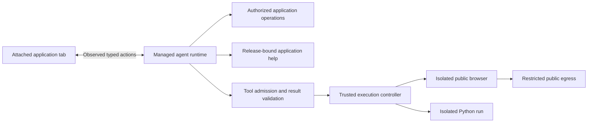

# Responsive page assistance and application knowledge

Status: proposed implementation (P45), 2026-11-28. Active scope is page control
and application knowledge. Browser and Python research is deferred to separate
work; the earlier execution-boundary notes below are retained as proposals only.
[D468](assistant-workspace.md#page-identity-and-observation-d468) records the
implemented reporting corrections and the coverage audit. The observation,
receipt and help contracts below remain proposals, not enabled capabilities.
Existing financial, delegation, approval and historical-context contracts remain
authoritative.

Improve page observation, physical reader coverage and action feedback first.
Application navigation needs the actual attached tab. It does not require an
external browsing service or arbitrary code execution.

## Current behavior and likely causes

These are source findings, not a measured latency diagnosis. D468's selection,
identity and failed-refresh regressions are reproduced by the local checks;
representative configured-model task runs remain unqualified.

| Finding | Consequence |
| --- | --- |
| `RunWalkthrough` in `WalkthroughPlans.cs` returns `status: presented` when a plan is retained. `assistant-panel.ts` keeps execution progress and errors in local maps. | The model receives no action completion receipt with which to observe a failed control, changed page or successful navigation. D336 deliberately distinguishes plan publication from browser completion. |
| `RunDigest` in `PageDigest.cs` uses the page report admitted with the question. Several pages supply only identity and selection. `PresentationPages` lists the current page and three entry destinations. | This is a bounded capability description, not a live map of the current tab after navigation. Some pages have native operations without a corresponding presentation adapter. |
| `WalkthroughPlans` accepts a closed control vocabulary and narrowly defined futures/swap fill syntax. | Unsupported fields and ordinary alternative phrasings can be refused even when a person understands the request. Broad DOM control would bypass deliberate limits rather than fix this contract. |
| `AgentTools.Offered` supplies an empty description when installation guidance is absent; `TurnWorker.Instructions` appends no bundled instructions. | Schemas remain available, but a model can receive little explanation of when and how to use them. This is permitted by D407; actual installation configuration must be inspected before attributing a failure to it. |
| `TurnWorker` awaits tool requests sequentially. A tool-read deadline ends the turn. Discovery lists operations before exact discovery supplies an input schema. | Extra discovery/model round trips and slow reads can add delay. Serial execution also protects target ordering and context acquisition; changing it requires evidence and explicit independence. |
| D466 already removes repeated application-route construction. | Do not reintroduce that cache or claim this known fix still accounts for current latency without checking the deployed build. |

The implementation anchors are [turn execution](../src/OpenEtrm.Api/TurnWorker.cs),
[tool offering](../src/OpenEtrm.Api/AgentTools.cs),
[page digest](../src/OpenEtrm.Api/PageDigest.cs),
[workspace discovery](../src/OpenEtrm.Api/AssistantWorkspace.cs),
[plan validation](../src/OpenEtrm.Api/WalkthroughPlans.cs) and
[browser execution](../web/src/assistant-panel.ts).

## Page observation and verified presentation

Extend the existing page adapters with a bounded observation contract: page and
subview identity, selected record pointers, visible control IDs and labels,
enabled/disabled state and reasons, loading/error state, and a page/form
generation. No arbitrary DOM dump, cookies, hidden controls or automatic export
of unsaved economic terms. The backend supplies the authoritative action catalog;
browser observations describe presentation and never grant business authority.

After explicit consent to the new observation capability, attach only bounded
presentation pointers, release-defined control labels and closed state/reason
codes to the question. Refresh observations through a page-observation tool.
Exclude raw browser error strings and dynamic record labels from automatic
metadata; resolve those through authorized backend reads and register their
source accesses before provider transmission. D407 still forbids automatic
financial context acquisition. Values needed for an answer come from the
existing authorized backend reads at the turn's explicit context. Browser
visibility and freshness are separate from financial effective time and
knowledge time.

Reauthorize and filter every observation's record pointers, labels and choices
before they enter model context. A visible page can contain more than the agent
is entitled to read. An action's resulting native reads must preserve the current
delegation and selected context through the shared operation boundary. Do not
expose the tab bridge to outside browser agents or turn the person's cookie into
agent authority; O29 remains unresolved for that separate access path.

Replace blind plan execution for interactive tasks with a short
observe → typed action → receipt → observe cycle. Keep walkthroughs for teaching
and reuse their typed adapters. Proposed interactive actions include opening an
issued destination, choosing a tab, selecting a record, filtering and scrolling.
Each exposed action declares prerequisites and its observable
completion condition. Unsupported actions return the missing capability and
available supported alternatives.

Review of a newly proposed business command remains a post-turn presentation
action. Both the existing browser and proposal reader require that proposing
turn to have completed. The model must finish with the proposal awaiting review;
it cannot await an open-Review receipt from its own running turn. The subsequent
human review/authorization uses the existing retained proposal and receipt flow,
not an automatically resumed model task.

The action protocol must bind each request and receipt to the authenticated owner,
workspace, conversation, running turn, action ordinal, attached tab instance,
current page generation, application contract version and financial selection.
Use server-issued expiring action identities. Exactly one attached tab may execute
an action; a second tab cannot acknowledge it. A receipt is an idempotent bounded
record with `completed`, `blocked`, `stale`, `cancelled` or `client_detached`, a
structured reason, and the resulting presentation observation. Changed retries
conflict. A browser receipt proves no business effect, price, source access or
approval; server rechecks remain mandatory.

Wait for the receipt without holding database transactions, connections or the
authorization fence. Bound that wait by the turn deadline and a separately
declared action timeout. Expiry, revocation, Stop, owner/context changes or human
takeover invalidate outstanding actions and prevent late receipts from resuming
work. Reconnect reconciles the same action identity. Reload or an unknown action
outcome requires observation before another action; never blindly replay a fill.
This adds concrete action records, not persisted generic financial contexts.

The first version refreshes state once after a recoverable stale observation.
Repeating the same normalized action against the same generation with the same
failure returns `no_progress`; it cannot consume the whole turn repeating itself.
Missing permission, required terms or unsupported controls need a specific next
step. A financial selection change ends dependent work rather than silently
acquiring different inputs. The agent reports completion only after a receipt.

Unsaved field assistance keeps explicit economic terms and native validation.
Broader natural-language extraction needs its own checked intent/term contract;
it must not weaken the current grammar merely to raise completion rates. Booking,
publication, job submission and all other business changes keep
Review → Authorize through the shared operations. Neither a page receipt nor a
browser click supplies human approval.

## Application knowledge and responsiveness

Provide searchable, bounded application help bound to the installed release:
implemented page capabilities, terminology, supported workflows, operation
schemas, required fields, error meanings and synthetic examples. Search should
return the section, release and supporting operation IDs. Start with a small
curated text index; there is no current need for a vector database. Planned
features and architecture proposals must be distinguishable from executable
capabilities. Search is a concrete help consumer, not permission to index private
configuration, logs or the entire repository.

Keep D407's installation-owned prompts. Expose configuration diagnostics showing
which selected application/page/tool guidance revisions exist and which are
absent, plus a synthetic task preview before an administrator publishes guidance.
Do not seed production prompts or silently change an existing agent version.
Release-bound help and operation contracts are retrieved evidence, not new
instructions that override installation policy. Prior chat search retains D427's
personal opt-in and remains separate from current business evidence.

Prefer a compact current-page capability summary and exact operation discovery
over repeated full-catalog discovery. Cache only immutable release metadata;
reauthorize each use and never cache grants or substitute current financial data.
Measure before adding concurrency. Independent reads may later run within an
explicit bounded scheduler after context acquisition, with deterministic result
and handle ordering; navigation, dependent reads and writes stay ordered.

Show useful progress immediately: reading the current page, opening a destination,
waiting for its data, or waiting for approval. Include elapsed
time, cancellation and an actionable error. These are execution states, not
private model reasoning. Separate model-call, discovery, authorization, native
read, page-action and execution-queue times so a slow model and a slow page are
diagnosable independently. Retain payload-free timing and refusal codes under the
installation's diagnostic policy.

## Where tools run

Deferred research notes; outside the current page-control/application-help work.

| Capability | Execution location | Initial boundary |
| --- | --- | --- |
| Application reads and business proposals | Existing managed API operations | Current intersected authority, explicit temporal inputs and existing approval contracts |
| Presentation actions on OpenETRM | The person's attached tab, through typed adapters | Observation and presentation only; no generic script, arbitrary selector or independent browser credentials |
| Public web research | Dedicated Linux tool workers, with an isolated browser per admitted research session | Public pages, separate cookies, broker-controlled egress, no application session or business API access |
| Python | A separate sandbox per admitted analysis run on the tool workers | Explicit input artifacts, bounded scratch space, no network and no credentials |

The initial change keeps the existing turn worker in the API. Tool execution runs
outside that process and outside database and financial-worker hosts. Reuse the
automation system's request identities, exact execution profiles, leases,
controller fences and uncertain-launch reconciliation where their contracts fit.
Its current `swarm_job`/`bounded_exit_v1` reports process exit only; it has neither
an interactive browser protocol nor an authorized artifact-result protocol.
Add a concrete consumer for each before sharing implementation. The risk worker
pool's database authority must not transfer to these workers.

Prefer self-managed Linux sandboxes with gVisor as the first isolation candidate;
qualify the exact browser/runtime, architecture, network controls and cancellation
on the intended hosts. An equivalent microVM boundary remains an alternative if
compatibility or host support requires it. A browser context separates browser
storage, but does not replace host isolation. The upstream
[browser-context documentation](https://playwright.dev/docs/browser-contexts)
describes that storage boundary; the
[container guidance](https://playwright.dev/docs/docker) cautions that its testing
image is not intended for untrusted browsing. Use a separately qualified image
and preserve the browser's sandbox. The
[gVisor security model](https://gvisor.dev/docs/architecture_guide/security/)
does not replace explicit limits on the files and network a workload can access.

Pin images and package manifests by exact version/digest. Enforce non-root
execution, read-only roots, CPU, memory, process, disk, output and wall-time
limits. Sandboxes receive no host mounts, Docker socket, database/provider keys
or application credentials. The trusted controller alone has launch authority.
Network and artifact policy must be enforced outside arbitrary Python and page
JavaScript. A missing required control or unqualified runtime refuses admission;
ordinary containers are not an automatic fallback.

Local development uses this repository's disposable API/database fixture and
an owned Linux sandbox environment. Do not attach the tool to an existing desktop
browser, application runtime or database. Hosted installation uses separately
provisioned tool nodes; accepting an admin setting does not provision or qualify
them. Provider-hosted execution would be a separate data-routing decision, with
its own cost, retention and capability contract, not an automatic fallback.

Browser-side Python is not the proposed baseline. A
[Pyodide worker](https://pyodide.org/en/stable/usage/webworker.html) can move Python
off the UI thread; it would still need a separate origin/security design, package
qualification and lifecycle rules for tab closure. Server sandboxes give this
consumer one explicit installation-controlled execution and accounting boundary.

## Browser and Python contracts

The proposed first browser consumer is reading a user-specified public source
and returning cited excerpts. It supports opening an admitted URL, reading a
bounded page, following issued link handles and capturing bounded evidence.
Search requires a separately configured destination; it is not silently routed
to a provider. Public research is the proposed initial scope. Signed-in external
sites, credential custody, submissions and uploads require a further contract.

Every outward request can disclose information, including a URL or search query.
Run research in an isolated model context that receives only the explicitly
admitted public task and public evidence. It cannot inherit conversation history,
business reads or Python artifacts. A business-informed model cannot supply an
unreviewed outward query: the initial topic/URL must be explicitly supplied for
public use by the person or reviewed as an exact outbound payload. Following
issued public links can proceed within that bounded task without approval at
every click. Later new queries follow the same admission rule. A domain allowlist
alone does not prevent disclosure to a permitted domain.

The isolated research context uses the same admitted provider/model route and
charges all model calls and browser work to the originating turn's aggregate
limits. It acquires no independent identity, longer lifetime or redelegation
right. Returning public excerpts to the main conversation does not allow later
private context to flow back into the research context.

Enforce allowed schemes, destinations and resolved addresses at the egress
boundary, including redirects and subresources. Block loopback, private/link-local,
metadata, application and control-plane addresses, alternate IP encodings,
unapproved protocols and direct-network/DNS bypass. Public-only browsing has no
login, form submission or arbitrary model-supplied JavaScript tool. Requests
still have normal externally observable effects; it is not a promise that an
arbitrary GET is harmless. Retrieved text is untrusted evidence and cannot alter
permissions or become financial input by itself.

Python's first consumer is a chart and CSV derived from an explicitly selected
authorized report. The managed broker obtains the report through the ordinary
operation, records exact inputs and source accesses, and delivers a bounded
read-only artifact. Python receives no general HTTP/SQL client authority. Start
with stateless script executions and explicit inputs; later cells can consume
authorized retained outputs, without an invisible long-lived notebook state.
An installation-approved image provides only the packages this consumer needs.
No runtime package installation, external processes outside the sandbox, or
network fallback is admitted.

Python may inspect, reshape and plot data; it does not become a second pricing,
schedule, TOU, unit-conversion, settlement or risk engine. Official totals and
financial explanations use native results and explicit native grouping policies.
Any exploratory calculation must state its method and remain an analysis
artifact, not a bookable value, risk result, fixing or financial-policy default.
Importing a proposed value still requires an existing validated business operation.

Retain the script, runtime/image identity, input hashes and exact native receipts,
declared numerical/randomness policy where relevant, resource usage and output
hashes as authorized tool evidence. No claim of bitwise reproducibility follows
merely from pinning a Python image. The broker derives provenance for code,
parameters and data, including every source visible to the model that generated
them: supplied earlier turns, history excerpts and other tool outputs can embed
values in a script. Conservatively inherit that complete source union and its
original financial dates; a runner or model cannot declare a narrower lineage.
Reauthorize that union before dispatch, result publication and later disclosure.
External evidence keeps retrieval/publication provenance and is not represented
as knowledge available at an earlier financial cutoff.

Artifacts are private, bounded and expiring under an explicit retention policy.
Reauthorize listing, preview, download, model reuse and later turns against every
contributing source. Revocation also hides dependent assistant answers. Reject
path traversal and symlink escape; validate content and render only admitted
inert types. Do not execute returned HTML/SVG or trust stdout as a success receipt.
Oversize structured results refuse or use an explicit paged/artifact contract;
they never masquerade as a complete result. No generic notebook or public file
store is justified by the chart consumer.

## Administration and lifecycle

Proposed **Administration → AI → Tools** controls:

| Control | Meaning |
| --- | --- |
| Enable browser and Python execution | Explicit installation/workspace opt-in; absent or disabled policy admits neither new capability |
| Browser research / Python analysis | Independent switches, each requiring a qualified exact execution profile |
| Agent version tool set and user delegation | A second bound on every tool; enabling an installation capability does not widen existing versions or grants |
| Permitted sources, egress and artifacts | Exact destination/data-routing policy, input/output limits and retention |
| Resource limits | Per invocation and aggregate user/workspace concurrency, CPU/memory/storage, elapsed time and usage budgets |
| Pause all assistant tools | Stop new native/page/external tool admissions and cancel pending/running tool work under the same current-authority fence |

Use existing administrative authority where it fits; changing execution-host
profiles remains an installation-operator action. UI controls cannot grant
infrastructure access. Settings are versioned and idempotent, with explicit
expected versions. Explain whether a tool is disabled, not granted, not installed
or temporarily unavailable. Existing native page tools keep their selected
contracts; new capabilities are never added to an older grant.

Admission pins the policy, agent/model/runtime versions, owner/delegation, task,
exact inputs and bounds. Current disablement, expiry and revocation still take
effect during execution and publication. Re-enabling cannot revive an old fence.
Use one logical invocation identity per turn/tool request and separate physical
attempt identities; a lost launch response reconciles that invocation instead
of executing again. Results and terminal outcomes commit atomically under current
authority. A stale attempt cannot publish.

Classify page receipt waits and sandbox execution separately from native reads.
`TurnWorker.Answer` currently puts every tool under the agent's time-per-read
limit, capped at 30 seconds. New action/queue/execution budgets must remain inside
the original parent turn deadline while retaining the existing bounds on actual
database reads. Raising a global read timeout is not this integration. New tool,
receipt and policy shapes require an explicit runtime/schema compatibility gate;
an older binary cannot admit a capability it cannot enforce.

Stop/disable closes admission immediately and requests termination. Show
`cancellation requested` until the controller verifies physical termination;
retain resource reservations for uncertain or overlapping work. Cleanup remains
authorized after the user's execution authority ends. Worker/API restarts must
fence orphan work; the initial API-bound turn runtime may mark the turn interrupted
rather than resume its model loop. Do not promise durable conversation execution
as a consequence of durable tool cleanup. Expired/replayed events never launch
new browser or Python work.

## Delivery and acceptance

1. Extend the D468 reporting checks to actual reader coverage: exact selected
   physical revision, Side/day, quantity heads, operations and allocations under
   one explicit turn context. Test missing authority, partial native-read failure,
   changed selection and missing data without inferred financial fallback.
   Establish a reproducible model baseline: navigate to New swap; open a
   selected position's details; explain an unavailable page control; find the
   implemented workflow for an explicitly named task. Run with synthetic accounts,
   fixed page state and recorded model/prompt/tool versions. Inspect the actual
   installation's guidance and deployed runtime before selecting fixes.
2. Add failing behavior checks for observation, completion receipts, stale-page
   recovery and repeated no-progress termination. Implement one navigation path
   end to end, then expand adapters based on observed failures. Preserve explicit
   terms and unsaved-state protection. Test two tabs, delayed/forged receipts,
   human takeover, reload, historical selection changes and revocation. A new
   business proposal must finish its turn before Review opens, with no circular
   wait between model completion and browser execution.
3. Add release-bound help and configuration diagnostics. Qualify answers against
   implemented operations, absent guidance, unsupported products and historical
   data requirements. Compare correct outcomes and citations, not prose style.
4. Deferred: implement the optional execution admission/cleanup path with a synthetic
   worker before running arbitrary code. Prove disabled-policy denial, aggregate
   limits, lost launch acknowledgments, replacement fencing, API/worker restarts,
   cancellation and orphan cleanup on owned disposable resources.
5. Deferred: qualify Python's chart/CSV consumer, then public-source browser research. Test
   source revocation after export and values embedded in generated code from an
   earlier read, malicious artifacts, resource exhaustion,
   egress bypass, prompt injection and attempted private-data disclosure. Browser
   and Python remain independently deployable and independently disabled.

Measure task completion, time to first useful feedback, time to verified page
change, model/tool calls, no-progress retries and refusal categories. Record
p50/p95 with sample counts, cold/warm state, provider/model versions, latency
conditions, concurrent users, unique contracts, scenarios, evaluated work and
memory/CPU environment. Separate native action time from provider latency. These
are proposed measurements, not performance results or accepted service levels.

Authorization, temporal behavior, async execution and isolation changes require
independent adversarial review and ordinary integration/release gates. Fake
provider tests establish protocol behavior; representative configured-model task
runs are needed to establish usefulness. No schema, dependency, process, live
setting or production capability is added by this proposal.
