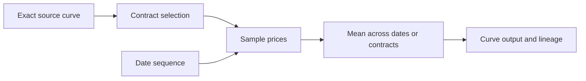

# Custom curve recipes

The local Curve builder page authors versioned graphs and previews their
computed values. Published versions are immutable. Visual editing and the formula
representation use the same managed validation and execution operation.
Exact source curves, published custom outputs, calendars and published
schedule versions are retained as foreign keys. Layout coordinates have no
financial meaning.



Sources may already have the supported multi-level basis dependencies. The
recipe retrieves only its selected contracts and declares their live primitive
factors. It does not infer dependencies from quoted price levels. Published
outputs supply explicitly pinned projections to existing monthly and daily indexed swaps
through the trade editor, API and shared portfolio/risk path (D183, D186). Ordinary
curves, basis relationships and custom recipes use the same connected evaluator.
The implementation does not add theoretical options or historical VaR/covariance.

A **Published custom curve** operation reuses the complete output panel of an
explicitly selected published version (D187). Choose its exact version/output and
`all_output_points_v1`, then connect it to a mean, a curve combination or curve output. The panel keeps
its positions, observation dates, delivery metadata and native-input lineage.
Its values remain graph references: a quote or computed-output shock on an
ancestor flows through every dependent curve. There is no replacement price
buffer or invented futures contract.

The typed `publishedSource` formula argument contains `catalogId`, `curveId`,
`version` and `outputNode`. Migration 0082 retains these as a normalized exact
output-node foreign key. All ancestors resolve under the same header/job context,
including its effective date, knowledge cutoff and current authority. A new
upstream version never changes an existing pin. Exact-version graphs may refer
to an older version of the same logical curve; cycles reject. Preparation permits
at most 32 published-source edges per path and 256 exact recipe versions, sharing
common ancestors within the operation.

This operation imports the parent's output under that context. It does not
resample it at a separately supplied date window. Contract selectors and weighted
contract mappings consume native curves. The `weighted_panels` contract below
combines computed panels. The `lookup` operator evaluates explicit target dates
with shared asset lookup policies; see [curve evaluation](curve-evaluation.md).

**Combine published curves** is a guided entry point (D193). Choose each exact
published ingredient/version, its decimal weight, signed sum or normalized mean,
and exact delivery-period matching. Choices start blank. Build constructs the
ordinary backend graph and explains it in plain words; Preview, Save and Publish
use the existing operations. Ingredient edits clear old prices and block these
actions until Build or Discard. Replacing a saved graph retains its identity and
optimistic generation. The guided form supports 1–30 ingredients within the
32-node authoring limit. Advanced graphs also combine native sampled panels,
historical means and earlier combinations.

`weighted_panels` connects named panel ports and typed `panelWeights` rows
(`sourcePort`, `weight`). `signed_sum_v1` adds signed weighted values;
`normalized_weighted_mean_v1` requires nonnegative weights and a positive sum.
`exact_delivery_intervals_v1` requires identical complete half-open delivery sets,
one cell per interval and identical price units. Position/order never aligns
curves. Missing/extra periods, repeated raw historical dates and incompatible
units reject; no point is silently dropped and no currency conversion occurs.
Different explicit historical averaging windows may combine under the same
resolved context. The resulting formula retains connected parent references;
shocking a primitive quote or a parent output propagates to the child, while a
child-output offset holds its upstream inputs constant.

Preparation bounds cumulative native samples and combination sample references
at 50,000 per recipe; shared formula traversal visits each formula once. Repeated
parent branches retain their declared sample-reference counts and either fit
that bound or fail explicitly before allocating another expanded provenance
array. This is a boundedness guard, not a production throughput qualification.

Agents can use `custom_curves.catalog_v1` and `custom_curves.prepare_v1` under
`ReadMarketData`. They call the editor's shared backend catalog and preview and
must supply the exact engine, formula and financial choices. Preparation saves
nothing. A server-issued proposal points to a successful preparation step owned
by that turn's user. **Review proposed curve** revalidates the original pin and
current source access, then opens an unpriced draft under the current header,
showing its origin dates. It never installs old prices under that header or
switches it implicitly. Ordinary Preview prices under the selected header; Save
and Publish retain their existing human authoring permissions. The assistant's
Curve builder page report describes saved ingredients, not unsaved graph edits.
These tools do not run portfolio risk or interpret dependency counts as exposure.

The three starting recipes are:

| Recipe | Definition |
| --- | --- |
| `ng_prompt` | Position one among the retained nonexpired monthly contracts. At the exact recorded last-trading cutoff, the expired contract leaves the sequence. |
| `ng_balmo` | Arithmetic mean of one daily forward for every delivery date from the context date through current month-end, inclusive. All daily forwards are priced at the same context instant. This is distinct from a separately quoted BALMO mark. |
| `ng_average` | A mean across an explicitly selected history window for each of positions 1–12, preserving twelve output points. The starting example uses twenty prior calendar dates, excludes the context date and says so in the editor. Business-day windows require an exact calendar. |

Historical selection has two explicit meanings: resolve each relative position at
each sampling instant, or resolve today's dated contract once and sample that
same contract's history. Price retrieval never promotes a later contract when a
required mark is missing. Every selected date and contract is required; duplicate
or missing observations fail rather than changing an average's denominator.

Date windows use context, inclusive remaining-month dates, prior calendar dates,
prior business dates or an exact published schedule and occurrence range. Schedule
bindings remain references rather than copied dates. Sampling uses the exact UTC
time of day of the selected snapshot. Current inputs retain the selected snapshot's
exact observation pins; historical samples use the latest final correction visible
at the selected knowledge cutoff. These policies are explicit graph fields. The
current implementation reads history within one exact definition bundle's
applicability. Cross-revision continuous histories require a later contract.
Explicit `freeze_final_future` source edges can consume an expired future's final
settlement. Historical sampling requires a single unambiguous final event at or
after its expiry and no later than the sampling instant, with visible corrections
resolved within that event. Multiple final events reject. At the current context,
the final fixing must already be pinned in the selected snapshot.

Past samples are frozen observations. Current projected samples declare their
primitive quote factors. Scenario execution supplies changed typed input samples
and reevaluates the graph; the recipe does not fetch replacement prices inside a
calculation. Exact rational means retain the quote currency, quantity and
multiplier. Only display formatting rounds the result. Receipts include input
observations, sampling instants, actual dated contracts, output dates and live
factor declarations. Business date labels are dates; displayed instants follow
the user's time zone.

Formula mode represents those same nodes and typed edges, for example:

```text
source = source(curve="ng_monthly")
selection = select(mode="positions", first="1", count="1", binding="each_sample", source=@source)
dates = dates(mode="context", sampling="context_utc_time", corrections="exact_context_frame_history_latest_visible")
prices = sample(selection=@selection, dates=@dates)
output = output(values=@prices)
```

Parameters are quoted strings; `@name` refers to another node. This language
cannot execute scripts or SQL text. Backend formatting and compilation allow
switching between the visual graph and its formula.

A `weighted_contracts` node connects multiple named source ports to explicit
contract members. Each row names its output position, source port, exact contract
ID and dimensionless weight. The source catalog supplies the eligible member
identities and delivery labels; the browser edits and transports rows without
resolving contracts or applying weights. `signed_sum_v1` preserves signed weights;
`normalized_weighted_mean_v1` requires nonnegative weights and a positive sum.
Every source port must be used, and duplicate output/port/contract rows reject.
The resulting selection feeds the ordinary sample node, so historical sampling
and current quote connections keep the same policies as other recipes.

Formula mode carries these same rows in a typed `contractWeights` array. The
managed backend alone compiles and formats formulas, validates mappings and
performs arithmetic. Saved rows retain exact source-node, source-curve/member and
version foreign keys under migration 0080.

D186 removes the SQL panel executor and its UI/API alternative. The sole recipe
engine is `custom_curve_recipe_v2`; unsupported old engines and SQL nodes reject.
Migration 0080 refuses a database containing saved recipes. An existing installation
must explicitly reset/rebook its earlier recipes before adopting this schema
baseline; the migration does not rewrite immutable saved or booked history.
The [cutover checklist](connected-calculation.md#adopting-the-schema-cutover)
covers retained jobs as well as recipes and explains the installation prerequisites.

Save requires current authoring permission, an exact session snapshot and an
optimistic generation. Publish requires separate publishing permission. Published
versions and their normalized graph relationships are immutable. Request replay
retains one exact command per current actor; uncertain network outcomes can retry
the original command. Full-content retry responses retain exact definition-bundle
and curve-version foreign keys and require current read access to both.
Historical views cannot author or publish, and current authority is rechecked
for source definitions and schedule/calendar references.

The As of control is a market-close calendar. Available days are qualified by the
managed backend for the selected curve, or the complete custom graph including
its history window. A date with incomplete inputs cannot be selected. Calendar
days and close times display in the user's time zone; selecting one retains the
same exact UTC snapshot and its financial business date. Multiple closes or
corrected snapshot versions on one displayed day require an explicit choice.
The calendar does not choose a substitute date or alter the separate effective
date and knowledge-cutoff controls.


## Published outputs in booked projections

`SwapFloatingInput.CustomProjection` is optional and has no inferred value. It
names `catalogId`, `curveId`, `version`, `outputNode`, `position`,
`implementation=published_custom_curve_projection_v1`. Monthly reset selection
uses `selection=single_output_position_v1` with an explicit nonnegative position.
Daily reset selection uses `selection=exact_delivery_interval_v1` with an explicit
null position. It maps each unresolved reset to exactly one computed output with
the same half-open delivery interval, independently of output order or sample
date. Missing or ambiguous matches reject. Both modes require the contractual
index's exact quote unit and the same source catalog and market revision;
cross-revision histories and inferred interpolation remain unsupported.
The position field is required in both modes; omission does not mean null.

The published recipe supplies only the unresolved projected price. The existing
index/fixing qualification, frozen actuals, independent payments, direction and
external quantity rules still govern the swap. Exact rational projected prices
reach scheduled cash and PV without an intermediate decimal rounding step.
Daily consumers select graph roots by delivery interval before loading forecasts.
The full symbolic recipe retains its delivery metadata and original output
indices; only demanded eligible samples compile. Demands for shared exact
ancestors coalesce before historical loading, so overlapping consumers share one
sample identity. Already-fixed resets keep their actuals and the period's full
averaging denominator, without preparing their expired forecasts.
Legacy floating-side identities retain their prior canonical encoding; the
custom-bound variant names its complete descriptor in version 5.

The trade editor requires an explicit price-source choice: the ordinary index
projection or a compatible published custom output offered by the authorized
backend catalog. Each offered output includes its exact descriptor and supported
sampling terms. The browser passes that descriptor unchanged through draft
Price/Risk, booking and amendments. A retained choice that is unavailable in the
selected context remains visibly unavailable; it cannot silently become ordinary
pricing. Changing terms or the header context clears stale calculation results.

The saved graph connects to the shared valuation provider. Historical sample
observations remain frozen, and current primitive quote shocks propagate through
the graph into each affected swap and book. A durable job retains exact version,
output and sample-observation relationships under its certified context; a worker
reconstructs those pins and verifies the admitted manifest. Changing the working
UI context cannot change a queued calculation. Current authorization still
controls reading, execution and publication.

Overlapping versions may require different exact historical sample frames.
Retention preserves the existing source/date/contract evidence and adds a
representative only for an otherwise missing frame, carrying all its exact
selections. It does not merge observation sets or change snapshot/graph identities;
previously covered receipts retain their original form.

## Effective version timelines

**Effective versions** loads the selected logical curve's retained activation
timeline. An authorized publisher supplies up to 64 disjoint half-open effective
date intervals, each naming an exact published version/output, and a reason.
**Publish complete timeline** uses `complete_effective_timeline_v1`, an expected
revision and a stable request ID. Each revision replaces the complete timeline
for later committed knowledge. Omitted dates are inactive; an empty timeline
deactivates all dates. Saved versions remain independently available.
Every request and interval field is required, including the explicit zero
expected revision for a first publication; omitted dates never become minimum dates.

**Preview effective version** first selects the latest plan committed by the
header's certified knowledge cutoff, then the interval covering its effective
date. Missing coverage or unavailable targets fail without falling back to an
older plan. The existing evaluator checks exact source revisions and all normal
pricing inputs. This operation selects a definition; activation alone does not
certify that every date in its interval has price coverage.

The response retains the plan revision, certified publication time, selected
interval and exact recipe. Ordinary **Preview** explicitly returns to the exact
version. Entering Live with an effective preview follows activation corrections;
entering with an exact preview preserves its selected version. Booked trades and
queued jobs always keep their exact admitted references. Timeline edits clear
calculated output and must be published or reloaded before effective preview.
Uncertain writes retain their original request for reconciliation.

Interactive preparation reads visible observation history for the selected source
revision before sampling. Source topology is compiled without pricing it; shared
connected nodes evaluate on demand. `SourceCompilations` and `DeclaredSourceNodes`
report preparation separately from evaluated graph work. The current portfolio
materializer still performs and counts its futures build pass. Historical query
pushdown and end-to-end financial workload qualification remain work; the integer
graph benchmark does not qualify this loading path.

Use an isolated synthetic preview with the additional monthly/daily panels:

```sh
python3 tools/run_preview.py --pg-bin /path/to/postgres/bin --dotnet /path/to/dotnet --with-custom-curves
```

The additional panel is original synthetic data, without exchange-listing claims.
The normal preview remains unchanged unless this flag is selected. Verification
uses `--custom-curves-check --browser-check --browser /path/to/chrome`; the same
check is included in `tools/check_all.py`.

The booked projection and retained worker check uses `--connected-portfolio-check`.
Managed targeted checks include `--connected-recipes`, `--custom-projection` and
`--connected-portfolios` in MarketData.Checks, plus the Rates swap checks. These
commands describe executable verification gates; they are not deployment claims.

An exact recipe schedule reference retains its published version after a symbolic
successor is published. The reader checks that version's own effective interval,
certified publication order/transaction and knowledge time, and current calendar
access; it does not substitute the active schedule's dates or extend the old
version's effective coverage. The active schedule library keeps its separate
bitemporal selection. Recipe evidence retains the original publication receipt.

The combination checks cover independent historical panels, exact interval/unit
matching, explicit signed and normalized weights, partial daily demand, repeated
ancestors and bounded provenance expansion. The booked integration check uses an
independent rational-price oracle for a two-parent curve, verifies each parent
and child output sensitivity, nests stresses without changing the base, and
compares retained-worker factors and input evidence with the interactive result.
Browser checks exercise blank required choices, backend composition and preview,
saved identity preservation, weight removal, stale-result clearing and narrow
layouts. Assistant checks cover explicit review, unpriced reopening, owner/source
authorization and the original historical pin. These synthetic checks establish
the supported contracts; they do not qualify financial throughput or Swarm
failure recovery.

## Raw component history

The History tab and **View component history** inspector action sample a relative
contract selection, an exact weighted-contract mapping, or its sample step through
the backend under `raw_component_history_v1` (D262). The view does not edit or save
the graph. It removes downstream averaging only from the temporary inspection.
Choose the component, prior calendar or publication-business dates, count and
whether to include the context date; business dates also require a calendar.

An `each_sample` selection resolves the canonical traded contract separately at
each sampling instant. Prices remain raw: roll jumps are neither smoothed nor
back-adjusted. A `context` binding retains its selected contract across dates.
The chart uses observation time, and the table and tooltips identify actual
dated contracts. Exact weighted mappings retain their declared weights.

Sampling uses the selected close's UTC time. Historical corrections are the latest
visible at the selected knowledge cutoff; the context close retains its exact
snapshot pins. Every required observation must exist, and all samples must fall
within the selected exact definition revision's coverage. Missing prices do not
promote the next contract or trigger interpolation. Saved identity and references
are validated before inspection. The browser renders server-returned prices and charts.

This view does not replay arbitrary aggregated outputs, daily-delivery panels or
published recipe outputs across historical contexts. Cross-revision continuous
histories and adjusted roll series remain separate work.
