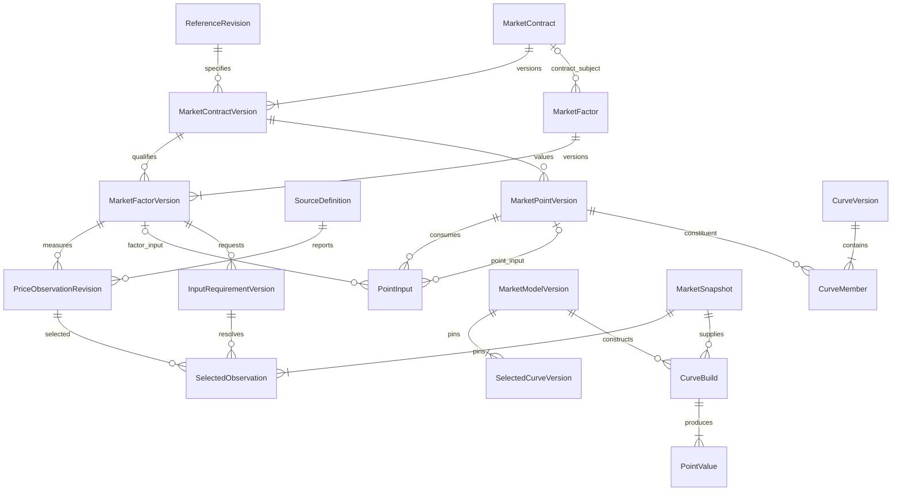

# Market model proposal

Status: logical model proposal with required curve ownership and composition below.
Requirements from [market-data.md](market-data.md) are agreed; detailed storage
entities/table shapes remain proposed.
This document does not implement a market-data schema, resolver, curve builder,
VaR estimator, data adapter or trading service.
The first bounded implementation is now recorded in [implementation.md](implementation.md).
The detailed shapes here remain a broader logical proposal; the implemented
commodity subset uses curve-owned definitions and scoped contract/measure keys,
with no separate public factor/point business objects. Generic numeric series and
price histories share observations; ratio inputs use the same typed series contract.
Current role persistence/RLS is in [security.md](security.md).
Implemented immutable quote scenarios, nested stresses and retained futures jobs
are described in [risk-engine.md](risk-engine.md). This broader storage proposal
does not replace those executable contracts.

## 1. Agreed domain structure

The main market-domain objects are Curve, MarketContract and MarketObservation.
Curve owns the specifications common to its constituents; MarketContract retains
the dated identity and contract-specific terms. MarketObservation retains a typed
reported value and its source/revision evidence. Detailed factor keys, point
definitions, version records and build artifacts below describe possible internal
representation, not a requirement for additional public business classes.

Use a common Curve abstraction with commodity, yield and composite/algorithmic
implementations. Commodity curves declare commodity/location, currency, quantity
and quote specifications, delivery profile/clock/calendar and applicable settlement
conventions through exact reference links. Every constituent must satisfy those
specifications. Common terms are explicitly bound through the selected curve
definition, never filled through a missing-field fallback. Dated terms retain
their authoritative contract/product/series references; incompatible membership
is rejected. Reuse across curves requires compatible terms.

Yield curves expose their supported rate/discount representation, day count,
compounding, calendars and construction conventions. They do not require commodity
contract or index-settlement fields. Exact class names and SQL decomposition remain
implementation choices.

Composite curves bind explicit source curve versions, supported operations,
parameters and delivery mappings. The same input relationship supports multiple
dependency layers and shared sources. Cycles are rejected. A basis curve declares
its spread orientation, reference base, units and delivery mapping; a composite
outright curve explicitly combines base and basis. A semantic base reference alone
does not create a pricing dependency.

### Five-layer commodity example

For explicitly mapped delivery periods, an illustrative construction is:

| Layer | Curve | Declared construction |
| --- | --- | --- |
| 1 | Gas futures | Selected futures settlement observations |
| 2 | Base-location gas forward | Mapped futures values + declared futures-to-forward basis |
| 3 | Regional gas forward | Base-location forward + location basis |
| 4 | Hub power forward | Regional gas forward × typed heat rate + power spread |
| 5 | Local power forward | Hub power forward + power location basis |

Each source binding pins the source curve version, input role, delivery-mapping
version and supported operation/parameters. The mapping resolves exact source
constituents and any explicit weights, unit/currency conversions and profile
transformations. Matching month names or expiries cannot establish compatibility.
Quarterly/hourly mappings require their own qualified rules; this example does
not implement shaping, interpolation or futures-to-forward adjustments.

Pricing construction and settlement definition are separate relationships. A
forward may explicitly use a futures value without acquiring daily variation
margin or the futures contract's settlement rule. Its own target index/formula,
fixing period, payment terms and correction/finality rules remain explicit. Basis
settlement defines the exact index difference and aggregation conventions; a
publisher name alone cannot identify an index. Index targets do not automatically
create forward pricing dependencies.

Source-expiry behavior is part of the versioned construction. If a source future
expires while dependent forwards remain live, an explicitly selected rule may use
its final settlement as a frozen fact, transition through a specified mapping, or
end eligibility. No implicit roll or transition is permitted. A frozen final value
requires the exact available observation and applicable finality rule. Missing or
unsupported transition inputs produce pending/error under the selected policy,
never an automatic current-price lookup. Historical builds retain the rule and
observation revisions originally selected.

### Mixed daily/monthly constituents

Mixed resolution is part of the agreed curve model: one commodity curve can
contain daily and monthly MarketContracts with compatible common specifications.
Frequency does not determine identity; exact delivery intervals and supported
clock/profile terms do. An explicit versioned membership rule selects the daily
window and monthly tail without mutating or discarding earlier contracts.

Use the benchmark actually named by the basis definition: a daily contract for
daily locational basis, or the matching remaining-period benchmark for a BALMO
spread quoted that way. BALMO and daily marks are independent unless an explicit
qualified transformation connects them. A single remaining-period mark does not
determine daily prices, and an expired monthly future is not an automatic base.
The [managed acceptance case](examples/mixed-resolution-gas.md) now tests these
equal-period bindings in mixed daily/monthly views and separate BALMO contracts.

A future daily-to-containing-month projection is permitted only for a spread
explicitly defined against that monthly reference and a qualified named mapping.
Preserve source and target intervals, units, orientation and exact reference pins.
Do not weaken delivery equality globally or infer an average/daily shape. The
custom-curve workspace has explicit exact means, and interval curves have qualified
monthly-block shaping. Those separate consumers do not enable arbitrary mappings
in this mixed daily/monthly contract. Managed validation, database sealing and the
adapter must agree before another mapping is enabled.

Follow-up proposal: replace the mixed demo's directly marked daily/monthly source
with separate daily-only and monthly-only sources and an explicit selection/splice
composition. Treat BALMO as a possible named remaining-day selector separately
from a directly quoted period contract. The month-end window rule is awaiting
selection; see [curve composition and rollover](examples/curve-composition-rollover.md).
Custom curves already implement explicit prompt selection and a daily-forward
remaining-month mean. The proposed splice composition and listing-window rule
remain separate work; see [custom curves](custom-curves.md).

### Detailed storage proposal

The diagram and contract-owned point shape below cover the commodity-curve branch.
Yield/discount points use an explicitly typed non-contract representation in the
implemented zero-rate model. The broader storage projection here must preserve
that separation; do not create fictional MarketContracts for them.

Make dated market contracts first-class entities. A curve is a cross-section of
their resolved values under one context; selecting a constituent opens that
dated entity's history. A future prompt/rolling reference selects dated entities
and never replaces their identities or raw observations.

Separate the definition of what a price means, the reported observations, and
the rules that construct a usable value. An observed all-in price is not a
spread, and receiving it cannot change a pricing rule.



PointInput has exactly one typed target per row, not an unconstrained polymorphic
ID. The diagram abbreviates version/publication records and reference children;
the foreign-key contracts below govern the proposed storage representation. They
remain subject to the agreed domain ownership above.

## 2. Keys, versions and reference linkage

Use opaque IDs for market identities; display codes, source symbols and array
positions are not foreign keys. Retain immutable definition versions separately
from logical identities so a correction cannot relabel old calculations.

For compactness this document uses these key shapes:

```text
RefKey(table)        = (reference_catalog_id, reference_revision_id, code)
ConversionKey        = (reference_catalog_id, reference_revision_id,
                        from_unit_code, to_unit_code)
CommodityUnitKey     = (reference_catalog_id, reference_revision_id,
                        commodity_code, unit_code) # existing; basis extension proposed
CommodityLocationKey = (reference_catalog_id, reference_revision_id,
                        commodity_code, location_code)
ExchangeClearingKey  = (reference_catalog_id, reference_revision_id,
                        exchange_code, clearing_house_code)
CalendarDayKey       = (reference_catalog_id, reference_revision_id,
                        calendar_code, business_date)
MilestoneKey         = (reference_catalog_id, reference_revision_id,
                        series_code, milestone)
ProductEvidenceKey   = (reference_catalog_id, reference_revision_id,
                        product_code, source_code, fact_group)
MarketKey(entity)    = (market_catalog_id, entity_id)
VersionKey(entity)   = (market_catalog_id, entity_id, version_id)
ObservationKey      = (market_catalog_id, observation_id, revision_id)
```

RefKey applies only to code-keyed definition tables. Relationship tables use
their actual composite keys above; there is no fictional code column for a
conversion, calendar override, milestone or evidence link. Every child must match
the parent's market catalog; every reference binding must match its declared
reference revision. Market catalogs are namespaces with explicit workspace
ownership and forced row-level authorization in the implemented security model.
A selected market model uses one coherent reference revision initially.
Mixing incompatible reference revisions is rejected rather than selecting latest.

Internal SQL primary/unique/foreign keys enforce identity and scope/version
linkage. Nullable alternative references require explicit discriminator and
exactly-one-target constraints. Referenced versions are retained; do not cascade
delete them. Cross-row semantic rules are validated before activation and again
when constructing a complete snapshot/build. A foreign key is not proof of
economic compatibility, current authority, source entitlement or publication.

History publication retains effective_from/effective_to and known_from/known_to
semantics from [context.md](context.md). They must be assigned under the qualified
publication protocol, not fabricated from import or row-creation timestamps.
The bounded certified publication/context resolver is implemented as described
there. Proposed identities/version links alone do not extend its qualified scope.

## 3. Reference-data specifications

These records must be explicit before a definition becomes usable. Initial SQL
only implements the existing tables listed below; extensions are proposals for a
later additive migration, not fields silently assumed present today.

| Specification | Existing reference linkage | Proposed extension / required meaning |
| --- | --- | --- |
| Commodity | RefKey(commodities) | Permitted measurement bases; gas energy and volume need distinct explicit bases |
| Quantity unit | RefKey(units), RefKey(dimensions), commodity_units | Unit variant, commodity and measurement basis; physical dimensions alone do not establish economic interchangeability |
| Fixed conversion | Both endpoint RefKey(units), ConversionKey | Matching commodity/measurement semantics; multiplicative conversion only in the first supported subset |
| Currency | RefKey(currencies) | Quote and settlement currencies are separate references; display minor units do not define all rounding |
| Location | RefKey(locations), RefKey(location_types), CommodityLocationKey | Typed market/commodity bindings; power nodes/zones/hubs and gas delivery-point metadata |
| Exchange/clearing | RefKey(exchanges), RefKey(clearing_houses), ExchangeClearingKey | Validate the permitted exchange/clearing relationship; a market operator is a separate reference entity |
| Clock/calendar | RefKey(clock_rules), RefKey(calendars), CalendarDayKey | Retained clock-rule version, operating-day boundary, supported calendar coverage and separate trading/delivery/payment calendars |
| Delivery profile | New RefKey(delivery_profiles) | TOU rules, applicable clocks/calendars, interval resolution, missing/repeated-hour behavior and quantity integration |
| Quote convention | New RefKey(quote_conventions) | Price value kind, quote currency, denominator quantity specification, quote multiplier, permitted range and distinct trading/clearing-price precision |
| Rounding | New RefKey(rounding_conventions) | Increment, direction/tie handling, target quantity/currency, stage and unit-versus-position application; never inferred from display precision |
| Price index | RefKey(price_index_definitions) | Source series, market/commodity/location, day-ahead/real-time/assessment distinction, component, interval and publication conventions |
| Rate/conversion input | RefKey(value_specifications); RefKey(interest_rate_definitions) for the implemented zero-rate curve | Dated numeric series with exact quantity-ratio/dimensionless types; dated interest maturities and selected conventions. FX conversion remains future scope without a dedicated catalog |
| Futures terms | RefKey(futures_products), RefKey(futures_series), MilestoneKey | Exact product/dated-series terms, listing/trading/notice/delivery/settlement milestones and evidence |
| Source evidence | RefKey(sources), ProductEvidenceKey | Provenance/configuration only; per-import payload/revision evidence is retained separately |

### Quantity and quote specifications

Propose a reusable QuantitySpecification reference:

```text
QuantitySpecification
  commodity            -> RefKey(commodities)
  measurement_basis    -> RefKey(commodity_measurement_bases) [new]
  unit                 -> RefKey(units)
  dimension            -> RefKey(dimensions)
```

The existing one-dimension-per-commodity model is insufficient for mixed
volume/energy measurement of the same gas commodity. Add permitted measurement
bases and enforce unit-to-basis dimensional compatibility. Do not rename a
commodity to disguise a different measurement basis. Volume-to-energy conversion
requires an explicit supported conversion model and its dated heating-value and
reference-condition inputs. It is not a constant edge in unit_conversions.

Propose QuoteConvention fields:

```text
quote_value_kind       # outright_price | spread | other explicitly supported kind
quote_currency         -> RefKey(currencies)
denominator_quantity   -> RefKey(quantity_specifications) [new]
quote_multiplier       # exact conversion from quoted currency subunit
price_domain_policy    -> explicit versioned policy (zero/negative/range rules)
trading_tick_rule      -> explicit versioned rule
clearing_price_rule    -> explicit versioned precision rule
```

Settlement currency and cash-rounding method belong to explicit settlement terms,
not to a unit symbol. Currency conversion consumes a declared FX definition and
dated observations. A quote multiplier is not an FX rate. Wire-format decimal
locators/encoding belong to the source adapter and are retained alongside raw
input; they must not be confused with either economic multiplier.

Contracts additionally specify lot_quantity, lot QuantitySpecification and one
explicit quantity basis: fixed_total, per_delivery_day or per_delivery_hour in
the proposed first inventory. More complex shapes require a qualified explicit
schedule. Add per_delivery_day to the existing product basis inventory. Calendar
days, gas operating days and 24 elapsed hours are not interchangeable bases.
Minimum lot size, lot increment, quote tick and settlement precision are distinct
specifications. Unsupported values/rules produce errors, not approximation.

### Location and index specifications

Retain location identity separately from geography and display name. A hub/zone
may be a defined aggregation of points. Proposed power-location children bind
location_id to a versioned market-operator ID, node/zone/hub identifier and any
explicit aggregation membership/weights. Gas-location children bind pipeline,
zone and receipt/delivery point IDs, where applicable. These are typed reference
relations, not free-text terms or an arbitrary attributes dictionary.

Index definition extensions must identify total price versus component, market
timeframe, publication series, interval duration/labels, clock and revision policy.
Energy, congestion and loss are separate measures. An explicit supported total
formula can combine them; total and component observations are not interchangeable
or automatically independent risk inputs. Operator-specific component conventions
must be explicit rather than assumed universal.

## 4. Market identities and dated definitions

| Proposed record | Required fields / foreign keys | Invariants |
| --- | --- | --- |
| MarketContract | market_catalog_id, contract_id, identity_key, contract_kind | Stable scoped identity for one dated market asset; not a booked Trade or a rolling alias |
| MarketContractVersion | VersionKey(contract), exact reference revision, native delivery dates, delivery profile, expiry/milestone references | Immutable retained definition; expiry, delivery, fixing and payment dates are distinct |
| FutureContractTerms | Parent contract version, RefKey(futures_series) | Series resolves exact product, venue, clearing, lot/quote and milestone terms; unknown/placeholder terms cannot activate |
| ForwardContractTerms | Parent contract version, RefKey(commodities), RefKey(locations), delivery/profile, QuoteConvention, SettlementRuleVersion | Standardized forward market bucket/assessment target; does not create a bilateral Trade or invent exchange specifications |
| MarketFactor | MarketKey(factor), subject_kind, stable subject identity, measure_key | Stable identity for a potentially shockable price/spread/component/rate; source and preliminary/final flag are not new factor identities |
| MarketFactorVersion | VersionKey(factor), typed subject reference, QuoteConvention or other explicit ValueType, measure_kind, applicable dated bucket | Fully typed; observations bind exact terms. Material type/regime changes require explicit history compatibility handling |

Contract-kind children have a discriminator-backed exactly-one relation. An
unknown field is represented explicitly and blocks activation; it is not replaced
with zero, a guessed expiry, a default location or a supposedly equivalent unit.
An intentionally inapplicable specification is distinct from an unknown one.

Avoid copying futures product economics into unchecked market columns. Follow
the exact series/product reference links. If a resolved immutable specification
is materialized for performance, retain its origin and validate equivalence.

A contract may have both all-in and spread factor definitions/observations. That
does not authorize blending them or computing one from the other. A spread's
semantic reference/direction and delivery mapping are explicit. Semantic metadata
alone does not create a calculation dependency; the selected pricing rule does.

Contract-price factors reference VersionKey(contract). Reusable non-price factors
do not require fictional contracts. The implemented generic series references a
value specification (dimensionless or an explicit quantity ratio). Rate-curve
points add exact maturity and interest-specification links; no heat-rate-specific
catalog is needed for a typed conversion input. Dedicated FX subject/conversion
storage is deferred until an executable conversion workflow justifies it.
An arbitrary subject_type/subject_id pair cannot substitute for required foreign
keys. Stable series identity retains its meaning across compatible versions;
retargeting an input requires a new identity, not a rename.

## 5. Observations and source evidence

Proposed PriceObservationRevision fields:

```text
ObservationKey
factor_version         -> VersionKey(factor)
source_definition      -> RefKey(sources)
ingestion_batch        -> VersionKey(ingestion_batch)
source_event_identity, source_revision_identity
observation_role       # bid | ask | last_trade | assessment | trader_mark |
                       # daily_settlement | final_contract_settlement | fixing
market_business_date
observed_at            # UTC instant represented, not time received
publication_state      # preliminary | final | explicitly applicable alternative
origin_classification  # reported actual/theoretical/etc., per explicit source map
price_representation   # native/trading-tick/clearing precision, where applicable
raw_value, raw_value_type, raw_encoding_evidence
                       # price ValueType includes its QuoteConvention reference
typed_value, normalization_definition_version [if normalization was requested]
source_published_at    # UTC when supplied; unknown remains explicitly unknown
received_at            # UTC receipt metadata, not authoritative knowledge time
corrects_revision      -> ObservationKey [optional, same logical source fact]
publication_revision   # assigned by qualified knowledge publication, not the feed
```

Role, publication finality, actual/theoretical classification and tick
representation are independent attributes. Final daily settlement is not the
same role as final settlement at expiry. No UI display rounding may replace a
clearing observation's retained value. Observation values can be negative or zero
when their explicit type/policy permits them; missing data is not numeric zero.

IngestionBatch binds source/reference versions, payload identity/digest and
ingestion evidence. Repeated identical source event/revision content is
idempotent. Reusing an event/revision identity with different content is a
conflict, not permission for last-write-wins. A correction retains its prior row
and source identity; timestamps alone do not decide precedence.

An explicitly versioned SelectionPolicy determines permitted sources, role,
finality/quality, market cutoff, revision ordering and staleness rules. The first
proposed supported policy rejects missing/ambiguous inputs and performs no
automatic source substitution, carry-forward, interpolation or imputation.
These are capability limits of that named policy, not hidden defaults.

## 6. Value points, curves and explicit dependencies

A commodity MarketPointVersion is a reusable value definition for a contract/measure
under a selected pricing model. Curves reference these points, so one value shared by
multiple curves need not be rebuilt repeatedly or acquire contradictory recipes.

```text
MarketPointVersion
  point identity + immutable version
  contract_version      -> VersionKey(contract)
  output_measure, output_value_type -> explicit typed references
  pricing_rule_kind, pricing_rule_version
  ordered typed inputs -> PointInput rows

CurveVersion
  curve identity + immutable version
  output specification, permitted delivery/profile domain
  ordered constituents -> CurveMember rows with VersionKey(point)
  interpolation_policy, extrapolation_policy -> explicit versioned policies

MarketModelVersion
  exact reference revision
  selected curve/point versions and complete dependency closure
  selection/mapping/numerical policy versions
```

PointInput has exactly one of factor_version or point_version, constrained by its
input_kind. Each input carries an operator slot, explicit coefficient where
supported and a DeliveryMapping reference. Identity mappings are explicit too;
matching month labels are not proof of identical delivery/profile semantics.

Static operands are separate typed rule-configuration relations: for example,
FixedConversionOperand holds a ConversionKey plus direction, while a mapping
operand holds its exact versioned definition. They are not mislabeled factors or
free-text payloads. Both static operands and scenario-dependent PointInputs enter
validation, reference closure and build identity.

The first proposed operator inventory is deliberately bounded:

| Rule | Explicit inputs | Output / validation |
| --- | --- | --- |
| DirectAllIn | One all-in factor version | Same full price specification; no upstream price-point edges |
| DirectSpread | One spread factor version | Spread value with its declared semantic reference/direction |
| BasePlusSpread | One base point, one spread factor/point, explicit mapping | Compatible currency, quantity basis/profile and spread convention; no inferred residual |
| ConvertUnitPrice | One price point, one exact fixed conversion reference | Correct inverse denominator conversion; same commodity/measurement basis |
| HeatRatePricePlusSpread | Fuel price point, typed heat-rate input, output price spread, mapping | Fuel/output commodity-unit ratio and compatible currency; no dimensionless collapse |

Non-price values such as heat rates use explicitly typed factor/value definitions.
Do not force their numbers into a currency-per-commodity price field. More general
FX, shape fitting, interpolation and conversion operators need separate qualified
contracts before enablement; a name in metadata does not implement behavior.

A direct all-in point cannot accept spread input or base-price dependency edges.
A dependent point cannot accept an all-in mark in its spread slot. Never infer an
implied spread, silently replace a rule, infer edges from correlation or allocate
risk from price proportions. Definition changes create new versions.

The selected model must resolve one compatible point version for each requested
contract/measure/pricing purpose. Multiple curve memberships can reference that
same point; conflicting alternatives require a separately selected model/context.
Outright, basis-only and component curves declare distinct output semantics.

Store input edges and memberships relationally with exact-version FKs. Validate
operator arity, types, currencies/bases, reference compatibility, delivery mapping,
coverage, duplicate/conflicting definitions and cycles. Compile to an in-memory
DAG; do not introduce a graph database. A shared point evaluates once per scenario.

## 7. Snapshots, builds and histories

MarketSnapshot records the resolved context, reference/input-requirement/policy versions and
exact selected ObservationKeys, including completeness/diagnostics. Selection is
keyed by an InputRequirementVersion, not factor ID alone. Each requirement pins
factor version, observation role, selection policy, sampling/cutoff coordinates,
expected value type and use_class: scenario_variable or frozen_fact.

The proposed first subset permits one coherent scenario-variable selection per
factor version per snapshot. All variable consumers must agree on its requirement;
requests for incompatible simultaneous bid/ask/mark views are rejected rather
than reusing whichever price was selected first. Separately named frozen-fact
requirements may select prior settlements or realized fixings for the same factor
at their explicit dates/roles. A valuation mark is never silently substituted for
a settlement input. Distinct variable views require a later explicit model.

Snapshots and ingestion batches are immutable artifacts; the illustrative
versioned projection gives each a VersionKey as well. Corrections create new
artifacts/observation revisions, never a mutable snapshot update.

Scenario overlays address the declared factor's scenario-variable input only.
They never shift frozen settlement bases or realized fixings in ordinary risk.
No later import, current reference lookup or correction may alter a captured
snapshot. Current authorization and usage permissions remain separate checks.

CurveBuild explicitly binds one MarketSnapshot and one MarketModelVersion,
generated delivery mappings/profiles and numerical policy. A snapshot does not
silently select a pricing model. Different explicit models can consume the same
snapshot only after checking the exact reference pin, input-requirement versions,
types, sampling context and complete input/dependency coverage for each build.
Each PointValue retains point/contract
identity, typed value and complete input lineage. A derived PointValue is a build
result, not an exchange-published observation or a mutable current-price field.

Two query shapes are deliberately separate:

```text
GetCurve(curve_version, snapshot, build_policy)
  -> constituent contract IDs, expiry/delivery fields and selected/built prices

GetHistory(contract_or_factor_id, interval, history_policy, knowledge_context)
  -> identified observations or explicitly reconstructed build results
```

Raw factor observations, selected marks, as-was derived values and reconstructed
history under a chosen model are different explicit HistoryPolicy modes. A mode
or recipe change is a visible regime boundary; do not silently pool unlike values
because a contract ID matches. A normal curve chart reads across contracts at
one market context; a selected-contract chart reads along market observation time.

HistoricalSampleSet retains factor/version columns, a sampling grid, selected
history/knowledge policies and exact observation/build lineage. Rows define
aligned intervals; transforms define price changes or supported return measures
with units. Same calendar date does not prove synchronized price observations.
Missing/stale values remain diagnosed; no default filling or fabricated zero move.
Covariance/VaR methods and how to handle short dated-contract histories remain
open, not attributes guessed by the data objects.

A future RollingReferenceVersion pins contract selection and adjustment policies.
Each resolved point retains the actual dated constituent. Raw rolling prices,
adjusted analytical series and an executed rolling trading strategy are distinct.
Rolling a data reference does not submit orders or amend Trades. Initial scope
reserves this boundary; it does not implement rolling algorithms or VaR.

## 8. Settlement references and realized observations

Separate four things: published settlement/mark observations; index fixings;
contractual settlement-value calculations; and Trade cash/lifecycle facts.

Proposed SettlementRuleVersion fields include:

- Exact contract/specification references and explicit daily valuation method,
  final settlement method and applicable unsupported/not-applicable states.
- An explicit target: exchange final-contract price, published index formula,
  or a supported physical-delivery convention; never generic "spot at expiry".
- Referenced index versions/components, location, market timeframe, fixing
  schedule/profile, publication/revision cutoffs and aggregation operator/weights.
- Settlement currency, explicit FX rule if needed, rounding convention/stage,
  payment calendar/lag and contractual finality/correction rules.

For a forward market contract, the forward-mark factor and eventual index fixings
are separate identities. A monthly target can consume many dated/hourly fixings;
it is not one price observation at the instant of expiry. IndexFixingRevision
references the exact index version, delivery interval/profile/component, source
and observation revision evidence. Multiple contracts can reference the same
fixing without copying or relabeling it.

An explicit mixed realized/projected period rule can combine eligible observed
fixings and still-future curve values. It retains each contribution and its weight.
Missing required historical fixings cause pending/error under the selected rule;
they cannot silently become forwards. Actual settled facts remain frozen in
ordinary risk. Source correction history does not automatically rewrite banked
cash or contractually finalized settlement inputs.

SettlementValueResult retains the exact rule, observations and result type.
Daily futures settlement prices can drive variation calculations; quote receipt
does not prove an obligation was posted or paid. Variation basis, posted amounts,
payments and remaining exposure belong to Trade lifecycle later. Market-data
storage does not implement clearing or physical delivery workflows.

## 9. Minimal synthetic walkthrough

[market-model-synthetic.json](examples/market-model-synthetic.json) illustrates
typed key links, direct/dependent pricing alternatives and observations. It is
non-executable proposal data, not an imported catalog or qualified model.

For one dated base-gas future and one dated location-gas forward bucket:

```text
base all-in mark      3.00 TST/EA
location spread mark 0.20 TST/EA
location all-in mark  3.20 TST/EA

dependent model: location = declared base + declared spread
direct model:    location = declared location all-in factor
```

These equal initial numbers have different declared dependencies. A synthetic
base bump of +0.10 TST/EA produces dependent location 3.30 and direct location
3.20; a bump of the direct location factor affects only its explicit consumers.
Those are curve-value expectations, not instrument PV or risk-allocation results.
Supported instrument consumers use deterministic base/up/down valuations to
determine exposure; the shared implementation is described in [risk-engine.md](risk-engine.md).

The example's later base correction is a separate observation revision. An older
snapshot pins the original; a corrected snapshot explicitly pins the correction.
It does not demonstrate a qualified wall-clock historical resolver.
Its reference keys describe the existing unsealed synthetic fixture projection
plus proposed extensions, not modifications to a sealed reference revision.
The example's expectations explicitly name both snapshot and model for each build;
their point outputs are compared without changing raw observations.

## 10. Review and implementation gates

1. Agree identity/version boundaries and reusable point-versus-factor semantics.
2. Define additive reference extensions and enforce their exact composite FKs;
   migrate existing synthetic fixtures explicitly, without guessing real bases.
3. Define supported quote, numerical, source-selection and settlement policies.
4. Implement relational market definitions/observations with correction/idempotency
   invariants and qualified publication; constrain mismatched kinds and references.
5. Prove typed curve building and strict input rejection with synthetic examples,
   dimensional/quote-scale checks, both pricing alternatives and shared scenarios.
6. Prove cross-section/history queries and correction replay under pinned inputs;
   qualify public date selectors only with the temporal protocol.
7. Add aligned history contracts now; implement rolling and VaR estimators later.

Current data-rights, authorization, activation and publication requirements remain
mandatory. This proposal carries no real source names/data, implies no production
readiness and authorizes no further push or deployment.
