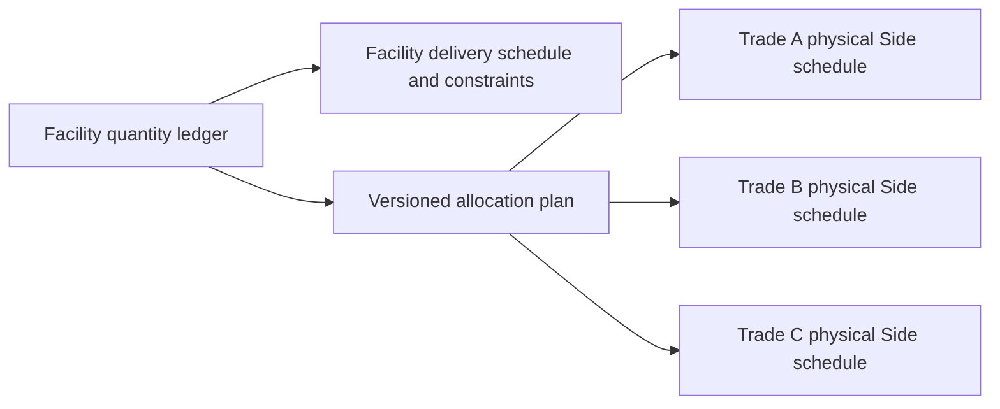
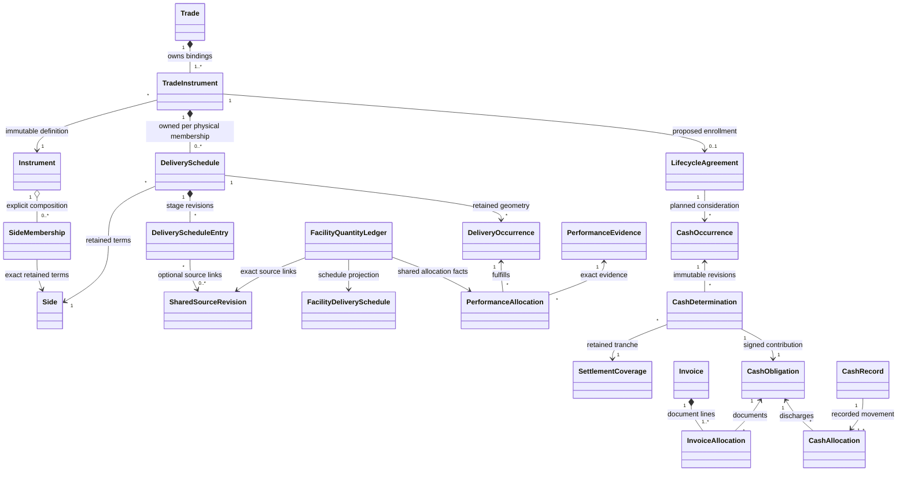

# Reusable physical delivery and cash lifecycle

D321 implements the bounded [facility-final quantity-input consumer](gas-basis-demo.md)
through exact adopted-plan/target links. It adds no physical completion, invoice,
cash or lifecycle remaining-value policy. The wider object responsibilities and
commodity adapters below retain their stated proposed/implemented boundaries.

Status: local design for review. D303 records the agreed object-oriented reuse
and scheduling ownership model: unique booked physical Side schedules, a shared
facility quantity ledger where operations span trades, and explicit connecting
allocations. Facility schedules and constraint results are coordinated views of
those facts; financial hedges do not create physical flows.
P44 records proposed detailed types, policies and implementation sequence. The
[implemented facility increment](facility-quantity-ledger.md) implements database-backed
manual quantities, gas allocation plans, native-period maximum assessments and
their UI/HTTP operations. Other types and
capabilities below remain proposed; no new financial convention is selected.
Existing supported profiles retain their contracts.

## Design direction

Use the existing `Trade` → `TradeInstrument` → `Instrument` model, independent
`Side` definitions and explicit instrument-owned memberships/connections. Add
an operational `DeliverySchedule` for each applicable booked physical membership,
with explicit fulfillment relationships and source evidence where required. A reusable definition must
never acquire one customer's deliveries, invoices, paid status or inventory.

Share behavior when its invariants agree. Select commodity behavior by composing
small, explicitly versioned policies. Avoid a deep `GasTrade`/`CrudeTrade`/
`LngTrade` hierarchy, commodity switches in the common ledger, and one physical
trade object containing every possible field. A new commodity label alone is
not a new class or an executable model.

The default operational ownership is one independently owned booked physical Side
and DeliverySchedule per applicable booked membership. Reuse here means reusable
classes, behavior, policy implementations, schedule primitives and reference data;
it does not require two trades to share a physical Side object. Do not introduce
a global shared physical-Side registry or make this workflow depend on interning.
Retain existing immutable economic terms/canonical identities and replay; adding
a trade ID or nomination to an economic hash is not how operational uniqueness is
established. Any optional calculation reuse must include complete lifecycle inputs.

The first reuse proof is the existing bounded crude workflow plus a proposed
explicit gas workflow. A power interval specimen checks the design's other
geometry. LNG and NGL examples describe extensions of this shared lifecycle, not qualified
adapters for it. Existing [LNG cargo booking](physical-lng.md) keeps its own
implemented contract. No new master table or unused strategy is justified by
those future examples.

## Current code to retain

| Existing owner | Current capability | Reuse boundary |
| --- | --- | --- |
| [Instrument and Side](../src/OpenEtrm.MarketData/Trading/Instruments.cs), [unit contracts](instrument-contracts.md) | Immutable unit economics, external typed binding quantities, declared dependencies and common PV | Lifecycle references the exact binding; it does not replace pricing or add a second editable booked quantity. Leaf instruments need no artificial Side. |
| [RetainedProgramInstrument](../src/OpenEtrm.MarketData/Trading/RetainedProgramInstrument.cs) | Common retained gas/crude PV execution | Keep native identity bytes and declared markets. This is not an operational ledger. |
| [Side plans](side-plans.md) | Whole-term Side parameters and instrument-owned typed connections | Physical outputs can feed multiple explicit cash/fee inputs. A Side does not own other Side objects or resolve its peers. |
| [CrudeReceiptCash](../src/OpenEtrm.MarketData/Crude/CrudeReceiptCash.cs), [CrudeCashLedger](../src/OpenEtrm.MarketData/Crude/CrudeCashLedger.cs), [operations](physical-crude-operations.md) | Certified quantity receipts, bounded title/inventory/dispatch, partial invoices/payments and record corrections | Extract matching allocation/conservation mechanisms only after golden checks. Preserve fixed contractual quantity, cumulative rounding, explicit directions and existing invoice/reversal restrictions. Separate-master delivery-to-cash still refuses. |
| [Swap settlement](swap-settlement.md), [determinations](../src/OpenEtrm.MarketData/Trading/SettlementDetermination.cs), [net allocations](../src/OpenEtrm.MarketData/Trading/SwapNetSettlement.cs) | Final payment calculations, immutable restatements, gross cash allocation, reversals and settlement-aware PV | Preserve occurrence continuity, original/correction contributions, current authority and the existing same-trade/currency netting boundary. Invoices are not implemented by this subsystem. |
| [Gas quantities](physical-gas-daily-quantities.md) | Per-booked-physical-membership nominated/confirmed/scheduled/allocated revisions, retained native grids and explicit quantity-input selection | Extend this pattern instead of creating a parallel operational quantity engine. Selection leaves contractual PV unchanged; meter/fuel-stage inputs, gas completion and settlement are not implemented by it. |
| [Meter finality](meter-finality.md), [PPA preview](settlement-preview.md) | Exact native power evidence/finality, payment continuity and bounded gross preview | Meter evidence is not accepted cash or a payment. PPA cash acceptance remains deferred under D204. |
| [Shared utilities](../src/OpenEtrm.Shared/README.md) | Exact arithmetic/rounding, temporal primitives and reusable mechanisms | Keep commodity rules, currency policy, domain entities, authorization and persistence in their owning managed modules. |

`CashPayment_v1` is a specific instrument whose supported contract treats cash as
settled from its payment date. It must not stand in for unpaid physical receivables
or payables. Neither that definition nor existing swap/crude policy changes merely
because a new shared interface exists.

## Object ownership

Names marked proposed below are design names, not APIs to import today.

Durable state uses relational tables, authorized write functions and integrity
triggers, as specified in the [storage contract](facility-quantity-ledger.md).
Object-oriented views/behavior do not require a separate object database, a new
event framework or duplicate in-memory authoritative ledgers. Keep calculation
policy in the managed backend; use SQL for exact references, serialization,
idempotence, immutable history and publication invariants.

### Physical Side delivery schedule

The physical Side defines delivery terms, schedule behavior and allowed inputs.
An editable `DeliverySchedule` is the operational instance for one booked physical
membership: its scope identifies the exact binding and membership/occurrence
lineage, and it retains the immutable Side definition. It is naturally managed
and displayed through that physical Side's booked view. Updating its nomination
appends that owned schedule's operational revisions while retaining the economic
terms. "Booked physical Side" denotes this ownership scope; it need not introduce
another quantity-bearing layer between Trade and Instrument.

This is a domain view over the existing retained SideSchedule geometry and
quantity-input slots, not another independently generated calendar. It keeps
separate immutable versioned tracks for the stages the selected profile supports,
such as nomination, confirmation, scheduled quantity, measured quantity and final
allocation. A profile need not implement all of these tracks. A new stage revises
its own facts; it does not overwrite contractual quantity or another stage.

Proposed behavior includes `Nominate`, `Confirm`, `RecordMeasurement`,
`RecordAllocation` and `ResolveQuantity(purpose, context)`. Each operation requires
its own supported capability, current authority and exact effective/knowledge
coordinates. Front-office versus back-office permissions are explicit operation
contracts, not consequences of which tab contains the field. There is no universal
priority order or automatic nomination-to-billing fallback: each consuming purpose
selects an explicit retained policy. Current gas selection policies keep their
existing versions and admission restrictions.

Schedule entries can carry their own manually entered quantity/status/evidence,
as current gas records do. A standalone universal evidence aggregate is not a
prerequisite. Shared/imported measurements instead retain references to their
existing source revisions; do not copy those raw readings into each schedule.
The shared inspector presents all applicable tracks and links in one place.

Some scheduling is independent of a particular trade: a selected pipeline-flow,
cargo, transport or asset/meter program may cover multiple contractual obligations
or be planned before booking allocations exist. In that case an explicitly
supported operational schedule owns those quantities and allocations connect it
to booked schedules. Reuse compatible schedule behavior/grid primitives, but add
that independent scope only for a concrete consumer. Do not force every trade's
nomination through a separate movement aggregate or automatically widen today's
trade-scoped gas/crude records.

### Several trades at one facility

The named multi-trade example is one facility's measured flow serving booked
physical Sides with different counterparties. The agreed ownership model uses a
shared facility quantity ledger alongside the individually owned booked Side
schedules. Proposed `FacilityQuantityLedger` coordinates the facility's exact
operational facts, source references and allocation relationships;
`FacilityDeliverySchedule` presents its supported time-based tracks. They are one
operational scope with schedule and balance views, not competing writable stores,
a shared physical Side or a fabricated Trade. Reuse schedule/grid/track behavior
by composition where the complete contracts agree.

"Ledger" describes an immutable, reconcilable quantity history, not a new general
accounting system or a requirement to copy meter/receipt records. Existing native
source stores remain authoritative for their readings; the facility view retains
exact typed links. Prove the first multi-trade consumer before deciding whether
new persistence is needed. A facility reference row alone does not justify an
empty ledger, inventory model or commodity framework. Every supported operating
facility uses the same ownership contract with explicitly selected operating
profiles. This is a logical home for typed flow/entitlement partitions, not a
single fungible facility balance or a requirement for one facility-wide lock.

Synthetic example, under an explicitly selected same-basis export-flow profile:
one final native-period meter total is 100 MWh. Allocations to compatible booked
obligations are 60 to counterparty A, 25 to B and 10 to C; 5 MWh remain explicitly
unallocated. Each physical Side retains its own terms, nomination history and cash
links. No 100 MWh copy is made for each trade, no default pro rata/FIFO assigns
the remaining 5, and no invoice or payment is implied by the physical allocation.

The facility allocation references exact source revisions and target booked
membership/occurrence cells. Its scope distinguishes exact facility/flow point,
direction, commodity/specification, native unit/basis, period/grid and applicable
legal-entity/entitlement policy. Common facility ID alone establishes neither
compatible quantities nor permission to fulfill a contract. Opposite flows,
different products/bases and separate entitlements are not one net capacity pool.
Any losses, inventory change or material transformation need their selected model;
a reconciliation residual is not an invented loss or balancing transaction.

Multiple trades may hedge the facility's price risk with different counterparties.
Their declared financial dependencies and scenario PV remain on their instruments;
the ledger does not infer hedge effectiveness or exposure from physical totals.
Only explicitly connected physical delivery obligations, movements and allocations
enter its quantity reconciliation. A cash-settled hedge creates no physical flow
or capacity claim. A trade with physical delivery participates through those
obligations regardless of its commercial label. Opposite purchases/sales retain
their gross direction and contractual identity unless a supported physical model
explicitly permits netting. Neither a risk hedge nor matching financial amounts
discharges a delivery obligation.

Facility-reported nominations/confirmations and a derived sum of trade nominations
are different views/facts. If both are needed, retain which is authoritative for
each purpose and show discrepancies. A facility-backed trade allocation is a
projection of the shared allocation facts, not another independently editable copy
of its amount. A profile explicitly chooses direct-entry or facility-allocation
mode and defines any supported override/correction operation.

Updating several allocations atomically fences the stable facility source-capacity
head and every selected target/head in a documented lock order. It validates both
source and target conservation. Source corrections never reset claimed capacity
or silently rewrite target schedules, determined cash or historical reports;
supported reconciliation/adjustment operations retain exact predecessors. Reusing
one reading for nonconsumptive pricing/eligibility is distinct from claiming the
same physical entitlement twice.

Facility/source authority and target-trade authority are checked independently.
Seeing one trade at a facility does not expose other counterparties' volumes,
prices or terms; facility access does not grant trade access. Facility totals or
unallocated residuals are returned only under the applicable complete-scope
permission. A restricted trade view does not treat hidden allocations as zero or
leak them by subtraction. Cross-target write plans refuse atomically if any
required target/source authority is missing.

Protect capacity-dependent previews and writes as well as read totals. A caller
must be authorized for the complete shared capacity pool before receiving its
availability, global claim-head details or success/over-allocation outcomes.
Otherwise use a separately supported retained entitlement/reservation limit whose
available amount is independent of hidden counterparties, or refuse before those
pool-dependent checks are observable. Scoped views and error/stale-head metadata
must not expose global allocation changes. Permission to edit one's own trade is
not permission to probe the facility's remaining capacity.

The UI can offer a facility schedule with allocation drill-down and each trade's
physical Side view, both reading the same authoritative facts. Committing one
allocation updates those coordinated views without a second manual entry; it does
not silently redistribute the residual or edit another trade's nomination. A
common facility does not merge counterparties, consideration Sides, settlement occurrences,
currencies or cash netting rights. No facility schedule/permission/table is
implemented by this power example; it is a concrete P44 design/qualification case.
The first storage consumer instead uses the bounded manual gas profile documented
in the storage contract; it does not establish gas billing or power support.

### Physical constraints and notifications

The first constraint consumer is the facility allocator's schedule/exception view.
One managed domain evaluator assesses the selected ledger prefix, exact native
intervals, source/allocation revisions and versioned operating rules. UI, agents
and jobs consume that same assessment; TypeScript does not reimplement capacity
or balancing rules. A result identifies the violated rule, applicable scope and
period, observed/planned amount, limit, excess and exact input/context versions.
It distinguishes within-limit, breached and unassessed conditions. Missing or
incompatible required inputs never produce an all-clear result or silently
resolve a prior breach.

Operating limits, availability and supported tolerances use exact-version
reference/configuration records with effective and knowledge coordinates, not
commodity constants. Add only the rules consumed by the selected profile.
Flow-rate, interval-energy, ramp, storage and quality limits are different
contracts; no daily average substitutes for a native-interval limit. Inventory
balances or transformations require a separately qualified consumer and model;
power is not forced through a storage-lot abstraction. A rule specifies its
aggregation/basis, applicable stage, authority and enforcement operation. There
is no default loss factor, tolerance, allowable net flow or severity.

Keep three kinds of validation distinct:

- Source-quantity and target-entitlement conservation prevents duplicate or
  excessive allocation. An operating limit is not additional source quantity.
- A prospective plan/nomination/confirmation is warned or blocked only under its
  selected enforcement contract. Missing mandatory assessment inputs block any
  operation requiring a passed assessment. No automatic curtailment or pro rata
  reassignment is implied.
- A valid observed measurement remains recordable when it exceeds an operating
  limit; preserve the fact and flag the breach. Authorization, source integrity,
  units and revision checks still apply. Recording or allocating an actual does
  not assert physical compliance, approve a plan or qualify cash automatically.

For a synthetic interval-energy limit of 90 MWh, an observed 100 MWh is retained
with a 10 MWh breach. Allocating 60/25/10 leaves 5 unallocated and preserves that
same 10 MWh operating breach; allocation neither creates another flow nor cures
the violation. This is not a 90 MW rate-limit test. Measurements may likewise be
recorded while a required operating rule is unavailable, with an unassessed
exception rather than an invented limit or successful compliance result.

An admission requiring compliance rechecks the relevant ledger, allocation and
rule/availability heads after waits and commits the assessment pins with its
outcome. A concurrent limit or source change forces reassessment or a structured
stale-plan refusal. Later revisions append new assessments/reconciliation work;
they do not rewrite historic results, accepted allocations or cash. Replay of a
completed command returns its first outcome, including its assessment pins.

The facility view shows scoped exceptions and the authorized user's next action;
each trade view shows its own affected obligation/entitlement. Do not expose
hidden facility totals, global breach amounts or capacity-dependent success/error
differences through badges, alerts or notification timing. The complete-pool
authority/independent-entitlement boundary above also applies to assessment and
notification access, including current permission checks at read and delivery.

If durable notifications are implemented for this consumer, publish their intent
atomically with the accepted fact/assessment and use an idempotent dispatcher.
Retried commands or reevaluation of identical inputs do not create duplicate
alerts. A stable typed issue key identifies operating scope, constraint lineage
and native period/stage; source/rule revision pins belong to each assessment,
not a new unrelated issue key. Rule continuity must itself be explicit. Each
issue has a monotone sequence and expected-head fence: assessment publication
rechecks the complete applicable input-head set (ledger/plan/allocation, source,
operating rule, availability and selected profile/policy heads) and advances the
issue atomically. Any changed input makes an assessment stale for current
publication, even when the meter and operating-rule revisions are unchanged.
An older assessment may remain historical, but cannot become current after a
newer resolution or reopening. Retain open/resolved/reopened transitions without
erasing their exact historical pins.

Each notification intent carries that issue key/sequence. The dispatcher rechecks
current authority and issue head before sending; a current-state delivery endpoint
rejects superseded sequences. Checking before external I/O cannot retract an
already dispatched message: any delayed delivery must be explicitly a versioned
historical event linking to the authorized current view, never an unqualified
claim of current breach/resolution. Old breach and resolve messages cannot regress
the current issue state. A correction can change the issue without erasing history.
Notification failure cannot roll back a valid measured fact or fabricate a passed
assessment. This design creates no notification table or background service.

### Terms, physical facts and contractual fulfillment

These are three different ownership questions:

| Object | Owns |
| --- | --- |
| `Side` | Whole-term delivery rules, location/unit/basis, schedule behavior and declared valuation inputs. Each booked physical Side manages its own DeliverySchedule. Reuse its class/behavior; do not assume shared operational instances or put mutable quantities into economic identity. |
| `Instrument` | The economic composition, Side memberships/coefficient rules and explicit physical-to-cash connections. It does not own a booked position's actual fulfillment. |
| `TradeInstrument` binding | The booked quantity and binding/occurrence lineage identifying this contractual commitment. Its physical memberships scope the applicable DeliverySchedules and lifecycle enrollment. |
| `DeliverySchedule` | The booked physical membership's supported operational quantity tracks, entry history and references/allocations to source facts. Contractual quantities derive from the binding and retained geometry; they are not edited as a second booked size. |
| `FacilityQuantityLedger` / `FacilityDeliverySchedule` | One separately supported facility-flow scope: immutable source links/operational facts and allocation relationships, projected as schedule, reconciliation and constraint views. Exact links preserve existing raw source stores. Explicit versioned allocations feed individually owned booked schedules; financial hedges do not create physical capacity or pool counterparties/cash. |
| Independent physical operations / evidence, where needed | Shared receipt/dispatch/cargo/meter records or operational schedules and their source/revision/finality/rights. Existing independent sources remain authoritative; direct entries need no mandatory new global evidence class. |
| `PerformanceAllocation` | The explicit link from qualified operational evidence to this binding's delivery occurrence, including allocated quantity/coverage and policy. This establishes contractual fulfillment without transferring ownership of the raw evidence. |

For example, one qualified 100-unit receipt may support allocations of 40 and 60
to two compatible booked obligations under a supported shared-source profile.
Neither trade owns a separate copy of that receipt. Likewise, a shared meter
reading can be an input to several instrument calculations without being owned by
any Side. Evidence access and trade access remain separately authorized.

"Physical operations" is an ownership boundary, not a requirement for another
generic table or a duplicated evidence store. Reuse the existing concrete source
records. Current trade-scoped crude receipts keep their keys/visibility and are
not automatically widened to shared receipts by this proposed ownership model.

The diagram shows separate ownership links, not an inheritance tree. Persistence
and command scopes may be smaller than this read model. Receipt, title, invoice,
payment and financial completion remain independent axes, not one mandatory
`TradeStatus` sequence.

| Proposed object | Responsibility and invariant |
| --- | --- |
| `LifecycleAgreement` | Immutable, exact-version enrollment of one binding's supported operational, settlement-input, allocation, correction, rounding and valuation contracts. Reference existing economic terms; do not conceal a changed price, payment date or quantity outside instrument identity. |
| `DeliveryOccurrence` / `CashOccurrence` | Distinct typed planned obligations generated from the retained binding/schedule. Their quantities derive from the binding; they are not a second quantity-bearing layer between Trade and Instrument. Dates alone are not occurrence identity. |
| `DeliveryScheduleEntry` | One immutable stage-specific operational revision with exact retained cell/occurrence, quantity/status, evidence, predecessor and effective/knowledge coordinates. Manual entry can own its evidence value; a shared/imported source is referenced explicitly. |
| `PerformanceEvidence` | A typed view/reference over required evidence. It can refer to an owned schedule entry or an independently owned measured/verified source revision with its own authority. It is not necessarily another aggregate/table or a copied reading. |
| `AcceptedPerformance` | A profile-qualified interpretation of exact evidence for one occurrence. Acceptance here means the selected contract's input qualification, not an extra universal financial approval workflow. |
| `PerformanceAllocation` | Explicit mapping of qualified performance to obligation coverage. Prevent duplicate or excessive claims. Partial, many-to-many or cross-trade allocations exist only under a separately supported profile. |
| `TitleTransfer` / `InventoryAllocation` | Optional operational-domain capabilities with their own facts, ownership and conservation rules. Trade lifecycle references the effects on its obligations; it does not own all title or inventory records. Quantity measurement alone does not transfer title. Power delivery need not acquire an artificial inventory lot. |
| `CashDetermination` | Immutable complete final cash calculation for its exact supported coverage, source pins, contract/model/numerical versions and predecessor. A correction retains the prior result and contributes an explicit adjustment. |
| `SettlementCoverage` | An exact original cash-contribution slice: retained membership/occurrence lineage and native cells or a qualified quantity tranche. Original claims are disjoint and capacity-bounded; a correction reuses its original claim. |
| `CashObligation` | The signed original or adjustment amount and explicit due terms. Due or overdue cash remains open until a supported discharge/correction is recorded. |
| `Invoice` / `InvoiceAllocation` | A commercial document over eligible existing obligations and explicit amounts. Issuance does not create the same payable a second time and never proves payment. |
| `CashRecord` / `CashAllocation` | Recorded external cash evidence with exact signed gross allocations. Allocation totals reconcile to the record; an invoice association does not create a parallel payment ledger. This is not bank dispatch. |
| `RecordReversal` | An immutable, exact-target reversal permitted by the selected profile. It undoes exactly the target record's allocations and restores prior balances/capacity; it records no refund or new external cash movement. Economic restatement is a different operation. |
| `LifecycleView` | A pure projection of a selected event prefix: quantities, title/inventory, unaccepted cash, open obligations, invoices and payments. It neither records facts nor prices a new obligation. |

Objects validate their own units, lineage and local invariants through constructors
and behavior methods. Cross-object rules belong to narrow domain services. Command
handlers authorize/load/fence/save; they do not become another pricing engine.
Avoid exposing partially valid objects through public setters or using a generic
entity containing an unrestricted dictionary of commodity fields.

For example, proposed behavior methods are `CashDetermination.Restate`,
`CashObligation.ProposeAllocation` and `Invoice.Issue`. They validate complete
immutable inputs and return new validated facts/proposals; they do not independently
write a database or send money. The application operation rechecks the read heads
and persists the complete transition atomically.

## Composition and polymorphic behavior

Use small contracts at actual behavioral differences. Proposed examples:

- `IPhysicalCompletionPolicy`: qualifies a receipt, dispatch, meter interval or
  other supported performance source against the exact delivery obligation.
- `IQuantityBasisPolicy`: selects the declared contractual, accepted-performance,
  energy, standard-volume, mass or component basis from retained inputs. It owns
  no hidden conversion factor or automatic quantity substitution.
- `IPerformanceAllocationPolicy`: validates explicit scope/coverage and conservation.
  It does not choose FIFO, pro rata or tolerances from a commodity name.
- `IFinalCashCalculator`: adapts the existing supported Side/retained schedule
  cash evaluator to final pinned inputs. It must not copy that evaluator's formula.
- `ICorrectionPolicy`: determines eligible restatement and adjustment due terms;
  it never edits an issued document or recorded payment in place.
- `IInvoicePartitionPolicy`: allocates cash/document lines under a retained rounding
  and ordering contract. Invoice-required, optional and unsupported are explicit.
- `ILifecycleValuationPolicy`: supplies a disjoint remaining-value partition to
  the existing black-box Instrument/portfolio evaluator.
- `IPhysicalRecognitionPolicy`: an optional separately qualified policy for
  noncash delivery/title/transfer recognition in a physical-economic P&L measure.
  It is unnecessary for a cash-only settlement bridge and supplies no inventory costing.

Do not implement all of these interfaces in advance. Introduce each only when a
named operation needs the boundary and two concrete consumers establish common
behavior, or one current consumer needs distinct executable strategies. Share
construction/validation in a base implementation only where invariants match.
Unsupported optional capabilities are explicitly absent; no successful empty
schedule, zero cash, inferred default or `NotImplementedException` stands in for
a qualified result.

For example, the existing crude receipt profile can compose certified
standard-volume input, its current title rule and cumulative invoice partition.
A proposed gas profile can compose retained gas-day coverage and an explicitly
selected quantity basis with the same proven cash-allocation mechanism. A power
profile can use native interval meter finality without selecting title/inventory.
Their pricers and financial rules remain their existing domain contracts.

Operational plans are not necessarily linear. Measurement and a separately timed
title transfer may be independent prerequisites; an invoice may cover several
qualified occurrences; a legitimate advance-payment contract may precede delivery.
Only a selected supported profile can admit those combinations. The current crude
profile's coincident receipt/title rule and current payment ordering remain intact.

The shared lifecycle planner consumes an existing declared schedule/capability.
It does not require every Instrument to generate artificial delivery or cash
events. Futures margining remains its own explicit contract.

## Commodity-specific evidence and reference data

The following are requirements to make explicit in a future profile, not universal
commodity conventions or newly supported models.

| Profile family | Specialized inputs/capabilities | Common objects it can consume |
| --- | --- | --- |
| Pipeline gas | Exact receipt/delivery point, gas-day clock/grid, quantity basis, finality and any supported fuel/quality/conversion terms | Performance allocation, cash determinations, obligations, invoices, cash/reversals |
| Crude | Exact grade/custody point, standard-volume specification and qualified measurement; optional separate title, lot and dispatch | Same financial objects; existing quantity inventory capability |
| LNG | Exact cargo/parcel and transfer terms; any selected mass/volume/energy, composition/quality, loss or transformation model | Same evidence/coverage and financial objects after those models are independently qualified |
| NGLs | Exact component/product specification and measurement; any selected assay, component allocation, quality or transformation model | Same allocations/financial objects; no inferred component fractions |
| Power | Exact delivery point, clock/tzdb, UTC interval geometry, product masks and meter/finality terms; capacity/environmental attributes remain independent obligations where contracted | Same cash/receivable objects; no mandatory stock/title-lot machinery |

Existing exact-version reference tables remain authoritative. Commodity
specializations reference the specific existing or newly justified master objects;
there is no universal free-text `Location`. Units do not supply density, heating
value, quality, loss factors, settlement price or contractual clock. Source and
target commodity relationships in a material transformation require an explicit
model, not just a compatible numerical unit conversion.

Financial policies are selected versioned contract inputs. Admin configuration
can publish a new qualified version; it cannot reinterpret a booked contract.
User preferences control presentation only. A catalog row naming a strategy does
not make it executable: supported identifiers map to project-owned managed code.
Missing, ambiguous, conflicting or inaccessible required inputs refuse explicitly.

## Identity, corrections and persistence

Use a stable typed occurrence key rooted in the Trade binding, original obligation
lineage and continuity-bearing membership/period key. Current instrument/Side IDs,
trade revision, delivery/payment dates, market levels and run IDs are evidence,
not a substitute for that lineage. Repeated instances of the same Instrument in
one Trade must remain distinct. An amendment preserves an occurrence only through
an explicit retained continuity mapping; changed or ambiguous obligations refuse
until the selected amendment/correction contract resolves them.

Measurement, input eligibility, title and settlement each retain their own revision
chains and effective/knowledge coordinates. Select the applicable visible head
before inspecting eligibility or filtering required authority. A withdrawn head
does not revive an older final reading. New corrections never pretend that an
earlier context knew them. Due-date and interval geometry are separate from display
time zone; neither local wall-clock ambiguity nor a missing gas day becomes a default.

New acceptance/restatement qualifies the selected evidence heads. Reading an
already posted determination instead consumes its original exact pins under
current authority; a later source withdrawal/correction does not erase its cash
or require it to pass the new eligibility state again. Surface the changed
evidence and require the supported explicit adjustment operation. Likewise, an
accepted performance allocation changes only through its supported retained
revision/reversal contract, not a read-time quantity substitution. Financial,
physical and title histories must not rewrite one another.

Do not create the proposed lifecycle tables merely because they appear in this
design. The first storage slice maps its rows to a concrete manual gas operation
and independent acceptance cases; each further table needs the same justification.
When durable rows are needed, use exact composite foreign keys for scope, binding,
occurrence, source revision, policy, determination, document and payment targets.
Typed source/detail link tables can support distinct evidence families; an
unvalidated `(source_kind, source_id)` pair or arbitrary JSON relationship cannot.
Common immutable headers must not duplicate existing raw meter/receipt stores.

All writers use the same authorized business operation for UI, agents and jobs:

Writes fence current operational heads. A historical browsing context grants no
write capability; a supported backdated correction is an explicit current command
with its own effective time and retained predecessor.

1. Resolve current authority and the explicit historical/business contract.
2. Reconcile the canonical actor/scoped request ID and payload before selecting
   new inputs; recheck current authority even when returning a prior receipt.
3. Lock the required binding/occurrence/event heads and any shared consumptive
   source-capacity/claim heads in a documented stable order. The source-capacity
   key follows the logical physical source across measurement revisions; a new
   reading revision does not reset already claimed quantity. Recheck authority,
   expected heads and source/target capacity after waits.
4. Qualify pinned source revisions, complete coverage, policy versions and allocation
   ownership. Recalculate final cash using the same managed evaluator as preview.
5. Atomically append facts, claims and outcome receipt under the existing knowledge
   certification boundary; recheck authority before publication/return.

The same business key, value and effective time is a no-op returning its existing
record. A different value is an explicit new revision at new knowledge time, never
an overwrite; applying a financial change still requires its supported correction
operation, otherwise it refuses. A retried command returns its original outcome rather than accepting
new market inputs. Hashes index canonical equality; caller digests establish none.
Queued work additionally retains original admission, input pins, limits and the
existing worker-generation/lease/deadline fences.

## Financial conservation and valuation

Physical allocation and cash allocation are separate typed ledgers. A delivery
quantity can feed consideration and a separately contracted fee through explicit
instrument links; doing so does not create two deliveries. Direction comes from
applying the resolved signed binding/membership once to the signed formula, not
from labels such as Purchase, Fee or Invoice. Allocation direction follows the
resulting signed open cash obligation, not the membership coefficient alone.
Negative prices require a profile that explicitly supports them; current crude's
nonnegative-price admission and direction checks remain unchanged.

Physical source consumption and evidence reuse are distinct. Fulfillment cannot
overclaim one source across bindings; pricing/finality evidence may legitimately
be referenced by multiple cash components without consuming another delivery.

Keep exact quantity × price and quote-multiplier arithmetic through the existing
managed evaluator. Retain currency, price basis and numerical/rounding version.
There is no universal invoice rounding rule:

- Original/restated cash can reuse the existing rule
  `adjustment = rounded(new total) − rounded(previous total)` only when selected.
- Crude's current partition uses rounded cumulative exact cash differences. Its
  invoice sequence and predecessor are contractual inputs, not insertion order.
- Allocation of an already rounded obligation conserves that amount in its exact
  currency precision. Re-rounding invoice lines independently must not create or
  destroy payable cash. A new partition rule needs its own version and oracle.

For a selected context, signed open cash equals visible retained original/adjustment
contributions minus active gross cash allocations. Uninvoiced, invoiced, due and
overdue are views/subsets of that cash, not extra balances to add together.
Signed totals are reconciliation views, not permission to settle a net amount.
Preserve each gross contribution, direction and due date; net discharge requires
an explicitly supported scope/party/currency/due-date netting contract. A credit
adjustment does not silently pay an opposite-signed original obligation.
Physical outstanding quantity, quantity owned and quantity reserved are independent.
Inventory costing, FX settlement, taxes, write-offs, cross-trade netting and bank
dispatch require separately supported contracts; this design supplies none.

A lifecycle valuation scope retains the exact binding, applicable event prefix,
accepted contribution coverage, context, source/model/numerical versions and
selected valuation policy. It composes with Instrument PV without mutating the
definition or routing common risk by commodity. Contractual PV, lifecycle remaining
value, cash face, discounted open cash and inventory value are distinct measures.
Existing crude contractual PV must not silently become settlement-aware PV.

Current [swap lifecycle coverage](../src/OpenEtrm.MarketData/Trading/SwapLifecycle.cs)
is whole membership/period coverage. It cannot
be lifted unchanged into partial gas/power determination. A selected partial
profile must retain disjoint original-contribution coverage: exact native cell
identities or explicit normalized quantity tranches with their source/target
capacity, price applications, unit and allocation-policy version. A whole-cell
claim and a quantity-tranche claim are different supported contracts; neither
automatically creates an intrainterval split. Unqualified partial coverage refuses.

Two differently named claims cannot duplicate the same source allocation, and
their active original coverage cannot exceed the selected occurrence/component.
Consideration and fee coverage remain separate financial contributions. A
correction of one tranche reuses its claim and adjusts cash only; it does not
consume coverage again. Invoices/payments do not release forecast coverage.
Unsupported reopening, repartitioning or changed continuity refuses.

Original uniqueness and correction predecessors are scoped by occurrence **and
exact SettlementCoverage**, not by occurrence alone. Two disjoint tranches have
independent originals/correction chains; a new total never subtracts another
tranche's prior total. Native-cell corrections retain the same cell geometry;
quantity-tranche corrections retain the same claimed normalization/capacity.
Measured cash-basis inputs may change only under the declared correction/mapping
contract; changing the coverage itself requires a supported repartition operation.

When a new profile supports lifecycle remaining value, its coverage claims remove
exactly the original contribution replaced by frozen determined cash. Future
uncovered contributions remain valued normally; determined commodity inputs stay
frozen under quote shocks, while declared discount risk may remain. An invoice or
the passage of its due date cannot remove outstanding cash. Missing coverage is
a refusal, not a successful zero. Caches/reuse include complete lifecycle inputs:
independently owned physical Sides have independent deliveries and balances, even
if some immutable inputs or unit calculations happen to be reusable.

For a supported unchanged **cash-only** scope, reconcile closing remaining cash
value minus opening remaining cash value plus the change in cumulative recorded
cash, partitioned by exact currency and measure. This is not automatically a
complete physical-trade P&L bridge. A physical-economic measure that transfers
value out of the contract on delivery/title additionally requires an explicit
retained noncash transfer/recognition contribution under its own selected policy.
That policy supplies the sign, value measure, valuation context and evidence;
there is no inferred inventory or consumption value.

Backdated cash learned later is a knowledge adjustment, not cash moved in the
period. New trades, amendments, corrections and rounding retain separate bridge
contributions. Physical market value and contractual cash must not be added twice;
general inventory valuation/costing and accounting integration are not implied.
Until the physical recognition contract is qualified, expose only the supported
cash bridge and contractual physical PV as separate measures.
If a broader selected scope includes the receiving inventory's value, do not also
add a transfer term for that same internal movement.

## Compatibility and shared presentation

Existing crude invoice allocation does not have a separate accepted-determination
ledger. Preserve its current contractual balances and behavior: a common object
must not manufacture a historic acceptance, retag knowledge time, or turn the
uninvoiced remainder into new financial postings. Read adapters can present exact
legacy facts with their original evidence; a new durable common representation
needs a separately qualified, explicit cutover. Existing swap/PPA continuity and
unsupported historical boundaries likewise remain authoritative.

Start extraction with golden inputs from current public operations and compare
exact results, rounding effects, identities, receipts and event prefixes against
the original implementations. Share only matching mechanisms. Product adapters
may retain different admission and ordering restrictions. Do not dual-post one
fact into independent ledgers or let a shadow comparison create financial writes.

A shared lifecycle inspector can display obligations, performance/evidence,
determinations, documents and cash, with typed commodity-specific input editors
only where needed. Backend capability metadata and current permissions determine
available actions; a capability is not an authorization grant. TypeScript renders
results and submits the same closed authorized commands as agents/jobs. There is
no browser settlement algorithm or arbitrary action/reflection endpoint.

## Delivery sequence and executable gates

| Slice | Concrete work and acceptance gate |
| --- | --- |
| L0 — contract selection | Inventory current objects and select an explicit synthetic gas agreement: quantity basis, qualification/finality, allocation, price, due/correction, invoice, rounding and value measure. No inferred gas market convention. Preserve crude/swap versioned baselines. |
| L1 — shared mechanisms | Golden current crude/swap behavior first; introduce only matching validated objects/mechanisms for the gas consumer. Old public operations, canonical identities, event keys and numerical results remain unchanged. |
| L2 — gas performance | Reuse existing gas quantity read/record/history and retained gas-day geometry in the booked DeliverySchedule. Qualify additional evidence tracks and partial fulfillment explicitly; preserve current versions and authority. A nomination or contractual daily amount cannot become a final meter reading. |
| L3 — final cash | One original per eligible occurrence plus exact SettlementCoverage, with an independent versioned correction chain for that coverage; independent sides/fees, replay and concurrent ownership claims. No payment/invoice feature is implied. |
| L4 — documents and cash | Optional qualified invoices, explicit partial/full cash allocations and reversals; actual overdue balances remain open. Keep any external bank action outside these record operations. |
| L5 — value/report integration | Explicit lifecycle measure, disjoint claims, current/history/risk/worker parity and cash/P&L reconciliation. Pure contractual PV remains available under its own supported contract. |
| L6 — second geometry | A bounded power native-interval consumer proves reuse without inventory/title assumptions; any PPA cash enrollment must be separately selected and supersede D204's deferral explicitly. |
| Later — LNG/NGLs | Select one real executable contract and qualify required measurement/transformation models before adding a strategy, table or activation. Interfaces alone establish no product support. |

Synthetic independent cases must include:

- Two independently owned booked physical Sides using the same behavior/policy
  classes, one with partial performance/cash and one without: independent schedule
  revisions, lineage and balances. Optional reuse of identical economic definitions
  must not merge their operational state or alter existing canonical identities.
- A declared 100-unit obligation with 40 units accepted: 60 remain unfulfilled;
  contractual versus measured settlement basis is an explicit profile choice.
- Selected cumulative ties-to-even rounding: three one-unit allocations at USD
  0.005 produce 0.00, 0.01 and 0.01, totaling 0.02 = round(0.015). Also test
  negative signs, zero cash and an independently signed fee without netting it.
- Original cash 300, payments 80 and 40, then restated total 270: adjustment −30
  and gross open contributions 180 and −30, with signed reconciliation 150.
  Reversing the original 40 payment record gives 220 and −30, signed 190;
  issuing a credit document alone moves no cash and no implicit net payment is admitted.
- Conditional on an explicit undiscounted tranche-price profile: 100 units, with
  40 finalized at 3 and 60 still projected at 4, have remaining cash value 360.
  Payment of 50 gives 310. A quote shock from 4 to 5 changes only the 60 projected
  units, adding 60. A correction of the same 40-unit tranche from 120 to 124 adds
  a +4 adjustment obligation, with no recorded cash movement or further coverage claim.
  A whole-period profile must refuse
  this partial input instead of suppressing all 100 projected units.
- For a selected negative-price profile, coefficient +1 × one unit × price −3
  produces cash −3; coefficient −1 × one unit × price −3 produces +3. Matching
  payment directions follow those obligations. These tests do not relax crude.
- Conditional on a separately selected physical recognition policy: unchanged
  market 4, physical value 100 × 4 and cash −300 give opening value 100. Transfer
  of 40 units out of the remaining contract leaves 60 × 4 − 300 = −60 and no
  cash movement. Retained noncash recognition +160 reconciles to zero market P&L;
  reporting −160 as market loss or silently creating inventory cash is invalid.
- Explicit 2 MW power coverage over a 23-hour or 25-hour day produces 46 or
  50 MWh once; repeated local hours retain distinct UTC cells. A declared daily
  gas quantity is not silently treated as an hourly flow rate.
- Measurement gaps/withdrawal, incompatible native basis, missing quality or
  transformation evidence, ambiguous amendment continuity and duplicate claims
  refuse under the selected profile; historical valid prefixes remain reproducible.
- Parallel acceptance/payment/correction, authority expiring during a wait, a lost
  acknowledgement, same fact with a new request ID, changed payload with the same
  ID, and worker death/retry publish no duplicate financial effect.
- Two bindings concurrently consuming one physical source cannot exceed its
  shared capacity, including after a new measurement revision. Reuse of a price
  or eligibility assertion alone must not consume that physical capacity.
- Facility meter total 100 MWh, target allocations 60/25/10 and unallocated 5:
  one source and three independently owned physical Sides, with no duplicate
  quantity or cash. Concurrent allocation of more than the remaining 5 refuses;
  source/target corrections preserve old-cutoff views. A restricted counterparty
  view reveals neither another party's allocation nor a residual that exposes it.
  Repeated quantity probes, success/refusal differences and stale/global head
  details cannot reveal the unrestricted pool to that party. A fully authorized
  facility allocator still receives exact source/target conservation validation.
- Under a selected 90 MWh native-interval operating limit, retain the measured
  100 MWh and show a 10 MWh breach before and after the same allocations. An
  enforced prospective 100 MWh plan refuses; a valid observed fact does not.
  Missing rules yield unassessed, never all-clear. Adding a cash-settled hedge
  changes neither physical quantity nor the breach. Opposite physical flows do
  not net without a selected compatible model; no implicit curtailment occurs.
- A rule/availability or ledger/plan/allocation change racing an enforced plan or
  assessment publication triggers reassessment or stale refusal. Under a selected
  planned-stage 90 MWh limit, changing the plan from 80 to 95 invalidates the old
  passing assessment even with unchanged meter/rule heads. Independently lowering
  effective availability from 90 to 70 invalidates an 80 MWh plan's passing
  assessment. Old-cutoff facts and assessment pins remain reproducible. Lost
  replies, repeated evaluation and notification retries create one issue
  transition. A delayed old breach after resolution and a stale resolution after
  reopening cannot change the current head or be delivered as current status;
  already dispatched events remain explicitly historical. Revoked facility access
  and restricted-counterparty reads/delivery
  expose no hidden quantities, outcomes or global issue timing.

Tests compare exact outputs and literal independent oracles, not two wrappers
around the same algorithm. Broader product semantics require new cases. See the
[extension guide](physical-lifecycle-extension-guide.md) for the implementation
recipe and [physical booking plan](physical-energy-booking-plan.md) for deferred
operational scope.
